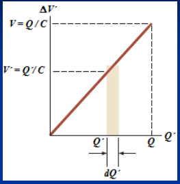
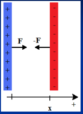

# ENERGÍA ELÉCTRICA Y DENSIDAD DE ENERGIA



- U: energía del condensador con carga Q y diferencia de potencial ΔV
- U’ y ΔV’: energía y diferencia de potencial cuando varían durante el proceso
  de carga.
- Durante el proceso de carga:

```math
dU'=\Delta V'\,dQ'
```

```math
U=\int_0^U dU'=\int_0^Q\Delta V'\,dQ'\qquad\Delta V'=\frac{Q'}C
```

```math
U=\int_0^Q\frac{Q'}C\,dQ'=\frac1C\int_0^Q Q'\,dQ'=\frac12\frac{Q^2}C
```

Empleando:

```math
C=\frac Q{\Delta V}
```

```math
U=\frac12\frac{Q^2}C=\frac12C\Delta V^2=\frac12Q\Delta V
```

Energía del Capacitor

Energía almacenada en un capacitor. El flash de una cámara almacena energía en
un capacitor de 150 μF a 200 V. a) ¿Cuánta energía eléctrica puede almacenarse?
b ) ¿Cuál es la potencia de salida si toda esta energía se libera prácticamente
en 1.0 ms?

## Densidad de energía de un campo eléctrico

Para un condensador de placas plano paralelas

```math
C=\frac{\varepsilon_0 A}d\quad\mathrm y\quad\Delta V=Ed
```

```math
U=\frac12C\Delta V^2=\frac12\left(\frac{\varepsilon_0 A}d\right)(Ed)^2=\frac12\varepsilon_0 E^2(Ad)
```

```math
Ad=Vol_{\text{entre placas}}\Rightarrow U=\frac12\varepsilon_0 E^2Vol_{\text{entre placas}}
```

```math
u=\frac U{Vol_{\text{entre placas}}}=\frac12\varepsilon_0 E^2
```

Densidad de Energía Potencial Eléctrica

```math
u=\frac{dU}{dV}\Rightarrow U=\int dU=\int u\,dV=\frac12\varepsilon_0\int E^2\,dV
```

## Fuerza entre placas de un condensador plano



F es conservativa, luego la variación de la energía potencial es igual al
trabajo realizado por la fuerza conservativa cambiado de signo

```math
dU=-dW=-F_x\,dx\Rightarrow F_x=-\frac{dU}{dx}
```

Si el condensador esta cargado y aislado la carga se conserva

```math
U=\frac12\frac{Q^2}C=\frac{Q^2}{2\varepsilon_0 A}x\Rightarrow F_x=-\frac{dU}{dx}=-\frac{Q^2}{2\varepsilon_0 A}
```

```math
E=\frac\sigma{\varepsilon_0}=\frac Q{\varepsilon_0 A}\Rightarrow F_x=-\frac12\varepsilon_0 E^2A
```

## Procedencia y observaciones de transcripción

- Original:
  `2019/1er Parcial/2018 PF UT III - Capacidad. Prop electr de la Materia.pptx.pdf`,
  páginas 13, 14, 15 de 26, dos diapositivas por página salvo el cierre.
- SHA-256: `ac23675b753c3d9349b89600ea349edcbc8dfe56058b3c78a09e873777616145`.
- Fecha impresa: 28/03/2018. Ubicación canónica: material 2019. No consta autor
  en estas páginas.
- Herramientas: PyMuPDF4LLM y Poppler para extracción; cotejo visual de texto,
  expresiones, tablas y figuras. Medios conservados mediante recorte/render
  PyMuPDF, excepto las dos imágenes de carga por batería extraídas directamente
  del PDF.
- Cubre las diapositivas 25–29. Se conservan primas de las variables durante la
  carga, la notación Vol y los signos negativos de fuerza. La pregunta del flash
  no tiene desarrollo en la fuente; no se resuelve.
