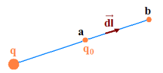
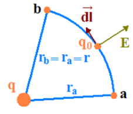
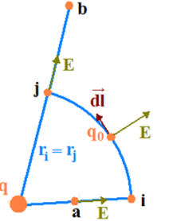

# Energía potencial eléctrica y trabajo

Demostraremos que la fuerza eléctrica es una fuerza conservativa, lo que nos
permitirá obtener la variación de energía potencial eléctrica en términos del
trabajo que realiza la misma.

El trabajo realizado por la fuerza eléctrica para llevar la carga q₀ desde el
punto a con posición rₐ hasta el punto b con posición rᵦ esta dado por:

```math
W_{ab}=\int_a^b\vec F\cdot\overrightarrow{dl}=q_0\int_a^b\vec E\cdot\overrightarrow{dl}=q_0\int_a^b E\cos(\theta)\,dl
```

Sea q la fuente de campo y consideremos un camino radial centrado en q (Fig.
izquierda).



```math
E=\frac1{4\pi\varepsilon_0}\frac q{r^2},\qquad\theta=0\quad\mathrm y\quad\overrightarrow{dl}\equiv\overrightarrow{dr}
```

```math
W_{ab}=q_0\int_a^b E\,dl=\frac{q q_0}{4\pi\varepsilon_0}\int_{r_a}^{r_b}\frac{dr}{r^2}
```

```math
W_{ab}=\frac{q q_0}{4\pi\varepsilon_0}\left(\frac1{r_a}-\frac1{r_b}\right)
```

Consideremos ahora que el camino es un arco circular centrado en q (Fig.
izquierda arriba). En cada punto de esta trayectoria es



```math
\overrightarrow{dl}\perp\vec E\Rightarrow\theta=90^0\Rightarrow\vec E\cdot\overrightarrow{dl}=0
```

```math
W_{ab}=q_0\int_a^b\vec E\cdot\overrightarrow{dl}=0
```

Si consideremos una combinación de ambos casos (Fig. izquierda abajo).



```math
W_{ab}=\int_a^b\vec F\cdot\overrightarrow{dl}=q_0\left[\int_a^i\vec E\cdot\overrightarrow{dl}+\int_i^j\vec E\cdot\overrightarrow{dl}+\int_j^b\vec E\cdot\overrightarrow{dl}\right]
```

La integral entre i y j (arco circular) se anula, quedando solo el aporte de las
trayectorias radiales

```math
W_{ab}=\frac{q q_0}{4\pi\varepsilon_0}\left(\frac1{r_a}-\frac1{r_i}\right)+0+\frac{q q_0}{4\pi\varepsilon_0}\left(\frac1{r_j}-\frac1{r_b}\right)
```

teniendo en cuenta que

```math
r_i=r_j
```

```math
W_{ab}=\int_a^b\vec F\cdot\overrightarrow{dl}=\frac{q q_0}{4\pi\varepsilon_0}\left(\frac1{r_a}-\frac1{r_b}\right)
```

Cualquier camino curvilíneo arbitrario puede descomponerse en una superposición
sucesiva de pequeños tramos radiales más tramos de arcos circulares centrados en
la carga q . Si bien esto aproxima el camino real, para un numero N →∞ de tramos
es rigurosamente exacto.

**El trabajo realizado por la fuerza eléctrica para llevar una carga desde a
hasta b solo depende de los extremos de la trayectoria.**

Por tanto la fuerza eléctrica es conservativa, y la variación de la energía
potencial eléctrica entre dos puntos y es igual al trabajo realizado por la
fuerza, cambiado de signo, y podemos escribir:

```math
\Delta U=U_b-U_a=-W_{a\to b}=-\int_a^b\vec F\cdot\overrightarrow{dl}=\frac{q q_0}{4\pi\varepsilon_0}\left(\frac1{r_b}-\frac1{r_a}\right)
```

Aunque solo tienen significado físico las diferencias de energía potencial, es
conveniente definir una posición para la cual U = 0, que tomaremos para r = ∞.

```math
r_a=\infty\Rightarrow U_a=0\qquad U_b=U\quad\mathrm y\quad r_b=r
```

```math
U(r)=\frac{q q_0}{4\pi\varepsilon_0}\frac1r
```

Energía potencial de la carga q₀ debida al campo de q.

```math
U(r)=-\int_\infty^r\vec F\cdot\overrightarrow{dl}
```

La energía potencial eléctrica U es una magnitud escalar. Si tenemos N cargas
electicas qᵢ (i=1, 2, . . . N), la energía potencial total será la suma de las
contribuciones de cada carga.

```math
U=U_1+\ldots+U_i+\ldots+U_N=\sum_{i=1}^N U_i
```

```math
U=\sum_{i=1}^N\left[\frac{q_0}{4\pi\varepsilon_0}\frac{q_i}{r_i}\right]=\frac{q_0}{4\pi\varepsilon_0}\sum_{i=1}^N\frac{q_i}{r_i}
```

Para una distribución continua de carga

```math
U=\frac{q_0}{4\pi\varepsilon_0}\int\frac{dq}{r}
```

## Procedencia y observaciones de transcripción

- Original:
  `2019/1er Parcial/2017 UT II - Energía Electrostatica. Potencial electrico.pdf`,
  páginas 4, 5, 6 de 16 (PDF original, dos diapositivas por página salvo la
  última).
- SHA-256: `3e220eba27f223b646b95bb01387049e32d8a38191b146cb7d8e0bcb5eb7ece5`.
- El nombre del archivo indica 2017; se conserva bajo 2019 por su ubicación
  canónica. No consta autor en estas diapositivas.
- Herramientas: PyMuPDF4LLM y Poppler para extracción; cotejo visual de todas
  las páginas, ecuaciones y figuras. Medios originales conservados por recorte y
  render con PyMuPDF. La extracción automática no conserva todas las ecuaciones.
- Se conservan «Si consideremos», «electicas» y la frase «entre dos puntos y» de
  la diapositiva 11. El ángulo recto se imprime con un cero en superíndice.
