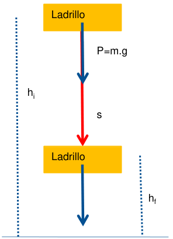
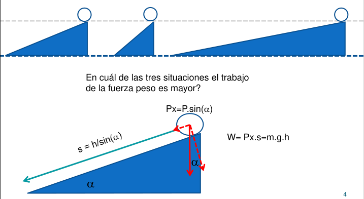
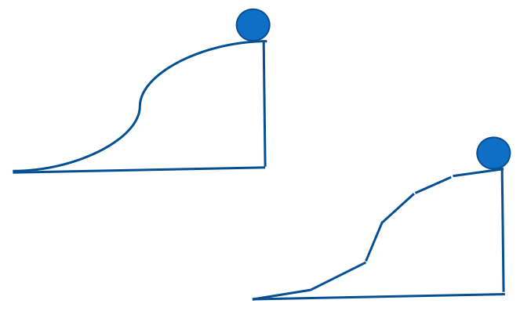

# UT II: Energía Electrostática. Potencial Eléctrico

## CONTENIDOS (Programa Analítico Física II)

- Energía electrostática de una carga puntual.
- Diferencia de potencial y potencial eléctrico.
- Potencial de cargas puntuales, de un dipolo y de distribuciones continuas de
  cargas
- El campo eléctrico como gradiente de potencial eléctrico.
- Superficies equipotenciales.
- Ecuaciones de Poisson y de Laplace.
- Energía potencial de un grupo de cargas puntuales.

## Energía Potencial Eléctrica

Designaremos a la energía potencial eléctrica por la letra U. Recordemos
previamente el concepto de fuerza conservativa, y su relación con la energía
potencial.

**Fuerzas conservativas: Son aquellas que cuando actúan sobre un cuerpo que
realiza una trayectoria cerrada, su trabajo es nulo.**

**Una fuerza es conservativa si el trabajo que realiza entre dos puntos
arbitrarios es independiente de la trayectoria que se emplea para unirlos.**

En el curso de Física I vimos que la fuerza gravitatoria y la fuerza
recuperadora elástica son fuerzas conservativas.

## Recordando…



```math
W=\int_i^f\vec F.\overrightarrow{ds}=m.g.\int_i^f ds=m.g.s
```

```math
W=m.g.(h_i-h_f)
```

Definimos

```math
m.g.h=Ep
```

```math
W=m.g.h_i-m.g.h_f=Epi-Epf=-\Delta Ep
```

```math
-W=\Delta Ep
```

En cuál de las tres situaciones el trabajo de la fuerza peso es mayor?



```math
P_x=P.\sin(\alpha)
```

```math
s=h/\sin(\alpha)
```

```math
W=P_x.s=m.g.h
```



Existe una relación entre el trabajo realizado por una fuerza conservativa y la
variación de la energía potencial como consecuencia de dicho trabajo;

**Si las fuerzas actuantes son conservativas, la variación de la energía
potencial del cuerpo como consecuencia de dicho trabajo es igual al trabajo
realizado por las mismas cambiado de signo.**

## Procedencia y observaciones de transcripción

- Original:
  `2019/1er Parcial/2017 UT II - Energía Electrostatica. Potencial electrico.pdf`,
  páginas 1, 2, 3 de 16 (PDF original, dos diapositivas por página salvo la
  última).
- SHA-256: `3e220eba27f223b646b95bb01387049e32d8a38191b146cb7d8e0bcb5eb7ece5`.
- El nombre del archivo indica 2017; se conserva bajo 2019 por su ubicación
  canónica. No consta autor en estas diapositivas.
- Herramientas: PyMuPDF4LLM y Poppler para extracción; cotejo visual de todas
  las páginas, ecuaciones y figuras. Medios originales conservados por recorte y
  render con PyMuPDF. La extracción automática no conserva todas las ecuaciones.
- Se conservan las preguntas sin responder y la diapositiva 5, que contiene
  únicamente dos diagramas de trayectorias.
