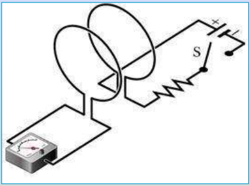
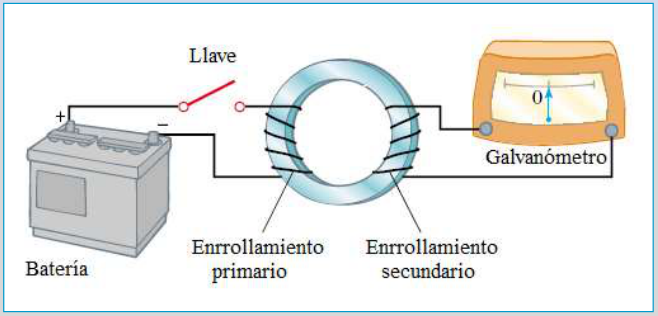
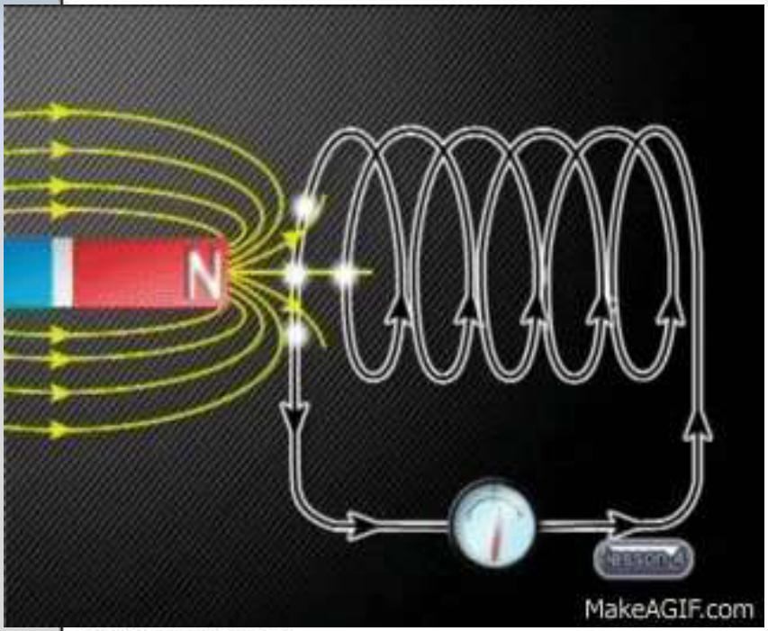
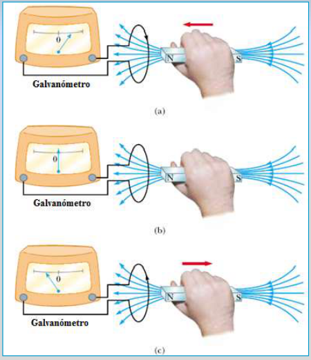

# Experiencias de Faraday con corrientes e imanes

Unidad Temática VII — Electromagnetismo

## Las experiencias de Faraday

### Experiencias con corrientes

Con la llave abierta G marca cero. Al cerrar la llave del circuito exterior
(rojo) la aguja del galvanómetro del circuito interior (azul) se desplazaba,
volviendo a cero tras unos instantes.

Sólo al abrir y al cerrar el interruptor el galvanómetro detectaba el paso de
una corriente que desaparecía con el tiempo. Además, la aguja se desplazaba en
sentidos opuestos en uno y otro caso.

Otros dispositivos experimentales. El de la izquierda utiliza espiras en vez de
solenoides,

Dos enrollamientos enlazados por un núcleo de hierro que confina el campo B.

[Ver simulación](http://micro.magnet.fsu.edu/electromag/java/faraday/)

En ambos casos al abrir y cerrar la llave se observa una desviación temporaria
en el galvanómetro

### Experiencias con imanes

Imán recto y una bobina conectada a un galvanómetro.

El circuito no tiene fuentes de corriente. Si hay movimiento relativo entre el
circuito y el imán, el galvanómetro marca el paso de corriente.

1. Si el imán se acerca a la espira el galvanómetro indica el paso de corriente.
   Cuanto más rápido se acerca el imán, mayor es la desviación de la aguja.
1. Si se detiene el imán la aguja vuelve a cero.
1. Si se aleja el imán la aguja se desvía en sentido contrario.
1. Si invertimos el imán y lo acercamos o alejamos, nuevamente la aguja del
   galvanómetro se desvía, pero en sentidos contrarios al caso previo

## Procedencia y observaciones de transcripción

- Original:
  `2019/2do Parcial/2019 UT VII - Fenómenos de Inducción Electromagnética.pdf`,
  páginas 4–8 de 67. Fecha impresa: 14/05/2019.
- SHA-256: `cbefa338a0f56f56079880a84f05a963257a6473febd8da50f944a67f2210a8f`.
- Herramientas: PyMuPDF4LLM, Poppler y recortes PyMuPDF; páginas del tramo
  cotejadas visualmente.
- Cinco figuras originales; la página 7 contiene una imagen estática y su marca,
  sin texto explicativo adicional. No se inventa ni reconstruye una animación.
  Se conserva el enlace del original sin ejecutar su applet.
