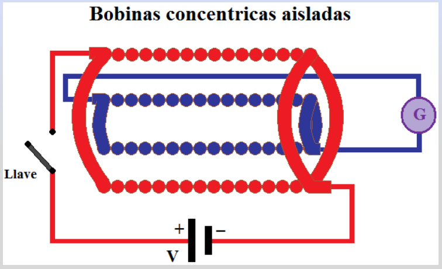
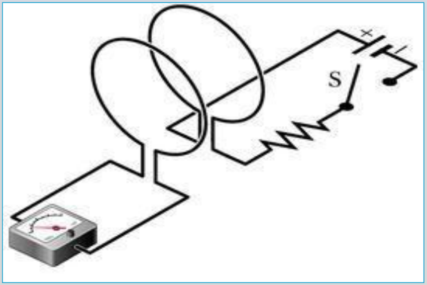
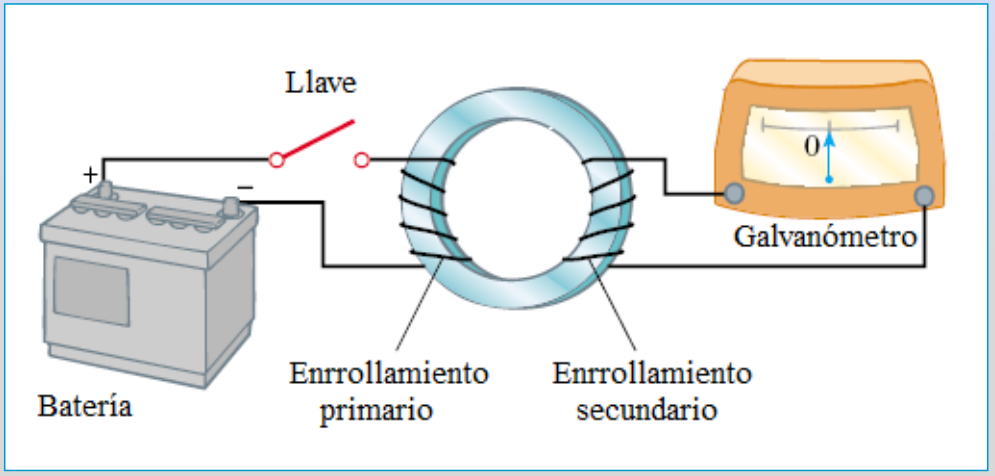
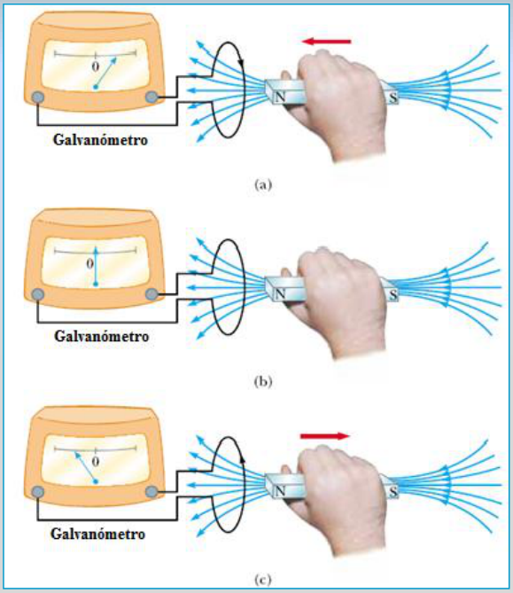
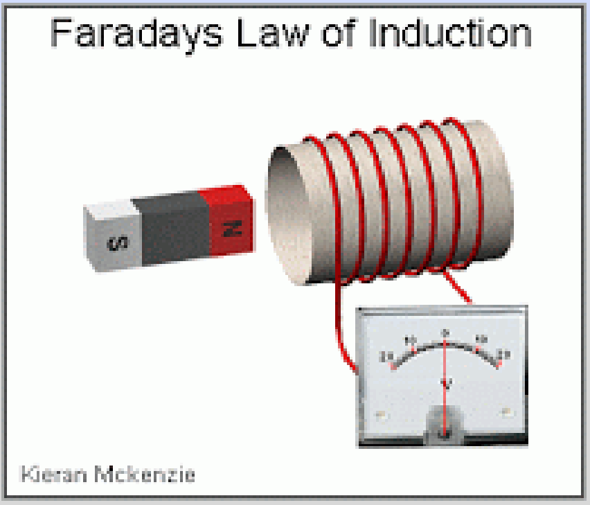

# Experiencias de Faraday: versión Electromagnetismo

Unidad Temática VII — Electromagnetismo

## Las experiencias de Faraday

### Experiencias con corrientes

Con la llave abierta G marca cero. Al cerrar la llave del circuito exterior
(rojo) la aguja del galvanómetro del circuito interior (azul) se desplazaba,
volviendo a cero tras unos instantes.

Sólo al abrir y al cerrar el interruptor el galvanómetro detectaba el paso de
una corriente que desaparecía con el tiempo. Además, la aguja se desplazaba en
sentidos opuestos en uno y otro caso.

Otros dispositivos experimentales. Utiliza espiras en vez de solenoides,

Dos enrollamientos enlazados por un núcleo de hierro que confina el campo B.

En ambos casos al abrir y cerrar la llave se observa una desviación temporaria
en el galvanómetro

### Experiencias con imanes

Imán recto y una bobina conectada a un galvanómetro.

El circuito no tiene fuentes de corriente. Si hay movimiento relativo entre el
circuito y el imán, el galvanómetro marca el paso de corriente.

1. Si el imán se acerca a la espira el galvanómetro indica el paso de corriente.
   Cuanto más rápido se acerca el imán, mayor es la desviación de la aguja.
1. Si se detiene el imán la aguja vuelve a cero.
1. Si se aleja el imán la aguja se desvía en sentido contrario.
1. Si invertimos el imán y lo acercamos o alejamos, nuevamente la aguja del
   galvanómetro se desvía, pero en sentidos contrarios al caso previo

## Faradays Law of Induction

Kieran McKenzie

## Procedencia y observaciones de transcripción

- Original: `2019/2do Parcial/2019 UT VII Electromagnetismo.pdf`, páginas 5–9 de
  62\. 2019 corresponde al nombre del archivo; no consta fecha impresa en estas
  páginas.
- SHA-256: `eff3447774cadfcb2726a6caabbe8e257782276fce3e67dda465673d5ef67a6a`.
- Herramientas: PyMuPDF4LLM, Poppler y recortes PyMuPDF; páginas del tramo
  cotejadas visualmente. Esta versión no se declara duplicada de la presentación
  de 67 páginas.
- La página 6 dice «Utiliza espiras en vez de solenoides» y la 7 no contiene el
  enlace de simulación de la otra versión. La imagen de página 9 se conserva con
  su título y crédito; no se reconstruye una animación.
