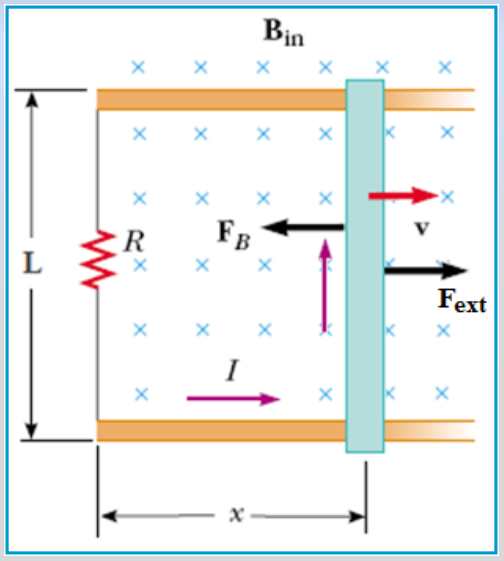
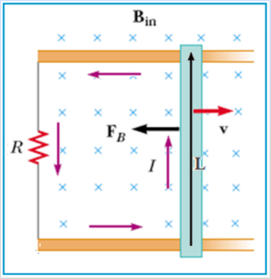
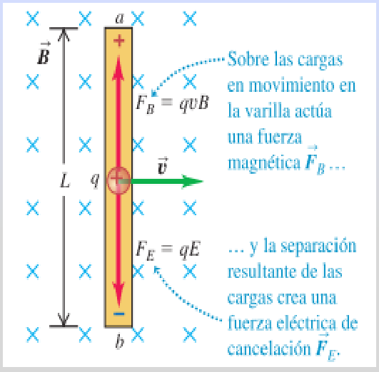
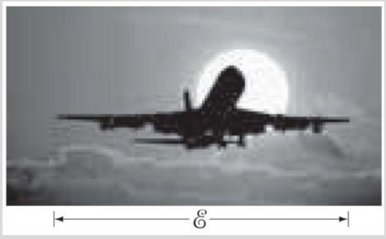

# Fem de movimiento y problema del avión: versión Electromagnetismo

Unidad Temática VII — Electromagnetismo

## FEM de movimiento para un circuito cerrado



Supongamos que la varilla conductora se desliza a lo largo de dos conductores
que están unidos a una resistencia. El flujo magnético varía porque el área que
encierra el circuito también lo hace.

```math
A=Lx\Rightarrow\phi_B=BA=BLx
```

```math
\varepsilon=-\frac{d\phi_B}{dt}=-\frac d{dt}(BLx)=-BL\frac{dx}{dt}
```

```math
\varepsilon=-BLv\Rightarrow I=\frac{|\varepsilon|}R=\frac{BLv}R
```

La corriente I genera un campo magnético que sale del pizarrón

Ecuación valida en tanto B,L y v sean perpendiculares, sino se deben utilizar
las componentes de cada uno que sean perpendiculares.



Si se impulsa la varilla con velocidad v hacia la derecha y luego se deja en
libertad, la corriente inducida interacciona con B_in. La fuerza magnética F_B
que aparece sobre la varilla la frena hasta detenerla. Para mantener constante
la velocidad, un agente externo debe ejercer una fuerza igual y opuesta a la
fuerza magnética.

```math
\vec F_B=I\vec L\times\vec B_{in}\qquad F_B=ILB_{in}
```

módulo

## FEM de movimiento para un circuito abierto (Varilla conductora aislada)



El campo magnético es uniforme y dirigido hacia la página, y movemos la varilla
hacia la derecha a velocidad constante v. Entonces, una partícula cargada q en
la varilla experimenta una fuerza magnética.

```math
\vec F_B=q(\vec v\times\vec B)\qquad F=qvB
```

Sobre las cargas en movimiento en la varilla actúa una fuerza magnética F_B… y
la separación resultante de las cargas crea una fuerza eléctrica de cancelación
F_E.

Esta fuerza magnética hace que las cargas libres en la varilla se muevan, lo que
crea un exceso de carga positiva en el extremo superior a y de carga negativa en
el extremo inferior b. Esto, a la vez, crea un campo eléctrico en el interior de
la varilla, en el sentido que va de a hacia b (opuesto al campo magnético). La
carga continúa acumulándose en los extremos de la varilla hasta que se hace
suficientemente grande para que la fuerza eléctrica hacia abajo (con magnitud
qE) cancele exactamente la fuerza magnética hacia arriba (con magnitud qvB).

```math
\begin{cases}\vec F_B=q(\vec v\times\vec B)\\\vec F_E=q\vec E\end{cases}\Rightarrow qvB=qE
```

Equilibrio

```math
E=vB\Rightarrow\Delta V=EL=vBL
```

```math
|\varepsilon|=BLv
```

La fem se induce en una barra o en un alambre conductor que se mueve en el seno
de un campo magnético incluso cuando el circuito está abierto y no existe
corriente.

## Problema

¿Un avión en movimiento desarrolla una gran fem? Un avión viaja a 1000 km/h en
una región donde el campo magnético de la Tierra es de aproximadamente
$`5.0\times10^{-5}`$ T y es casi vertical. ¿Cuál es la diferencia de potencial
inducida entre las puntas de las alas, que están separadas70 m?



## Desarrollo del problema en el original

Consideramos a las alas como un conductor de 70m de largo que se desplaza a
través del campo magnético de la Tierra.

```math
v=1000\frac{km}h=280\frac ms\qquad\vec v\perp\vec B
```

```math
\varepsilon=Blv
```

```math
\varepsilon=(5\times10^{-5}T)(70m)\left(280\frac ms\right)=1V
```

## Procedencia y observaciones de transcripción

- Original: `2019/2do Parcial/2019 UT VII Electromagnetismo.pdf`, páginas 26–31
  de 62. No consta fecha impresa; 2019 es del nombre del archivo.
- SHA-256: `eff3447774cadfcb2726a6caabbe8e257782276fce3e67dda465673d5ef67a6a`.
- Herramientas: PyMuPDF4LLM, Poppler y recortes PyMuPDF; páginas, expresiones y
  figuras del tramo cotejadas visualmente.
- La solución de página 31 pertenece al original; se conserva 280 m/s y 1 V sin
  recalcularlos. La frase de página 28 dice «opuesto al campo magnético», aunque
  el esquema muestre campos perpendiculares; no se sustituye. Se mantiene
  «separadas70» en el enunciado.
