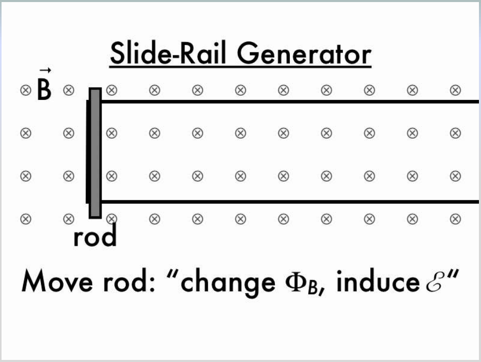
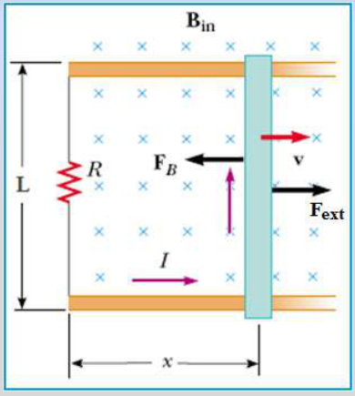
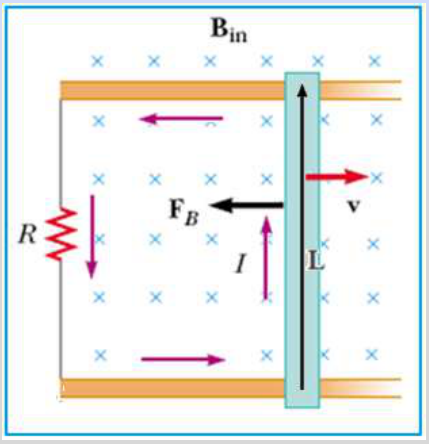
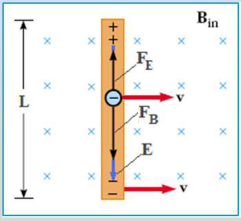
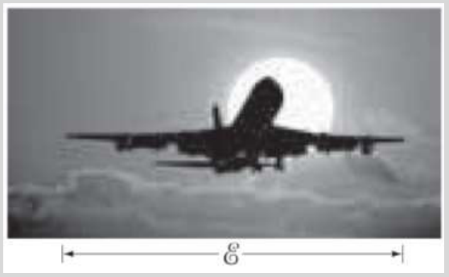

# Fem de movimiento en circuitos cerrados y abiertos

Unidad Temática VII — Electromagnetismo

## Slide-Rail Generator



Move rod: “change $`\Phi_B`$, induce $`\mathcal E`$”

## FEM de movimiento para un circuito cerrado



Supongamos que la varilla conductora se desliza a lo largo de dos conductores
que están unidos a una resistencia. El flujo magnético varía porque el área que
encierra el circuito también lo hace.

```math
A=Lx\Rightarrow\phi_B=BA=BLx
```

```math
\varepsilon=-\frac{d\phi_B}{dt}=-\frac d{dt}(BLx)=-BL\frac{dx}{dt}
```

```math
\varepsilon=-BLv\Rightarrow I=\frac{|\varepsilon|}R=\frac{BLv}R
```

La corriente I genera un campo magnético que sale del pizarrón



Si se impulsa la varilla con velocidad v hacia la derecha y luego se deja en
libertad, la corriente inducida interacciona con B_in. La fuerza magnética F_B
que aparece sobre la varilla la frena hasta detenerla. Para mantener constante
la velocidad, un agente externo debe ejercer una fuerza igual y opuesta a la
fuerza magnética.

```math
\vec F_B=I\vec L\times\vec B_{in}\qquad F_B=ILB_{in}
```

módulo

## FEM de movimiento para un circuito abierto (Varilla conductora aislada)



```math
\begin{cases}\vec F_B=q(\vec v\times\vec B)\\\vec F_E=q\vec E\end{cases}\Rightarrow qvB=qE
```

Equilibrio

```math
E=vB\Rightarrow\Delta V=EL=vBL
```

```math
|\varepsilon|=BLv
```

La fem se induce en una barra o en un alambre conductor que se mueve en el seno
de un campo magnético incluso cuando el circuito está abierto y no existe
corriente.

## Problema

¿Un avión en movimiento desarrolla una gran fem? Un avión viaja a 1000 km/h en
una región donde el campo magnético de la Tierra es de aproximadamente
$`5.0\times10^{-5}`$ T y es casi vertical. ¿Cuál es la diferencia de potencial
inducida entre las puntas de las alas, que están separadas70 m?



## Procedencia y observaciones de transcripción

- Original:
  `2019/2do Parcial/2019 UT VII - Fenómenos de Inducción Electromagnética.pdf`,
  páginas 26–30 de 67. Fecha impresa: 14/05/2019.
- SHA-256: `cbefa338a0f56f56079880a84f05a963257a6473febd8da50f944a67f2210a8f`.
- Herramientas: PyMuPDF4LLM, Poppler y recortes PyMuPDF; páginas, fórmulas y
  figuras del tramo cotejadas visualmente. No se añaden respuestas a preguntas
  vacías.
- Se conserva el enunciado del avión sin resolverlo. Los símbolos B_in y F_B del
  texto corresponden a los del esquema. Se mantiene «separadas70» del original.
