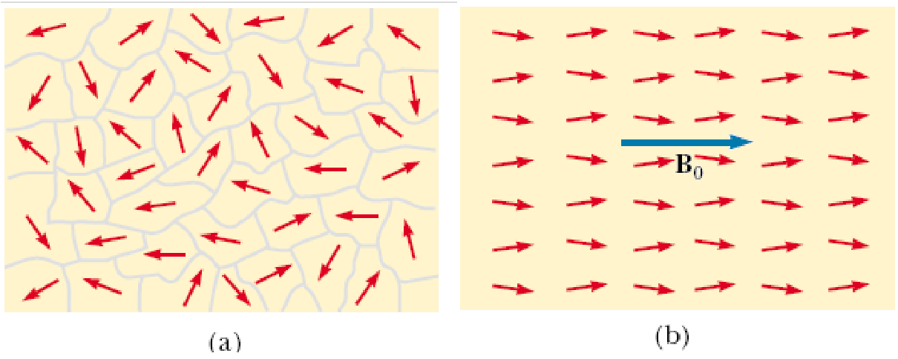
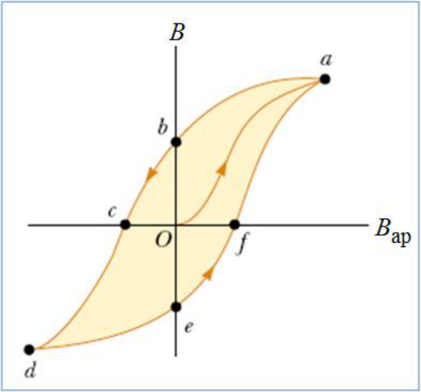
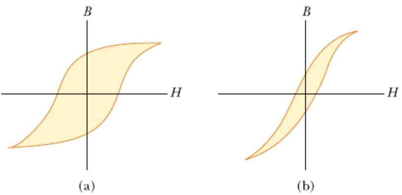
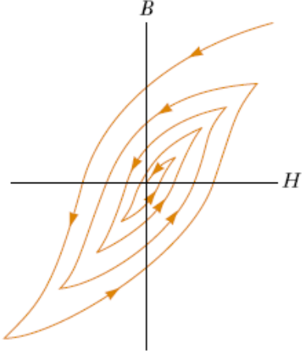

# Ferromagnetismo, dominios e histéresis

Unidad Temática VIII — Magnetismo en Medios materiales

## Ferromagnetismo

- Se presenta en Fe, Co, Ni y aleaciones.
- Existen interacciones entre los espines de los electrones.
- La susceptibilidad $`\chi_m\gt0`$ (grande)
- Magnetización alta aún para valores del campo externo bajos.
- En ausencia de campo existen dominios magnéticos en los que la magnetización
  no es nula.

Un examen microscópico revela que un trozo de hierro esta formado por pequeñas
regiones conocidas como Dominios.

Cada dominio se comporta como pequeños imanes con un polo norte y un polo sur.

a) Dominios con momentos magnéticos orientados al azar en una sustancia
desmagnetizada

b) Al aplicar un campo magnético externo B₀ los momentos se alinean dando lugar
a una magnetización neta M

En O es Bm = 0 (los dominios están orientados al azar), cuando aumenta el campo
externo Bap los dominios magnéticos se alinean y crecen hasta que se alcanza la
saturación en a (M = Msat). Si se quita el campo externo la curva de
magnetización sigue la trayectoria hasta el punto b, donde el campo B no es
nulo, sino tiene un valor Bm denominado campo remanente. Si aplicamos el campo
Bap pero en sentido contrario se alcanza el punto c donde el material esta
desmagnetizado (M = 0). Si seguimos aumentando Bap el material se magnetiza
hasta alcanzar la saturación en d, pero con dirección opuesta a la magnetización
en el punto a. Si eliminamos el campo externo llegamos a e con magnetización
remanente de dirección opuesta a la de b. Si aplicamos el campo en la dirección
inicial terminamos en el punto a de saturación.

a) Curva de Histéresis para un material ferromagnético duro. Mantiene la
magnetización remanente (forman buenos imanes permanentes). b) Curva de
Histéresis para un material ferromagnético blando. Pierde con facilidad la
magnetización al anular el campo externo (Para construcción de electroimanes,
transformadores, etc.).

Desmagnetización por repetición de ciclos de Histéresis.

## Procedencia y observaciones de transcripción

- Original:
  `2019/2do Parcial/2019 UT VIII - Magnetismo en Medios materiales.pdf`, páginas
  18–21 de 21. No consta fecha impresa; 2019 es del nombre del archivo.
- SHA-256: `5d97f163bf24ba9b9d9317dbe7faec1a00e5fab87621e3849d37756083e8f919`.
- Herramientas: PyMuPDF4LLM, Poppler y recortes PyMuPDF; páginas, expresiones y
  figuras del tramo cotejadas visualmente.
- La figura de página20 usa B en el eje vertical, mientras el texto alterna Bm y
  M; se conservan las magnitudes y las referencias a puntos del original. No se
  agregan explicaciones del punto f.

## Versión impresa de seis diapositivas

El archivo `2019/2do Parcial/UT 8 6 pag.pdf` (SHA-256
`d2d2d0f25fb3fdf3e79399ff0127bd753745d6368a9511122ae7f7076e1f09b2`) reproduce
estas diapositivas en las páginas 3, 4 de cuatro. Se cotejaron texto,
expresiones y figuras contra la versión individual; no contiene contenido
adicional en este tramo. La correspondencia por diapositiva está en
[el registro de imposiciones](../../../resources/common/imposiciones.json).
