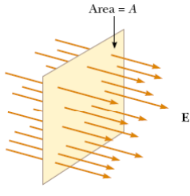
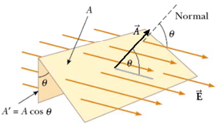
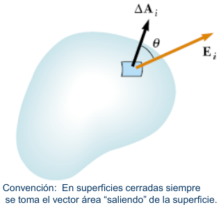
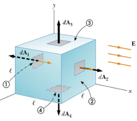

# FLUJO de un CAMPO VECTORIAL a través de una SUPERFICIE

El flujo de un campo da idea del número de líneas de campo que atraviesa cierta
superficie.

## FLUJO ELÉCTRICO A TRAVES DE UNA SUPERFICIE

```math
\Phi_E=\int_{Sup}\vec E\cdot\overrightarrow{dA}
```



Consideremos un campo eléctrico E homogéneo y perpendicular a un área plana A.
El número de líneas por unidad de área transversal es proporcional al campo
eléctrico E. Por lo tanto el numero total de líneas que atraviesan A es
proporcional al producto E A. Se define al Flujo de campo electrico como:

```math
\Phi_E=EA
```

Flujo de campo eléctrico



## Superficie no plana y campo eléctrico no uniforme



```math
\Phi_E\cong\sum_{i=1}^n\vec E_i\cdot\Delta\vec A_i
```

Convención: En superficies cerradas siempre se toma el vector área “saliendo” de
la superficie.

```math
\mathrm{si}\quad n\to\infty\Rightarrow\begin{cases}\Delta\vec A_i\to\overrightarrow{dA}\\\vec E_i\to\vec E\\\sum\to\int\end{cases}
```

```math
\Phi_E=\lim_{n\to\infty}\sum_{i=1}^n\vec E_i\cdot\Delta\vec A_i=\int_{Sup}\vec E\cdot\overrightarrow{dA}
```

Si la superficie es cerrada:

```math
\Phi_E=\oint\vec E\cdot\overrightarrow{dA}=\oint E\cos(\theta)\,dA=\oint E_n\,dA
```

## Cubo en campo uniforme



Consideremos un cubo de lado l y un campo eléctrico uniforme en la dirección x.
El flujo neto es la suma de los flujo en las seis caras del cubo, pero las
líneas de campo solo atraviesan las caras 1 y 2.

```math
\Phi_{E,cara3}=\Phi_{E,cara4}=\Phi_{E,cara5}=\Phi_{E,cara6}=0
```

```math
\Phi_E=\int_{cara1}\vec E\cdot\overrightarrow{dA}+\int_{cara2}\vec E\cdot\overrightarrow{dA}
```

```math
\Phi_E=\int_{cara1}E\cos(180^\circ)\,dA+\int_{cara2}E\cos(0^\circ)\,dA
```

```math
\Phi_E=-E\int_{cara1}dA+E\int_{cara2}dA=-El^2+El^2=0
```

## Procedencia y observaciones de transcripción

- Original:
  `2019/1er Parcial/2018 UT I - Fuerza Eléctrica y Campo Elécrtico.pdf`, páginas
  33, 34, 35 de 42.
- SHA-256: `326bb078ddbf25b43f166e198c175106027b686dde0d0ea9688c025795f46ca7`.
- El nombre del archivo indica 2018; ubicación canónica 2019. No consta autor ni
  fecha completa en estas páginas.
- Herramientas: PyMuPDF4LLM y Poppler para extracción; todas las expresiones y
  figuras cotejadas visualmente. Medios por recorte/render PyMuPDF; la captura
  de fórmulas y la figura oculta de líneas se recuperan desde sus franjas raster
  originales.
- Cubre la inferior de 33 y ambas de 34–35. Se conserva «los flujo» y la
  diferencia entre integrales abiertas de cada cara e integrales cerradas de la
  superficie completa.
