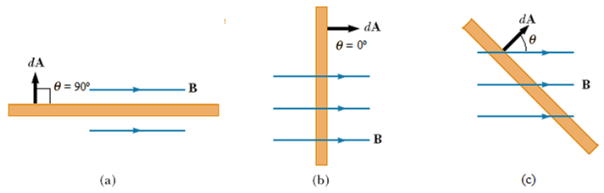
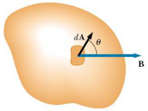
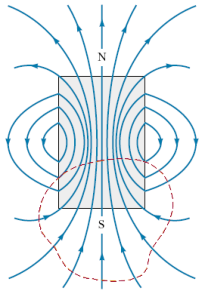
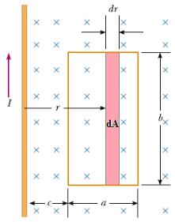

# Flujo magnético, ley de Gauss y ejemplo de espira

Unidad temática VI — Campo de Inducción Magnética. Propiedades.

Fecha impresa: 08/05/2019.

## Flujo magnético y la Ley de Gauss para el campo magnético



El flujo asociado con el campo Magnético B se define de manera similar al flujo
asociado al campo eléctrico. Si B es homogeneo

```math
\text{a) }\phi_B=0\qquad\text{b) }\phi_B=BA
```

```math
\text{c) }\phi_B=\vec B\cdot\vec A=BA\cos(\theta)
```

Si el campo no es uniforme y la superficie no es plana, consideramos una
superficie elemental dA, y



```math
d\phi_B=\vec B\cdot\overrightarrow{dA}\Rightarrow\phi_B=\int\vec B\cdot\overrightarrow{dA}
```

## Ley de Gauss para el campo magnético

Si consideramos una superficie gaussiana, como las líneas de campo magnético son
cerradas, la cantidad de líneas que entran es igual a las que salen



```math
\phi_B=\int\vec B\cdot\overrightarrow{dA}=0
```

## Ejemplo

Por un conductor recto circula una corriente I. Una espira rectangular de ancho
a y alto b esta emplazada a una distancia c como se indica en la figura.
Determine el flujo magnético total a través de la espira.



```math
B=\frac{\mu_0I}{2\pi r}\quad\text{y}\quad\phi_B=\int B\,dA=\int\frac{\mu_0I}{2\pi r}\,dA
```

```math
dA=b\,dr\Rightarrow\phi_B=\frac{\mu_0Ib}{2\pi}\int_c^{c+a}\frac{dr}r=\frac{\mu_0Ib}{2\pi}\ln(r)\big|_c^{c+a}
```

```math
\phi_B=\frac{\mu_0Ib}{2\pi}[\ln(c+a)-\ln(c)]=\frac{\mu_0Ib}{2\pi}\ln\left(\frac{c+a}c\right)
```

```math
\phi_B=\frac{\mu_0Ib}{2\pi}\ln\left(1+\frac ac\right)
```

## Procedencia y observaciones de transcripción

- Original:
  `2019/2do Parcial/2019 UT VI - Campo de Inducción Magnética. Propiedades.pdf`,
  páginas PDF 12–14 de 16, diapositivas 24–27 de 31.
- SHA-256: `b9bb8ec5e8acfa36814e15207ee532a00e566ff5ea72bd139eff27ae0b2d634f`.
- Herramientas: PyMuPDF4LLM, Poppler y recortes PyMuPDF; cotejo visual de todas
  las páginas y expresiones de este tramo. Se conservan figuras, etiquetas y
  erratas del original.
- Se conserva el signo de integral simple de Gauss de la diapositiva 26. Las
  páginas 12 y 14 se comparten con los apuntes contiguos; no se añade una
  derivación diferente.
