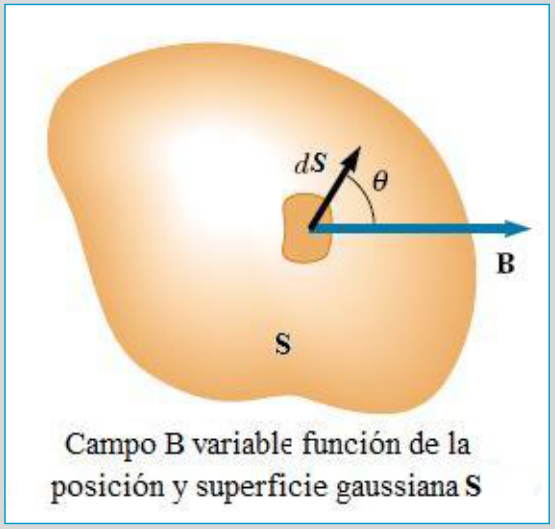

# Flujo magnético y wéber: versión Electromagnetismo

Unidad Temática VII — Electromagnetismo

## De la experiencia deducimos que

- Solo se genera corriente si hay movimiento relativo entre la espira y el imán.
- En el instante en que cesa el movimiento cesa la corriente.
- Esta corriente es producida por una fem, que denominaremos fem inducida.
- La fem aparece en la espira cada vez que cambia la intensidad del campo
  magnético en la región del espacio que ocupa la espira.
- La fem inducida cambia la polaridad cuando se invierte el sentido del
  movimiento.
- En la generación de corrientes (fem) inducidas podemos distinguir dos
  elementos
  - El inducido, que es el circuito donde aparece la corriente (la espira)
  - El inductor, que es el agente que provoca el fenómeno (el imán)

## Flujo magnético

Se define el flujo del campo magnético a través de una superficie como el número
total de líneas de fuerza que atraviesan tal superficie. En términos
matemáticos, para un campo magnético constante y una superficie plana de área S,
el flujo magnético se expresa en la forma:

```math
\phi_B=\vec B\cdot\vec S=BS\cos(\theta)
```



Si B es no homogéneo y S de forma arbitraria

```math
d\phi_B=\vec B\cdot\overrightarrow{dS}=B\cos(\theta)\,dS
```

```math
\phi_B=\int\vec B\cdot\overrightarrow{dS}=\int B\cos(\theta)\,dS
```

El flujo depende de tres factores: el campo magnético B, la superficie S y el
ángulo θ entre B y dS, basta que cambie uno de ellos para que el flujo cambie.
En las experiencias de Faraday vimos cambiar el campo magnético, por tanto
cambia el flujo que atraviesa el circuito.

En el Sistema Internacional la unidad de flujo magnético es el Wéber (Wb).

```math
1\mathrm{Wb}=1\mathrm T\,\mathrm m^2
```

## Procedencia y observaciones de transcripción

- Original: `2019/2do Parcial/2019 UT VII Electromagnetismo.pdf`, páginas 10–12
  de 62. No consta fecha impresa; 2019 es del nombre del archivo.
- SHA-256: `eff3447774cadfcb2726a6caabbe8e257782276fce3e67dda465673d5ef67a6a`.
- Herramientas: PyMuPDF4LLM, Poppler y recortes PyMuPDF; páginas, expresiones y
  figuras del tramo cotejadas visualmente. Se conserva esta versión por sus
  diferencias documentales.
- Esta versión no contiene la lámina inglesa Magnetic Flux ni la definición
  desarrollada de un wéber de la presentación de 67 páginas; no se agregan.
