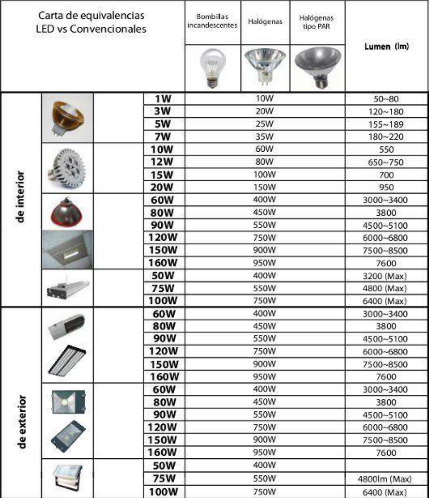

# Fotometría: carta de equivalencias de lámparas

Unidad Temática XI — Fotometría

## Carta de equivalencias LED vs Convencionales

Encabezados de los tipos convencionales: Bombillas incandescentes; Halógenas;
Halógenas tipo PAR. La columna de potencia convencional ocupa el espacio de esos
tipos en el cuerpo de la carta.

Los datos se transcriben en el orden de las filas de la carta, conservando sus
repeticiones y su celda vacía.

<!-- markdownlint-disable MD060 -->

| Aplicación | LED | Convencionales | Lumen (lm) |
| -- | -- | -- | -- |
| de interior | 1W | 10W | 50~80 |
| de interior | 3W | 20W | 120~180 |
| de interior | 5W | 25W | 155~189 |
| de interior | 7W | 35W | 180~220 |
| de interior | 10W | 60W | 550 |
| de interior | 12W | 80W | 650~750 |
| de interior | 15W | 100W | 700 |
| de interior | 20W | 150W | 950 |
| de interior | 60W | 400W | 3000~3400 |
| de interior | 80W | 450W | 3800 |
| de interior | 90W | 550W | 4500~5100 |
| de interior | 120W | 750W | 6000~6800 |
| de interior | 150W | 900W | 7500~8500 |
| de interior | 160W | 950W | 7600 |
| de interior | 50W | 400W | 3200 (Max) |
| de interior | 75W | 550W | 4800 (Max) |
| de interior | 100W | 750W | 6400 (Max) |
| de exterior | 60W | 400W | 3000~3400 |
| de exterior | 80W | 450W | 3800 |
| de exterior | 90W | 550W | 4500~5100 |
| de exterior | 120W | 750W | 6000~6800 |
| de exterior | 150W | 900W | 7500~8500 |
| de exterior | 160W | 950W | 7600 |
| de exterior | 60W | 400W | 3000~3400 |
| de exterior | 80W | 450W | 3800 |
| de exterior | 90W | 550W | 4500~5100 |
| de exterior | 120W | 750W | 6000~6800 |
| de exterior | 150W | 900W | 7500~8500 |
| de exterior | 160W | 950W | 7600 |
| de exterior | 50W | 400W |  |
| de exterior | 75W | 550W | 4800lm (Max) |
| de exterior | 100W | 750W | 6400lm (Max) |

<!-- markdownlint-enable MD060 -->

## Procedencia y observaciones de transcripción

- Original: `2019/3er Parcial/2018 UT XI - Fotometria.pdf`, páginas 12 de 32. El
  nombre indica 2018 y la carpeta 2019; no consta fecha de clase impresa en
  estas páginas.
- Duplicado binario: `2019/3er Parcial/2019 UT XI - Fotometria..pdf`; se
  conserva una única transcripción de ambos originales.
- SHA-256 de ambos:
  `b8cd5a2b645f5d301f347d8191d41cd87469e75a7595a0388a7d8ef460d669b2`.
- Herramientas: preflight y extracción PyMuPDF4LLM, Poppler, inspección y
  recortes PyMuPDF. Todas las páginas, expresiones, tablas y figuras del tramo
  cotejadas visualmente.
- La carta está recortada en el borde inferior de la diapositiva. Se transcriben
  sus 32 filas visibles, sin completar la celda vacía de la fila exterior50W ni
  añadir datos debajo del recorte. Las fotografías originales se conservan en la
  figura; esta carta se presenta como contenido histórico de la fuente, no como
  recomendación actual.
