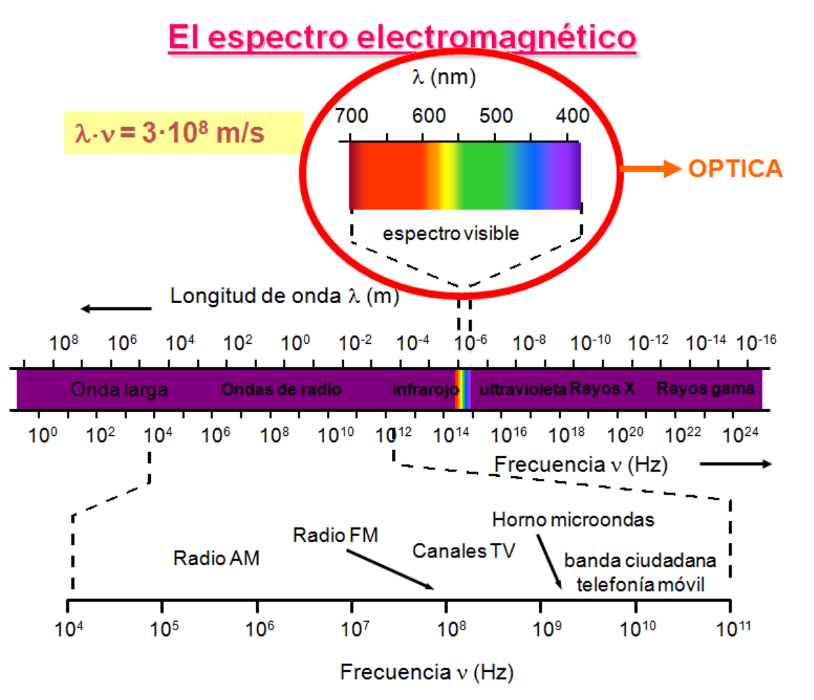
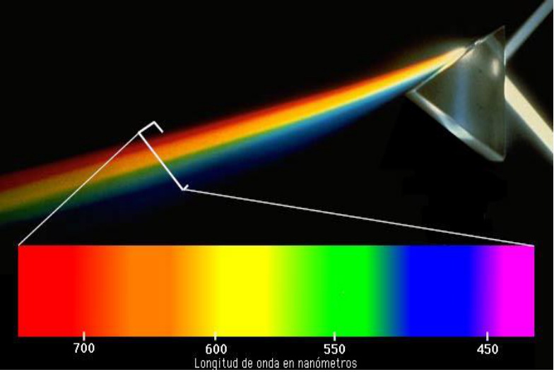

# Fotometría: espectro electromagnético y visible

Unidad Temática XI — Fotometría

## El espectro electromagnético

```math
\lambda\cdot\nu=3\cdot10^8\,\mathrm{m/s}
```



## El espectro visible (luminoso)



| Color | Longitud de onda |
| -- | -- |
| ROJO | De 620 a 750 nm |
| NARANJA | De 590 a 620 nm |
| AMARILLO | De 570 a 590 nm |
| VERDE | De 490 a 570 nm |
| AZUL | De 430 a 490 nm |
| VIOLETA | De 400 a 430 nm |

```math
1\ \text{micra}\ (1\mu)=10^{-6}\,\mathrm m
```

```math
1\ \text{milimicra}\ (1\mathrm m\,\mu)=10^{-9}\,\mathrm m
```

```math
1\ \text{nanometro}\ (1\mathrm{nm})=10^{-9}\,\mathrm m
```

```math
1\ \text{Angstrom}\ (1\text{Å})\quad10^{-10}\,\mathrm m
```

## Procedencia y observaciones de transcripción

- Original: `2019/3er Parcial/2018 UT XI - Fotometria.pdf`, páginas 4, 5 de 32.
  El nombre indica 2018 y la carpeta 2019; no consta fecha de clase impresa en
  estas páginas.
- Duplicado binario: `2019/3er Parcial/2019 UT XI - Fotometria..pdf`; se
  conserva una única transcripción de ambos originales.
- SHA-256 de ambos:
  `b8cd5a2b645f5d301f347d8191d41cd87469e75a7595a0388a7d8ef460d669b2`.
- Herramientas: preflight y extracción PyMuPDF4LLM, Poppler, inspección y
  recortes PyMuPDF. Todas las páginas, expresiones, tablas y figuras del tramo
  cotejadas visualmente.
- Se conservan las unidades antiguas micra/milimicra y la línea de Angstrom sin
  signo igual, tal como aparece en la página 5. Los seis intervalos de colores
  se transcriben a tabla.
