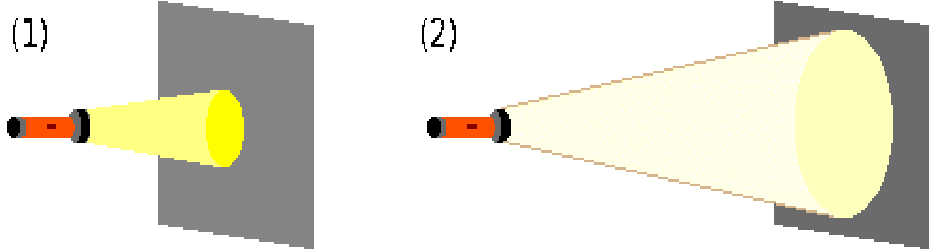
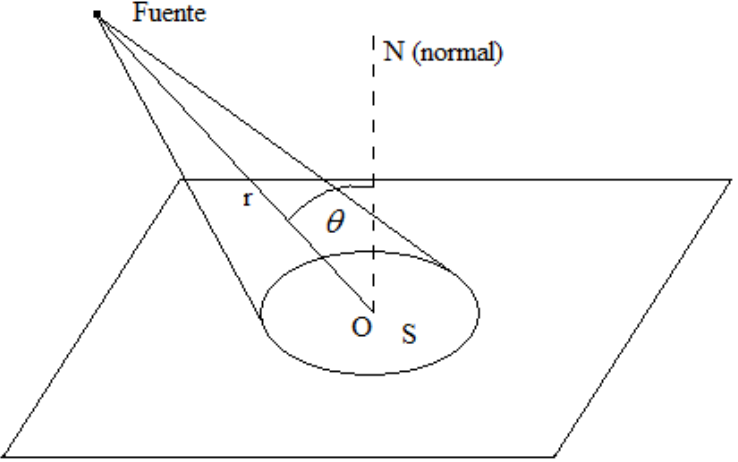
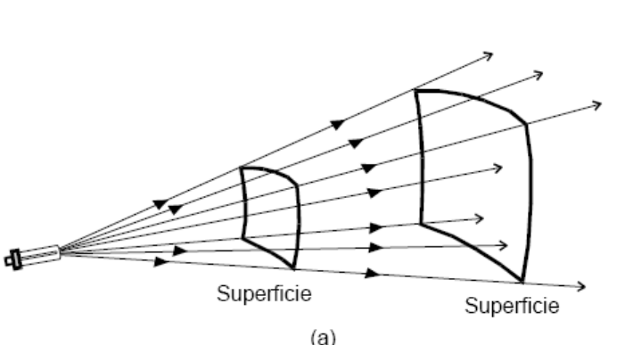
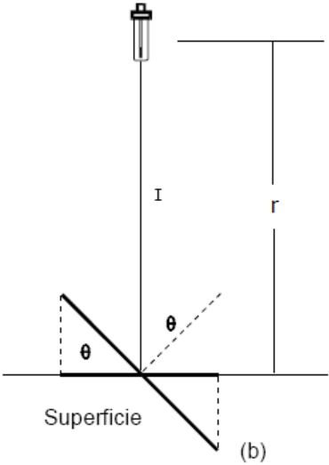

# Fotometría: iluminancia, distancia y ley del coseno

Unidad Temática XI — Fotometría

## ILUMINANCIA o ILUMINACIÓN (E)

Consideremos ahora un elemento de área S de una superficie en la que incide un
flujo luminoso $`\Phi_{lum}`$.



Se denomina Iluminación o Iluminancia E a la magnitud dada por la relación:

```math
E=\frac{\phi_{lum}}S\qquad[E]=\frac{[\phi_{lum}]}{[S]}=\frac{\mathrm{lm}}{\mathrm m^2}=\mathrm{Lux}
```

Ejemplo: Veamos cómo se determina la iluminación E que produce una fuente
puntual de intensidad I en una superficie S situada a una distancia r.



```math
\phi_{lum}=I\Omega
```

I = Intensidad Luminosa El ángulo sólido subtendido desde la fuente F por una
pequeña superficie S será:

```math
\Omega=\frac S{r^2}\cos(\theta)\Rightarrow\phi_{lum}=I\Omega=I\frac S{r^2}\cos(\theta)
```

```math
E=\frac{\phi_{lum}}S=\frac{I\frac S{r^2}\cos(\theta)}S=\frac I{r^2}\cos(\theta)\Rightarrow\begin{cases}E\propto I\\E\propto\cos(\theta)\\\displaystyle E\propto\frac1{r^2}\end{cases}
```





Veamos los casos particulares que se derivan del análisis anterior:

1.- El haz luminoso es perpendicular a la superficie.

```math
\theta=0\Rightarrow\cos(\theta)=1\Rightarrow E=\frac I{r^2}
```

La Iluminación es máxima

2.- El haz luminoso es paralelo a la superficie.

```math
\theta=90^\circ\Rightarrow\cos(90^\circ)=0\Rightarrow E=0
```

La Iluminación es mínima

## Procedencia y observaciones de transcripción

- Original: `2019/3er Parcial/2018 UT XI - Fotometria.pdf`, páginas 24, 25, 26,
  27 de 32. El nombre indica 2018 y la carpeta 2019; no consta fecha de clase
  impresa en estas páginas.
- Duplicado binario: `2019/3er Parcial/2019 UT XI - Fotometria..pdf`; se
  conserva una única transcripción de ambos originales.
- SHA-256 de ambos:
  `b8cd5a2b645f5d301f347d8191d41cd87469e75a7595a0388a7d8ef460d669b2`.
- Herramientas: preflight y extracción PyMuPDF4LLM, Poppler, inspección y
  recortes PyMuPDF. Todas las páginas, expresiones, tablas y figuras del tramo
  cotejadas visualmente.
- Se conserva la redacción y la notación originales sin añadir desarrollos.
