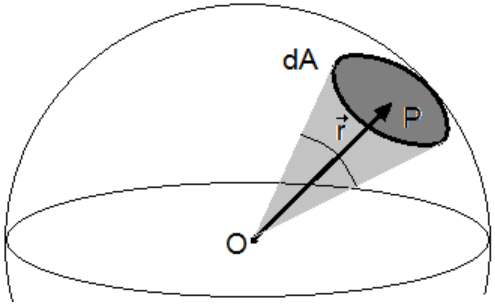
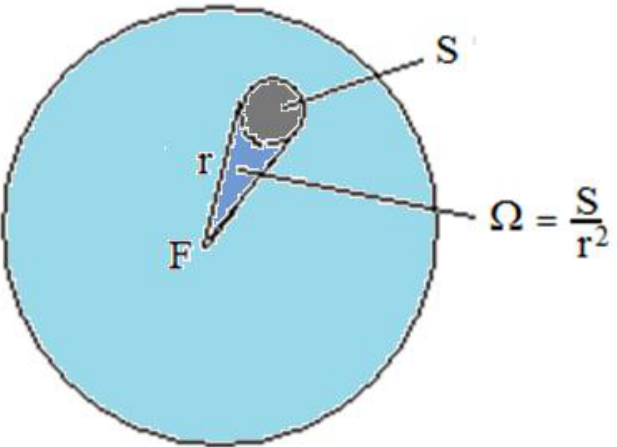

# Fotometría: intensidad luminosa y ángulo sólido

Unidad Temática XI — Fotometría

Lámpara incandescente de 100 W. → Flujo luminoso de 1380 lm

Lámpara fluorescente compacta de 20 W con balasto electrónico → Flujo luminoso
de 1200 lm

## INTENSIDAD LUMINOSA

El flujo luminoso caracteriza la cantidad total de luz emitida por una fuente
luminosa en todas direcciones. La intensidad luminosa I es el flujo luminoso
emitido por unidad de ángulo solido en una dirección determinada. La unidad de
intensidad luminosa es la candela (cd).

Ángulo sólido: consideremos una superficie esférica S de centro O. Si desde O se
traza un pequeño cono que interseca a la superficie S en un área infinitesimal
$`|dA|=dA`$, de centro P. Ese cono define el ángulo sólido ($`d\Omega`$)
subtendido por la superficie dA en el punto P como el cociente entre el área dA
proyectada sobre el plano perpendicular al radiovector r y $`r^2`$.



```math
d\Omega=\frac{\breve r\cdot d\vec A}{r^2}=\frac{dA}{r^2}\cos(\theta)
```

Consideremos una fuente luminosa puntual ( aquella cuya dimensiones son
despreciables respecto a las distancias que las separan de los objetos que
ilumina) y, además, un ángulo sólido Ω en una dirección cualquiera.



```math
\Omega=\frac S{r^2}
```

Entonces: La Intensidad luminosa de una fuente puntual se define como el flujo
luminoso por unidad de ángulo sólido.

```math
I=\frac{\phi_{lum}}\Omega
```

Intensidad luminosa

En el Sistema Internacional de unidades (SI) la unidad de medida de la
Intensidad luminosa es la candela (cd). Es una unidad fundamental.

```math
[I]=\mathrm{cd}=\frac{[\phi_{lum}]}{[\Omega]}=\frac{\mathrm{lm}}{\mathrm{sr}}\Rightarrow1\,\mathrm{lm}=1\,\mathrm{cd}\cdot\mathrm{sr}
```

sr (estereorradián) (unidad de ángulo sólido).

Una fuente que emite 400 lm, iluminando por igual todas las direcciones tendría
una intensidad luminosa de:

```math
I=\frac{\phi_{lum}}\Omega=\frac{400\,\mathrm{lm}}{4\pi\,\mathrm{sr}}=33\,\mathrm{cd}
```

## Procedencia y observaciones de transcripción

- Original: `2019/3er Parcial/2018 UT XI - Fotometria.pdf`, páginas 20, 21, 22,
  23 de 32. El nombre indica 2018 y la carpeta 2019; no consta fecha de clase
  impresa en estas páginas.
- Duplicado binario: `2019/3er Parcial/2019 UT XI - Fotometria..pdf`; se
  conserva una única transcripción de ambos originales.
- SHA-256 de ambos:
  `b8cd5a2b645f5d301f347d8191d41cd87469e75a7595a0388a7d8ef460d669b2`.
- Herramientas: preflight y extracción PyMuPDF4LLM, Poppler, inspección y
  recortes PyMuPDF. Todas las páginas, expresiones, tablas y figuras del tramo
  cotejadas visualmente.
- Se conserva el signo breve sobre r del numerador de la página21 y el
  resultado33cd del ejemplo de400lm, sin corregir el valor numérico original.
