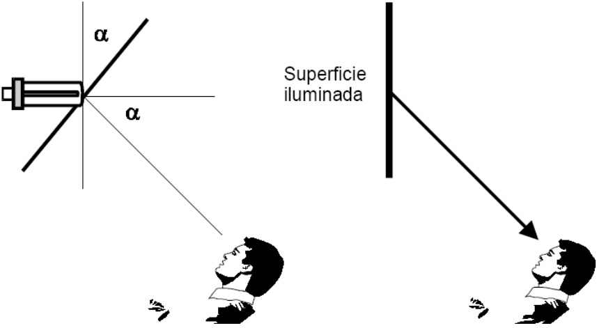
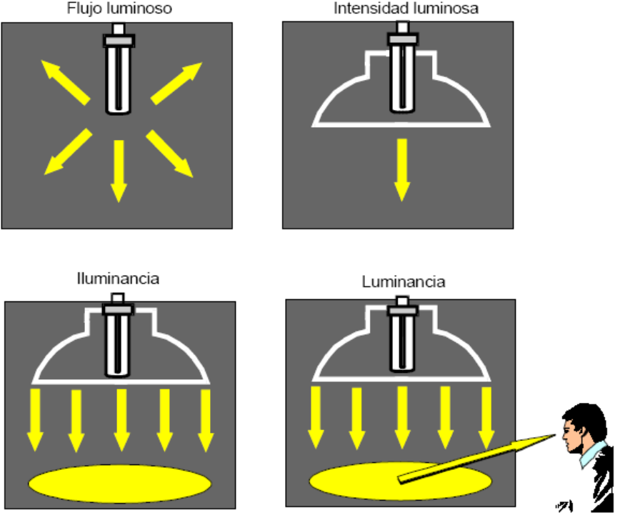
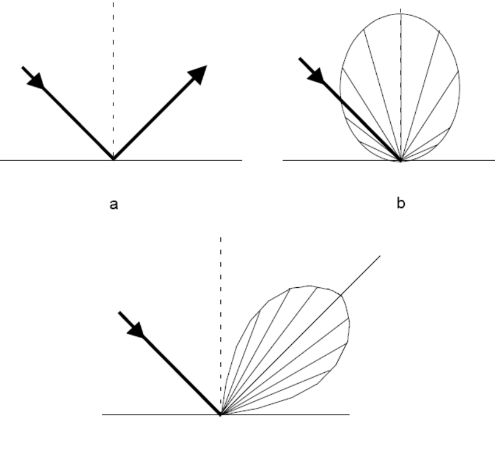

# Fotometría: luminancia y ley de Lambert

Unidad Temática XI — Fotometría

## LUMINANCIA (L)

La luminancia de una fuente o superficie se define como la intensidad luminosa
emitida por la fuente o superficie, en la dirección de un observador, dividida
por el área de la fuente o la superficie vista por el observador (área
proyectada). La unidad de luminancia es la candela por metro cuadrado [cd/m2].



Luminancia en la dirección del observador

```math
L_\alpha=\frac{I_\alpha}{A\cos(\alpha)}
```

Figuras que ilustran las diferentes magnitudes fotométricas



Si la superficie es un difusor perfecto la luminancia es independiente de la
dirección de observación. Si I0 es la intensidad según la normal e $`I_\alpha`$
la intensidad en la dirección de observación, tenemos

```math
I_\alpha=I_0\cos(\alpha)
```

Ley de Lambert

Emisor perfecto

Difusor perfecto

→

I varia con el coseno del ángulo entre la normal y la dirección de emisión



a) reflector especular

b) Reflector difuso

c) Reflector en parte especular y en parte difusor

## Procedencia y observaciones de transcripción

- Original: `2019/3er Parcial/2018 UT XI - Fotometria.pdf`, páginas 28, 29, 30,
  31 de 32. El nombre indica 2018 y la carpeta 2019; no consta fecha de clase
  impresa en estas páginas.
- Duplicado binario: `2019/3er Parcial/2019 UT XI - Fotometria..pdf`; se
  conserva una única transcripción de ambos originales.
- SHA-256 de ambos:
  `b8cd5a2b645f5d301f347d8191d41cd87469e75a7595a0388a7d8ef460d669b2`.
- Herramientas: preflight y extracción PyMuPDF4LLM, Poppler, inspección y
  recortes PyMuPDF. Todas las páginas, expresiones, tablas y figuras del tramo
  cotejadas visualmente.
- Se conserva la redacción y la notación originales sin añadir desarrollos.
