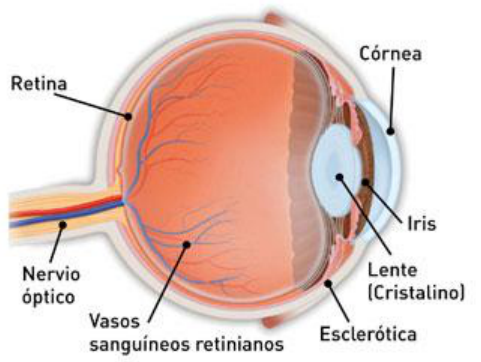
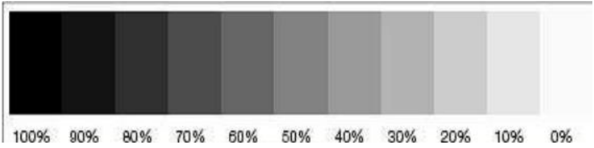
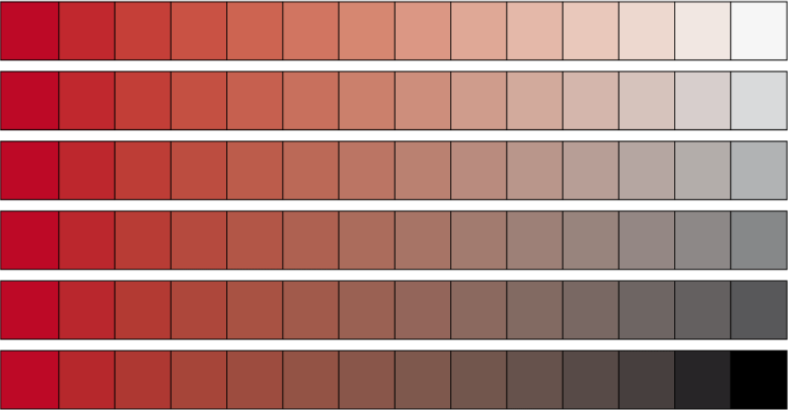

# Fotometría: luz, color y percepción

Unidad Temática XI — Fotometría

## ¿Qué es la luz?

La definición de la luz, dada por la OSA (Optical Society of America) se expresa
en los siguientes términos: "La luz es aquel aspecto de la energía radiante que
un observador humano percibe a través de las sensaciones visuales producidas por
el estímulo de la retina del ojo".

## Fotometría (óptica)

La Fotometría es la ciencia que se encarga de la medida de la luz como el brillo
percibido por el ojo humano.

Es decir, estudia la capacidad que tiene la radiación electromagnética de
estimular el sistema visual. En esta unidad temática estudiaremos algunos
parámetros o características de la luz como forma de energía tales como: flujo
luminoso, intensidad luminosa, iluminancia, luminancia y el rendimiento
luminoso. Se analizará también la forma de medir algunos de estos parámetros y
las unidades de medida en que se expresan.

La luz, al igual que las ondas de radio, los rayos X o los gamma es una forma de
energía. Si la energía se mide en joules (J) en el Sistema Internacional, para
qué necesitamos nuevas unidades. Las razones son: No toda la luz emitida por una
fuente llega al ojo y produce sensación luminosa, ni toda la energía que
consume, por ejemplo, una bombilla se convierte en luz, y además la misma
cantidad de energía luminosa produce respuestas diferentes según su longitud de
onda.

Algunas definiciones importantes:

MATIZ: Es aquella característica que permite clasificar un color como rojo,
verde, azul, amarillo.. Etc

SATURACIÓN: describe el grado en el cual un color se separa del gris neutro y se
aproxima a un color puro del espectro

Matiz y Saturación definen la cromaticidad.

BRILLO: es la característica de cualquier sensación de color que permite
clasificarla como equivalente a la sensación producida por algún elemento de la
escala de grises neutro

## Procedencia y observaciones de transcripción

- Original: `2019/3er Parcial/2018 UT XI - Fotometria.pdf`, páginas 6, 7, 8, 9,
  10 de 32. El nombre indica 2018 y la carpeta 2019; no consta fecha de clase
  impresa en estas páginas.
- Duplicado binario: `2019/3er Parcial/2019 UT XI - Fotometria..pdf`; se
  conserva una única transcripción de ambos originales.
- SHA-256 de ambos:
  `b8cd5a2b645f5d301f347d8191d41cd87469e75a7595a0388a7d8ef460d669b2`.
- Herramientas: preflight y extracción PyMuPDF4LLM, Poppler, inspección y
  recortes PyMuPDF. Todas las páginas, expresiones, tablas y figuras del tramo
  cotejadas visualmente.
- La definición atribuida a OSA se conserva como cita del apunte, sin actualizar
  su atribución. La página 10 contiene solo las escalas de color.
