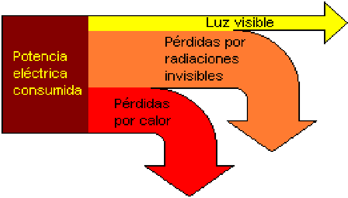

# Fotometría: rendimiento luminoso

Unidad Temática XI — Fotometría

La magnitud definida como la razón entre el flujo luminoso y el flujo radiante
se denomina Rendimiento luminoso η:



```math
\eta=\frac{\phi_{lum}}{\phi_{rad-total}}
```

El efecto visual de la radiación depende de la longitud de onda y del nivel de
iluminación. Las magnitudes fotométricas se obtienen a partir de factores de
peso que corresponden a la sensibilidad espectral relativa del sistema visual
humano basada en la diferente percepción de claridad para diferentes λ de la
región visible.

## Procedencia y observaciones de transcripción

- Original: `2019/3er Parcial/2018 UT XI - Fotometria.pdf`, páginas 15 de 32. El
  nombre indica 2018 y la carpeta 2019; no consta fecha de clase impresa en
  estas páginas.
- Duplicado binario: `2019/3er Parcial/2019 UT XI - Fotometria..pdf`; se
  conserva una única transcripción de ambos originales.
- SHA-256 de ambos:
  `b8cd5a2b645f5d301f347d8191d41cd87469e75a7595a0388a7d8ef460d669b2`.
- Herramientas: preflight y extracción PyMuPDF4LLM, Poppler, inspección y
  recortes PyMuPDF. Todas las páginas, expresiones, tablas y figuras del tramo
  cotejadas visualmente.
- Se conserva la redacción y la notación originales sin añadir desarrollos.
