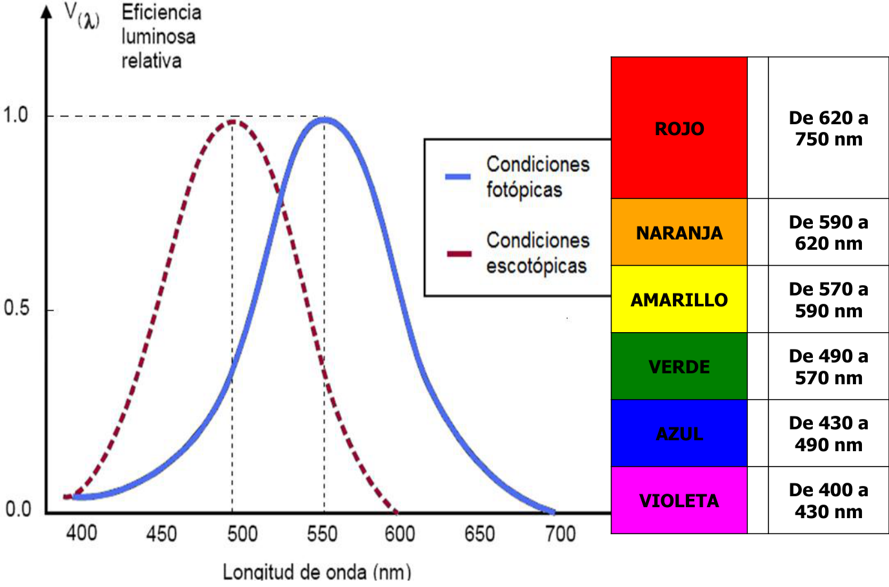
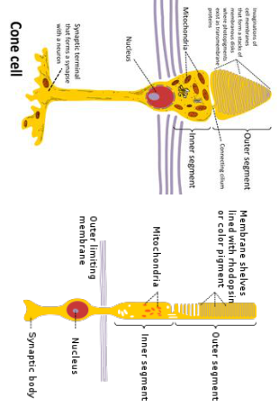
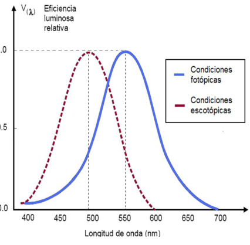

# Fotometría: sensibilidad espectral del ojo

Unidad Temática XI — Fotometría

La curva de sensibilidad espectral relativa del ojo humano o curva de
visibilidad V(λ) expresa cuantitativamente cómo, a iguales flujos de energía de
la radiación electromagnética con diferentes longitudes de onda (en el rango
visible del espectro), la intensidad de la luz percibida por el ojo humano es
diferente, es decir, su respuesta espectral no es plana sino curva. Esa
respuesta se caracteriza por la magnitud V(λ), denominada eficiencia luminosa
(adimensional, medida entre 0 y 1). La curva V(λ), definida como estándar por la
CIE (Comission Internationale de l´Éclairage - Comisión Internacional de
Iluminación), tiene el mismo aspecto (forma) en condiciones de luz de día
(visión fotópica) y nocturna (visión escotópica) aunque la longitud de onda a la
que se produce la mayor sensibilidad del ojo humano se desplaza de
$`\lambda=555\,\mathrm{nm}`$ (visión de día) a
$`\lambda=505\text{-}510\,\mathrm{nm}`$ (visión nocturna).



La tabla de colores que acompaña la curva reitera los intervalos siguientes:

| Color | Longitud de onda |
| -- | -- |
| ROJO | De 620 a 750 nm |
| NARANJA | De 590 a 620 nm |
| AMARILLO | De 570 a 590 nm |
| VERDE | De 490 a 570 nm |
| AZUL | De 430 a 490 nm |
| VIOLETA | De 400 a 430 nm |

Nivel de Iluminación alto → V(λ) para condiciones fotópicas (conos)

Nivel de Iluminación bajo → V(λ) para condiciones escotópicas (bastones)



En condiciones fotópicas el ojo tiene máxima sensibilidad para 555 nm, y en
condiciones escotópicas el máximo esta en 507 nm.

El flujo luminoso se expresa mediante la ecuación:

```math
\phi_{lum}=K\int_{380}^{760}\phi_{rad}V(\lambda)\,d\lambda
```

El flujo luminoso se expresa en lumen (lm) y el flujo radiante en wats (W).

K: Equivalente mecánico de la luz.

En condiciones fotópicas

```math
K=683\,\mathrm{lm/W}
```

En condiciones escotópicas

```math
K=1699\,\mathrm{lm/W}
```



Si consideramos luz monocromática:

```math
\phi_{lum}(\lambda)=K\phi_{rad}(\lambda)V(\lambda)
```

Si $`\lambda=555\,\mathrm{nm}`$ es $`V(555\,\mathrm{nm})=1`$ y a un flujo
radiante de 1 W le corresponde un flujo luminoso de 683 lm. Con ayuda de la
curva de Sensibilidad Espectral Relativa V(λ) puede determinarse la equivalencia
entre el W (wats) y el lumen (lm) para cada longitud de onda dada. Para 600 nm
la sensibilidad es 0,6. Luego:

```math
1\,\mathrm W\ \Leftrightarrow\ 0{,}6*683\,\mathrm{lm}=409{,}8\,\mathrm{lm}
```

## Procedencia y observaciones de transcripción

- Original: `2019/3er Parcial/2018 UT XI - Fotometria.pdf`, páginas 16, 17, 18,
  19 de 32. El nombre indica 2018 y la carpeta 2019; no consta fecha de clase
  impresa en estas páginas.
- Duplicado binario: `2019/3er Parcial/2019 UT XI - Fotometria..pdf`; se
  conserva una única transcripción de ambos originales.
- SHA-256 de ambos:
  `b8cd5a2b645f5d301f347d8191d41cd87469e75a7595a0388a7d8ef460d669b2`.
- Herramientas: preflight y extracción PyMuPDF4LLM, Poppler, inspección y
  recortes PyMuPDF. Todas las páginas, expresiones, tablas y figuras del tramo
  cotejadas visualmente.
- Se conserva K=1699 lm/W, los intervalos y máximos dados por la fuente y el
  ejemplo de600nm. Las figuras y rótulos mantienen su idioma y orientación
  originales; la figura de la página18 llega al borde superior de la
  diapositiva.
