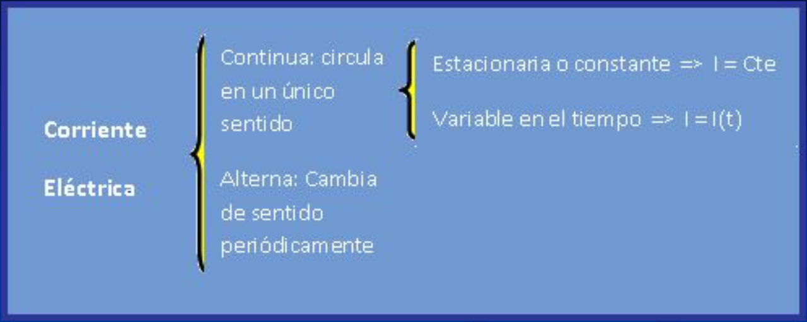
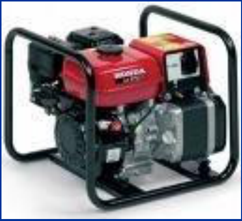
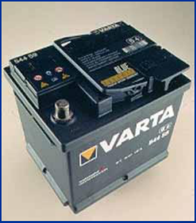
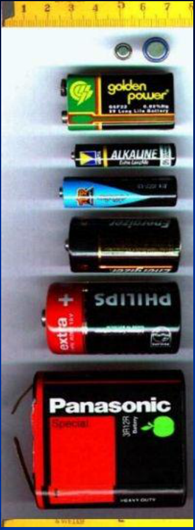
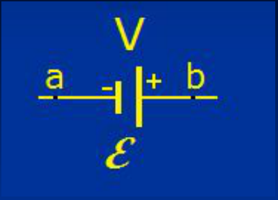
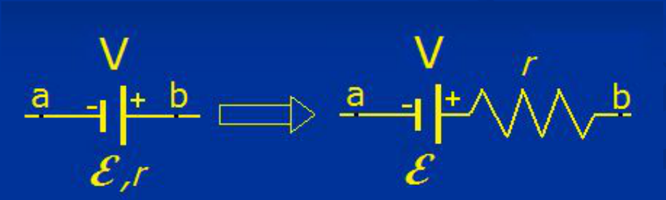
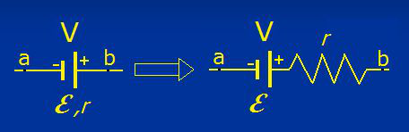
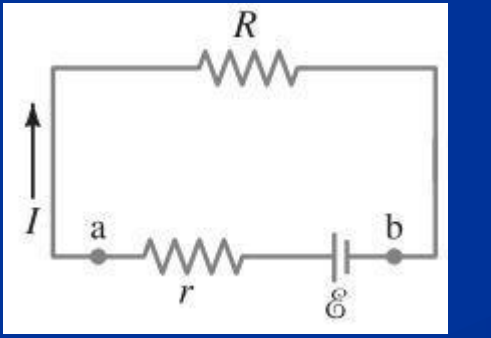

# Energía y corriente en circuitos de corriente continua



Corriente Eléctrica:

- Continua: circula en un único sentido
  - Estacionaria o constante ⇒ I = Cte
  - Variable en el tiempo ⇒ I = I(t)
- Alterna: Cambia de sentido periódicamente

Existen dispositivos que son capaces de mantener constante la diferencia de
potencial entre dos puntos de un circuito al que están conectados, tales como
**baterías, pilas y generadores eléctricos**. Reciben el nombre de **fuentes de
fuerza electromotriz ε (fem)**. La unidad de ε es el volt. También se utiliza V
para representar la fem.

## FUENTES DE FEM

**Pilas o baterías.** Son las fuentes de FEM más conocidas. Generan energía
eléctrica por medios químicos. Las más comunes son las de carbón-zinc y las
alcalinas. No admiten recarga. Las de níquel-cadmio (NiCd), de níquel e hidruro
metálico (Ni-MH) y de ión de litio (Li-ion) son recargables.

En los automóviles se utilizan baterías de plomo-ácido, que emplean como
electrodos placas de plomo y como electrolito ácido sulfúrico mezclado con agua
destilada.

**Máquinas electromagnéticas.** Generan energía eléctrica utilizando medios
magnéticos y mecánicos. Ej: dinamos y generadores pequeños utilizados en
vehículos automotores, plantas eléctricas portátiles, así como los de gran
tamaño empleados en las centrales hidráulicas, térmicas y atómicas, que
suministran energía eléctrica a industrias y ciudades.

Los generadores, baterías, pilas, etc. entregan a las cargas la cantidad de
energía necesaria para movilizarlas. Esa energía entregada por unidad de carga
que recorre el circuito se denomina fuerza electromotriz. F.e.m

Generador



Batería



Pilas





⇐ símbolo de fem

```math
V_a\lt V_b
```

Borne negativo: cátodo

Borne positivo: ánodo

Fem con resistencia interna r



Circuito equivalente

La diferencia de potencial entre los puntos a y b del circuito es

```math
Vab=\varepsilon-ir
```



Podemos medir la fem conectando un voltímetro en paralelo. La lectura del
voltímetro nos da la fem, dado que la elevada resistencia interna del mismo hace
que la corriente sea prácticamente nula y el termino i r despreciable.

Cuando el sentido de la corriente que circula por el circuito coincide con el de
la corriente que proporciona naturalmente la batería, decimos que la misma esta
descargándose a través del circuito. En el caso contrario decimos que la batería
esta cargándose.

## Problema

Un resistor de 65.0 ohm se conecta a las terminales de una batería cuya fem es
de 12.0 V y cuya resistencia interna es de 0.5 ohm Calcule a) la corriente en el
circuito, b) el voltaje terminal de la batería, V ab , y c) la potencia disipada
en el resistor R y en la resistencia interna r de la batería



### Desarrollo incluido en el original

```math
V_{ab}=\mathcal E-Ir.
```

Se aplica la ley de Ohm (ecuaciones 25-2) a esta batería y la resistencia R del
circuito:

```math
V_{ab}=IR.
```

Por lo tanto,

```math
IR=\mathcal E-Ir\quad\mathrm o\quad\mathcal E=I(R+r),
```

y de este modo

```math
I=\frac{\mathcal E}{R+r}=\frac{12.0\,\mathrm V}{65.0\,\Omega+0.5\,\Omega}=\frac{12.0\,\mathrm V}{65.5\,\Omega}=0.183\,\mathrm A.
```

b) El voltaje terminal es

```math
V_{ab}=\mathcal E-Ir=12.0\,\mathrm V-(0.183\,\mathrm A)(0.5\,\Omega)=11.9\,\mathrm V.
```

c) La potencia disipada (ecuación 25-7) por R es

```math
P_R=I^2R=(0.183\,\mathrm A)^2(65.0\,\Omega)=2.18\,\mathrm W,
```

y por r es

```math
P_r=I^2r=(0.183\,\mathrm A)^2(0.5\,\Omega)=0.02\,\mathrm W.
```

Qué pasa si “puenteo” con un alambre los bornes de la batería de este problema?
Que pasa con la potencia disipada en la batería?

## Procedencia y observaciones de transcripción

- Original: `2019/1er Parcial/2017 UT IV - Electrocinética.ppt.pdf`, páginas 35,
  36, 37, 38, 39, 40, 41 de 55.
- SHA-256: `5593bcdeb59339b25f4dfee074beac1812300dcec491fb423777a4e776ba1399`.
- El nombre del archivo indica 2017; se conserva bajo 2019 por su ubicación
  canónica. No consta autor en estas páginas.
- Herramientas: PyMuPDF4LLM, PyMuPDF y Poppler; cotejo visual de texto,
  fórmulas, tablas y diagramas. Figuras originales conservadas por recorte y
  render.
- La página 39 imprime Vab en la misma línea de base, sin subíndice. Se
  mantienen las denominaciones cátodo/ánodo, los redondeos del desarrollo y las
  referencias a ecuaciones de otro texto. El desarrollo proviene de la imagen de
  la página 41; las preguntas finales se conservan sin agregar respuestas.
