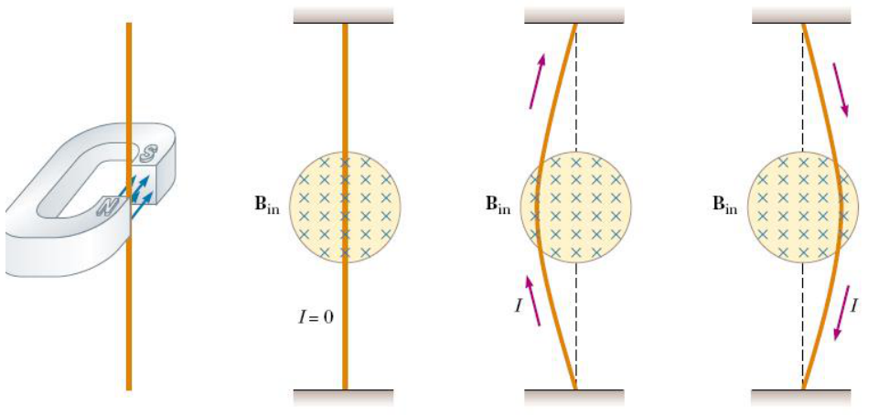
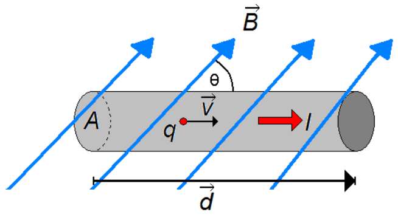
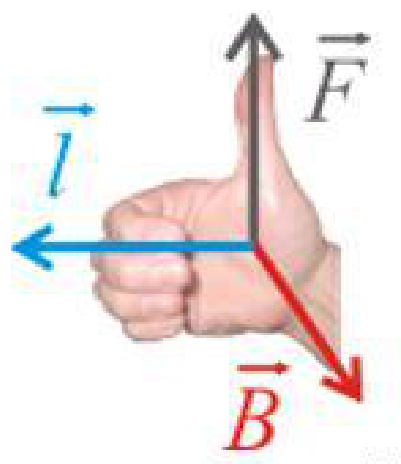
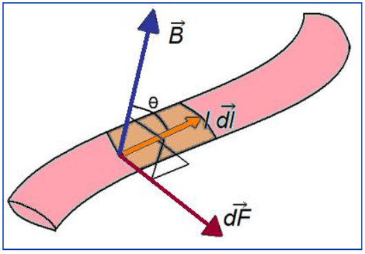
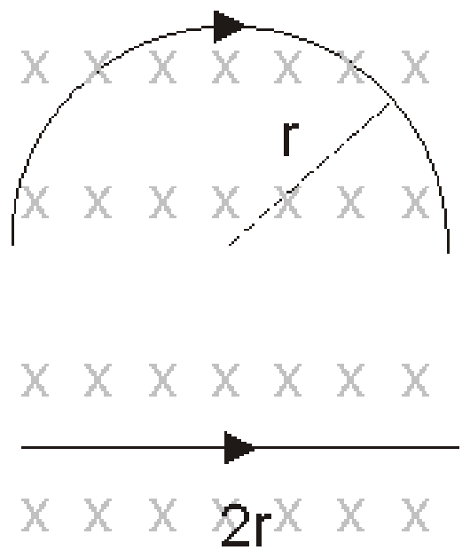

# Fuerza sobre conductores y elementos de corriente

Unidad Temática V — Fuerzas Magnéticas sobre cargas y elementos de corriente

## Fuerza sobre un conductor con corriente



I → conjunto de portadores de carga en movimiento



```math
N=nAd\qquad Q=Nq=nAdq
```

```math
\overrightarrow{Fm}=Q(\vec v\times\vec B)
```

```math
\overrightarrow{Fm}=nAdq(\vec v_d\times\vec B)
```

```math
d\vec v_d=v_d\vec d\Rightarrow\overrightarrow{Fm}=nAv_dq\vec d\times\vec B\Rightarrow\overrightarrow{Fm}=I\vec d\times\vec B
```

```math
\vec F=I\vec l\times\vec B
```



Si Idl es un elemento infinitesimal de corriente



```math
I\vec d\to I\overrightarrow{dl}
```

```math
\overrightarrow{Fm}\to d\overrightarrow{Fm}=I\overrightarrow{dl}\times\vec B\Rightarrow\overrightarrow{Fm}=\int I\overrightarrow{dl}\times\vec B
```

El módulo de Fm es:

```math
Fm=\int IB\mathop{\mathrm{sen}}\nolimits(\theta)\,dl
```

## Sobre cuál la fuerza magnética será mayor?



## Procedencia y observaciones de transcripción

- Original:
  `2019/2do Parcial/2019 UT V - Fuerzas Magnéticas sobre cargas y elementos de corriente.pdf`,
  páginas 27–31 de 42.
- SHA-256: `383fdb6f46e1627fbe65cf259b89a480bd4b4cc61821cbfc466fa3e4a63ceb29`.
  2019 corresponde al nombre del archivo; no consta fecha impresa en estas
  páginas.
- Herramientas: PyMuPDF4LLM, Poppler y recortes PyMuPDF; cotejo visual de todas
  las páginas, expresiones y figuras del tramo. Se conserva el contenido del
  original, sin resolver ejercicios vacíos.
- Se mantienen las letras d y l usadas por el original. La pregunta de página 31
  no tiene respuesta escrita: se conserva vacía.
