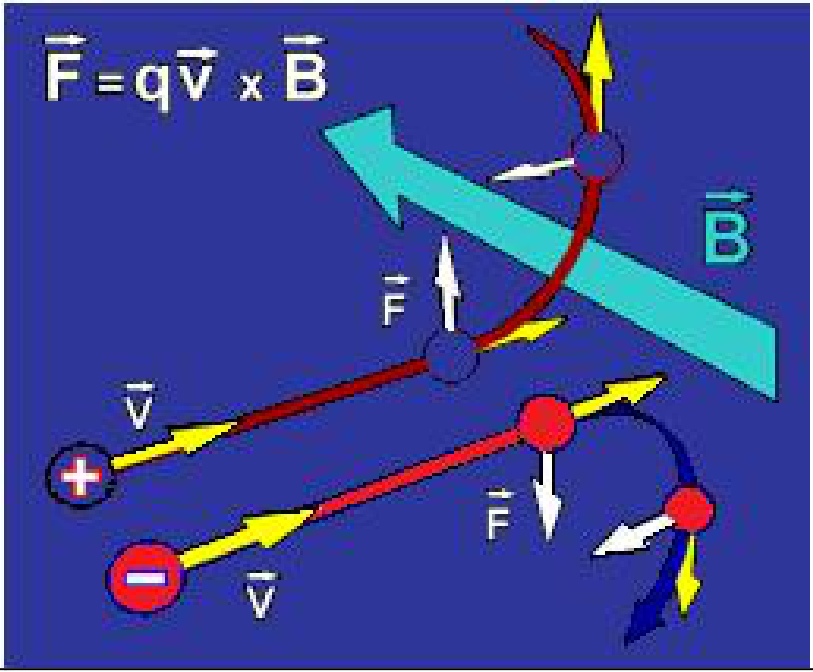
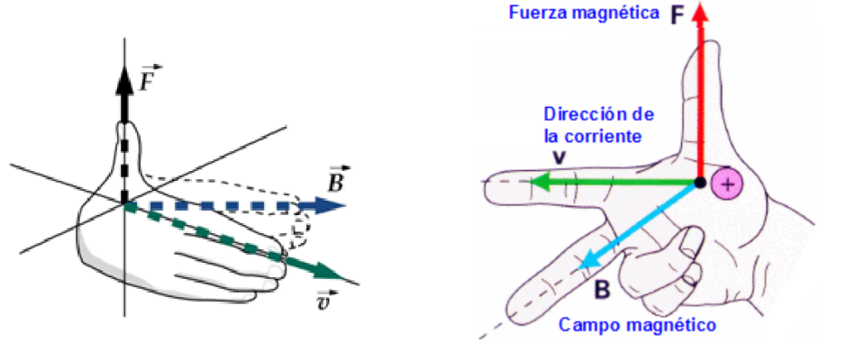
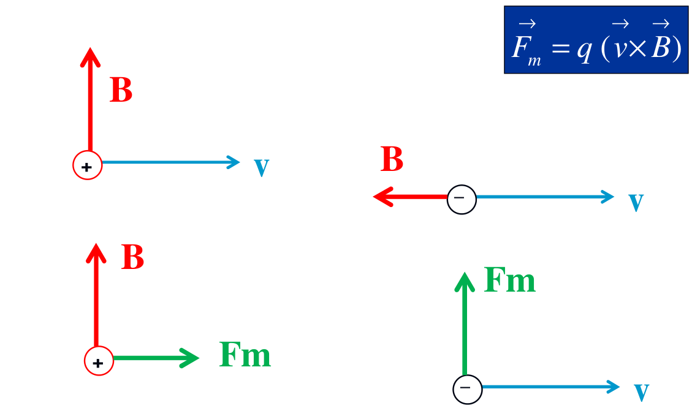

# Fuerza magnética sobre una carga y unidades — variante impresa

Unidad Temática V — Fuerzas Magnéticas sobre cargas y elementos de corriente

## Conclusiones

Fuerza magnética

```math
F_m=qvB\mathop{\mathrm{sen}}\nolimits(q)\Rightarrow\vec F_m=q(\vec v\times\vec B)
```



Por ser la fuerza magnética perpendicular a v, y por tanto al desplazamiento, la
misma no realiza trabajo sobre la carga.

```math
B=\frac{F_m}{qv\mathop{\mathrm{sen}}\nolimits(q)}
```

Unidad en el S.I.

```math
[B]=\frac{[F]}{[Q][v]}=\frac{N}{C(m/s)}=T=\mathrm{Tesla}
```

Otra unidad

```math
1G=10^{-4}\mathrm{Tesla}
```

## Regla de la mano derecha

```math
\vec F_m=q(\vec v\times\vec B)
```



Si la partícula tiene carga negativa se usa la regla de la mano izquierda (con
el mismo convenio para los vectores)

```math
\vec F_m=q(\vec v\times\vec B)
```



## Procedencia y diferencias de esta versión

- Original: `2019/2do Parcial/UT 5 4 pag.pdf`, página 4 de 11: diapositivas
  13–16. SHA-256:
  `134d9de661dcefd039d315a0e669b89c38bf02859d1d2d0806f15569b5006764`.
- El año corresponde a la carpeta; no consta fecha impresa en este tramo.
- Transcripción de las cuatro diapositivas completas, contrastada con OCR
  español sobre una copia, Poppler y los recortes del original rasterizado. Las
  tres figuras se cotejaron con las conservadas de la versión individual; se
  reutilizan esos medios, sin redibujar vectores ni añadir respuestas.
- Esta impresión usa la letra q en el argumento de sen tanto en la fuerza
  magnética como en la expresión de B. Se conserva q, distinta de la carga q del
  mismo producto; no se sustituye por theta.
- El caso inferior izquierdo de la última figura ya contiene una flecha Fm hacia
  la derecha y el inferior derecho una flecha Fm hacia arriba.
- La diapositiva 12 pertenece a la página anterior y está transcrita en
  [la versión individual](fuerza-magnetica-carga-unidades-regla-mano-2019.md).
  Esta nota comienza con «Conclusiones», como la diapositiva 13.
