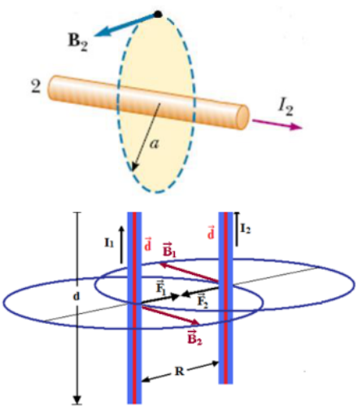

# Fuerzas entre corrientes y definición de ampere del material

Unidad temática VI — Campo de Inducción Magnética. Propiedades.

Fecha impresa: 08/05/2019.

## Fuerzas entre corrientes



```math
\vec F=I\vec l\times\vec B\qquad B=\frac{\mu_0I}{2\pi a}
```

```math
F_1=I_1dB_2\qquad F_2=I_2dB_1
```

```math
F_1=\frac{\mu_0I_1I_2}{2\pi R}d\qquad F_2=\frac{\mu_0I_1I_2}{2\pi R}d
```

```math
B_1=\frac{\mu_0I_1}{2\pi R}\qquad B_2=\frac{\mu_0I_2}{2\pi R}
```

## La definición de ampere internacional

El hecho de que las fuerzas se puedan medir con facilidad y precisión permite
definir el ampere como unidad fundamental recurriendo a experiencias
electromagnéticas, en las cuales la fuerza magnética varía con la intensidad de
corriente según una ley conocida. Tal es el caso de la interacción magnética
entre corrientes paralelas.

Considerando como medio el vacío con $`\mu=4\pi\,10^{-7}`$ y la distancia entre
los hilos conductores de 1 m, la expresión de la fuerza magnética entre ellos
esta dada por:

```math
\frac Fl=\frac{4\pi\,10^{-7}}{2\pi a}I^2
```

Haciendo en la anterior ecuación I = 1 A y d = 1 m, resulta una fuerza
$`F/l=2\cdot10^{-7}`$ N/m, lo cual permite definir el ampere como:

“Ampere: intensidad de corriente que circulando por dos conductores rectilíneos
de longitud infinita, sección circular y paralelos, separados entre sí un metro
en el vacío, producirá una fuerza magnética entre ellos de 2 · 10⁻⁷ N por cada
metro de longitud de cada uno de los dos hilos.”

## Procedencia y observaciones de transcripción

- Original:
  `2019/2do Parcial/2019 UT VI - Campo de Inducción Magnética. Propiedades.pdf`,
  páginas PDF 11–12 de 16, diapositivas 21–23 de 31.
- SHA-256: `b9bb8ec5e8acfa36814e15207ee532a00e566ff5ea72bd139eff27ae0b2d634f`.
- Herramientas: PyMuPDF4LLM, Poppler y recortes PyMuPDF; cotejo visual de todas
  las páginas y expresiones de este tramo. Se conservan figuras, etiquetas y
  erratas del original.
- La página 12 se comparte con el apunte de flujo. La definición del ampere se
  transcribe como aparece en estas diapositivas fechadas 08/05/2019; no se
  sustituye por otra definición. Se conservan las letras a, R y d del original.
