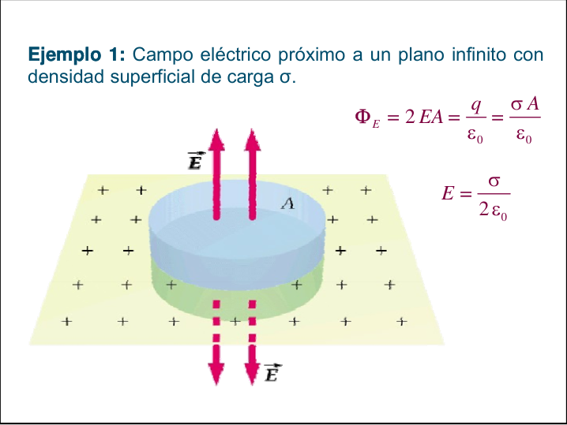
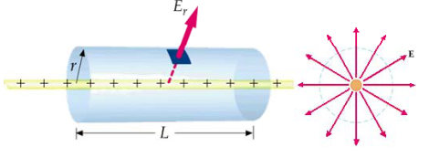
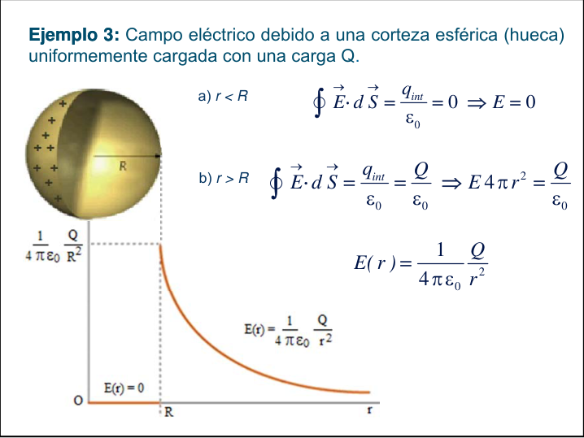
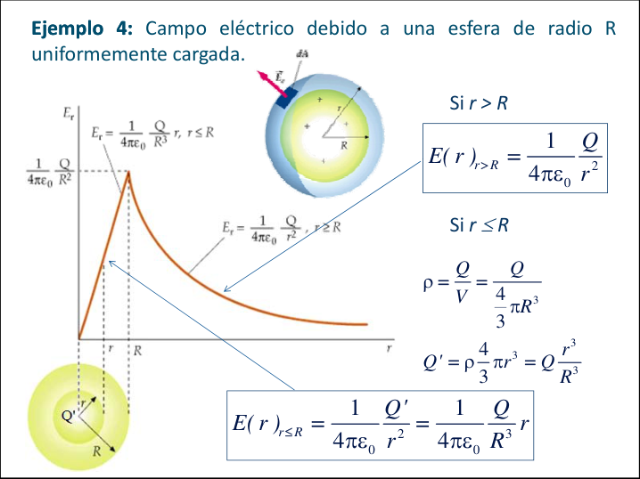
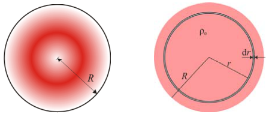

# Aplicaciones de la ley de Gauss

## Ejemplo 1

Campo eléctrico próximo a un plano infinito con densidad superficial de carga σ.



```math
\Phi_E=2EA=\frac q{\varepsilon_0}=\frac{\sigma A}{\varepsilon_0}
```

```math
E=\frac\sigma{2\varepsilon_0}
```

## Ejemplo 2

Campo eléctrico a una distancia r de una carga lineal infinitamente larga de
densidad de carga uniforme λ.



En las tapas E⊥dS, y el flujo es nulo. En la superficie lateral el módulo de E
es constante:

```math
\oint\vec E\cdot\overrightarrow{dS}=\iint_{S\ lateral}\vec E\cdot\overrightarrow{dS}=E\iint_{S\ lateral}dS=E\cdot2\pi rL
```

```math
\oint\vec E\cdot\overrightarrow{dS}=\frac{\sum q}{\varepsilon_0}=\frac{\lambda L}{\varepsilon_0}=E\,2\pi rL\Rightarrow E=\frac1{2\pi\varepsilon_0}\frac\lambda r
```

```math
E_y=2k\frac\lambda y
```

## Ejemplo 3

Campo eléctrico debido a una corteza esférica (hueca) uniformemente cargada con
una carga Q.



a) r < R

```math
\oint\vec E\cdot\overrightarrow{dS}=\frac{q_{int}}{\varepsilon_0}=0\Rightarrow E=0
```

b) r > R

```math
\oint\vec E\cdot\overrightarrow{dS}=\frac{q_{int}}{\varepsilon_0}=\frac Q{\varepsilon_0}\Rightarrow E\,4\pi r^2=\frac Q{\varepsilon_0}
```

```math
E(r)=\frac1{4\pi\varepsilon_0}\frac Q{r^2}
```

## Ejemplo 4

Campo eléctrico debido a una esfera de radio R uniformemente cargada.



Si r > R

```math
E(r)_{r\gt R}=\frac1{4\pi\varepsilon_0}\frac Q{r^2}
```

Si r ≤ R

```math
\rho=\frac Q V=\frac Q{\dfrac43\pi R^3}
```

```math
Q'=\rho\frac43\pi r^3=Q\frac{r^3}{R^3}
```

```math
E(r)_{r\le R}=\frac1{4\pi\varepsilon_0}\frac{Q'}{r^2}=\frac1{4\pi\varepsilon_0}\frac Q{R^3}r
```

Y si la densidad volumétrica de carga no es uniforme?



## Procedencia y observaciones de transcripción

- Original:
  `2019/1er Parcial/2018 UT I - Fuerza Eléctrica y Campo Elécrtico.pdf`, páginas
  39, 40, 41 de 42.
- SHA-256: `326bb078ddbf25b43f166e198c175106027b686dde0d0ea9688c025795f46ca7`.
- El nombre del archivo indica 2018; ubicación canónica 2019. No consta autor ni
  fecha completa en estas páginas.
- Herramientas: PyMuPDF4LLM y Poppler para extracción; todas las expresiones y
  figuras cotejadas visualmente. Medios por recorte/render PyMuPDF; la captura
  de fórmulas y la figura oculta de líneas se recuperan desde sus franjas raster
  originales.
- Cubre ambas de 39–40 y superior de 41. Se conserva E_y al final del ejemplo de
  línea, la integral doble en la superficie lateral y la pregunta de densidad
  variable sin inventar una ley de densidad o resolverla. La figura de esfera
  conserva sus expresiones originales, además de su transcripción.
