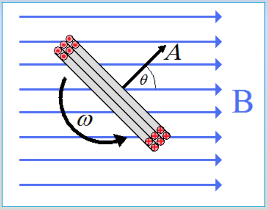
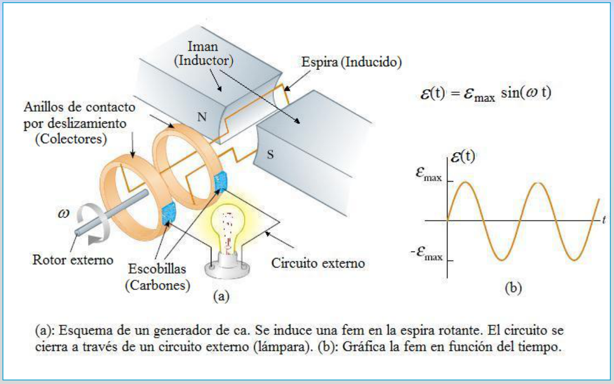
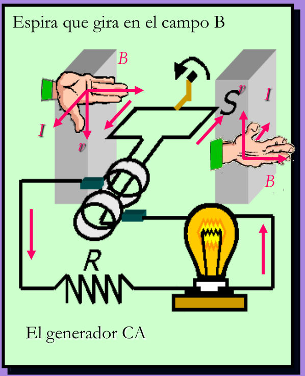
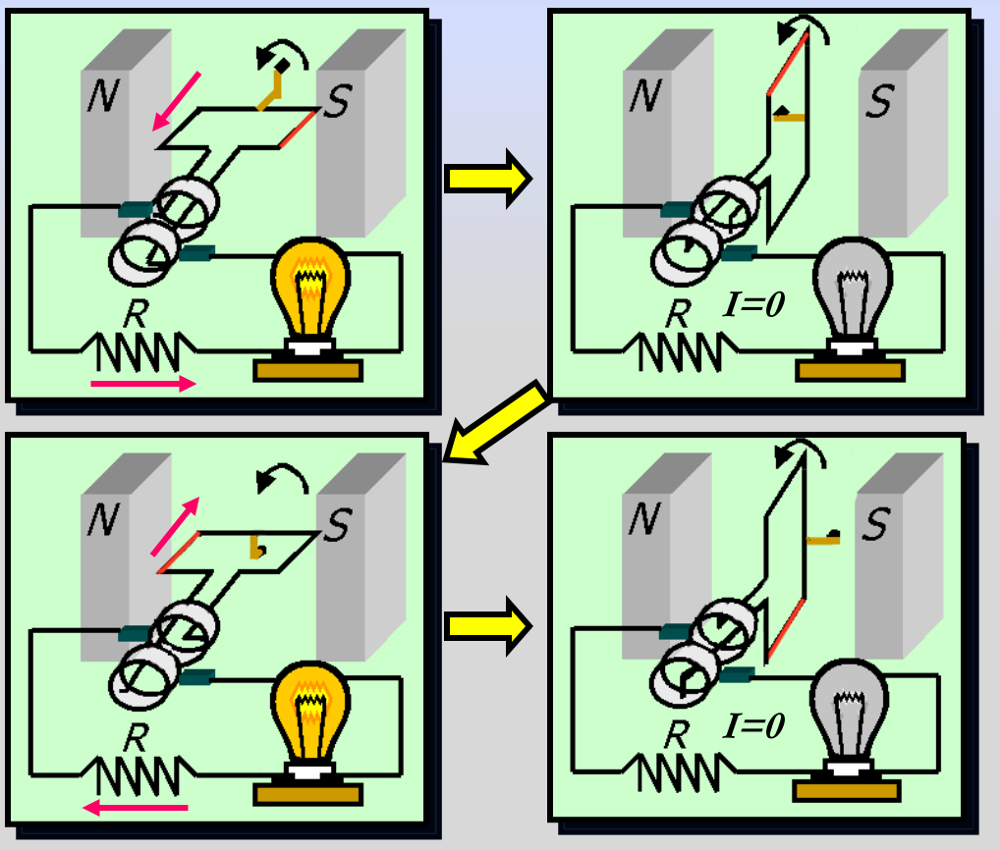
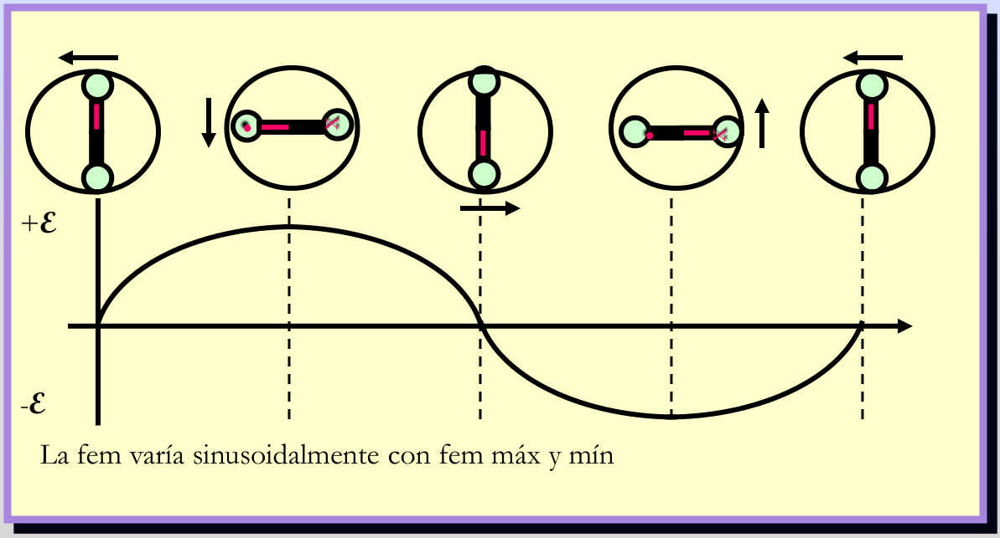

# Generador alterno: cálculo y fases de operación

Unidad Temática VII — Electromagnetismo

Siempre que exista un cambio en el flujo a través de una bobina, se induce una
fem.

```math
\phi_B=\int\vec B.\overrightarrow{dA}=\int B\cos\theta\,dA
```

Vemos que es posible inducir una fem de tres maneras

1. Mediante un campo magnético variable B.
1. Cambiar el área A de la espira en el campo.
1. Cambiar la orientación θ de la espira con respecto al campo.

## Cálculo de FEM inducida



Si tenemos N espiras de área A rotando Con velocidad angular ω constante en un
campo B, el flujo magnético será

```math
\phi_B=\vec B\cdot\vec A=BA\cos(\theta)
```

```math
\omega=\frac{d\theta}{dt}\quad\text{entonces}\Rightarrow\theta=\theta_0+\omega t
```

```math
\phi_B=BA\cos(\omega t)
```

```math
\varepsilon=-N\frac{d\phi_B}{dt}=NBA\omega\sin(\omega t)
```

```math
\varepsilon_{max}=NBA\omega\Rightarrow\varepsilon=\varepsilon_{max}\sin(\omega t)
```

Fem alterna

Ejemplo: Producción de energía eléctrica en una central hidroeléctrica

## Generador de corriente alterna



```math
\varepsilon(t)=\varepsilon_{max}\sin(\omega t)
```

(a): Esquema de un generador de ca. Se induce una fem en la espira rotante. El
circuito se cierra a través de un circuito externo (lámpara). (b): Gráfica la
fem en función del tiempo.

El generador es un dispositivo que convierte la energía mecánica del rotor
externo en energía eléctrica



- Al girar una espira en un campo B constante se produce una corriente alterna
  CA.
- La corriente a la izquierda es hacia afuera, por la regla de la mano derecha.
- El segmento derecho tiene una corriente hacia adentro.
- Cuando la espira está vertical, la corriente es cero.

I en R es derecha, cero, izquierda y luego cero conforme gira la espira.

## Operación de un generador CA



## Fem sinusoidal de generador



La fem varía sinusoidalmente con fem máx y mín

## Procedencia y observaciones de transcripción

- Original: `2019/2do Parcial/2019 UT VII Electromagnetismo.pdf`, páginas 19–24
  de 62. No consta fecha impresa; 2019 corresponde al nombre del archivo.
- SHA-256: `eff3447774cadfcb2726a6caabbe8e257782276fce3e67dda465673d5ef67a6a`.
- Herramientas: PyMuPDF4LLM, Poppler y recortes PyMuPDF; páginas, expresiones,
  diagramas y etiquetas del tramo cotejados visualmente. Se conserva esta
  versión sin añadir explicaciones ajenas al original.
- Se conserva θ₀ en la relación angular y su ausencia en el coseno posterior.
  Las páginas 22–24 agregan explicaciones y diagramas distintos de la
  presentación de 67 páginas; no se sustituyen por imágenes de esa versión.
