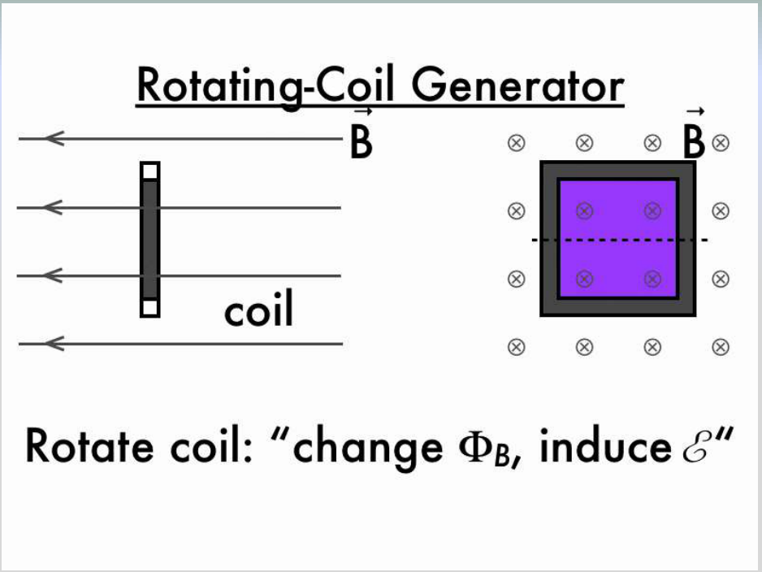
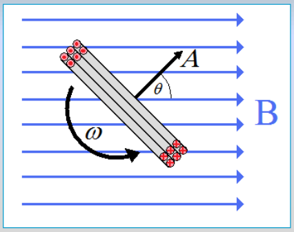
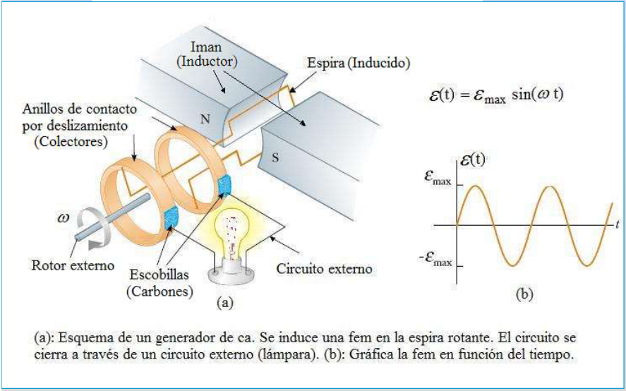
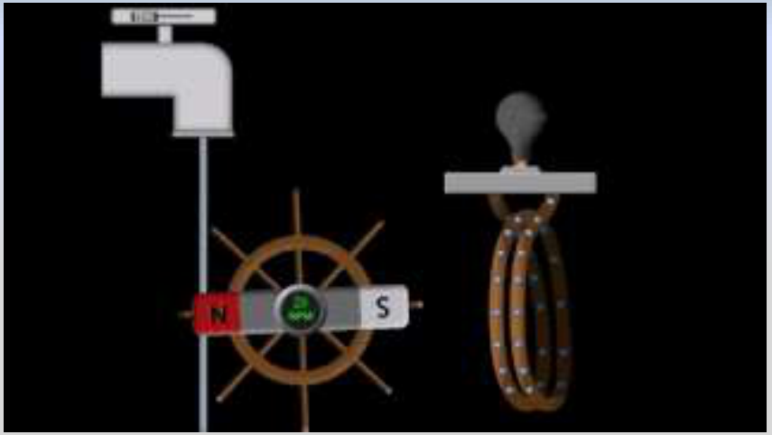
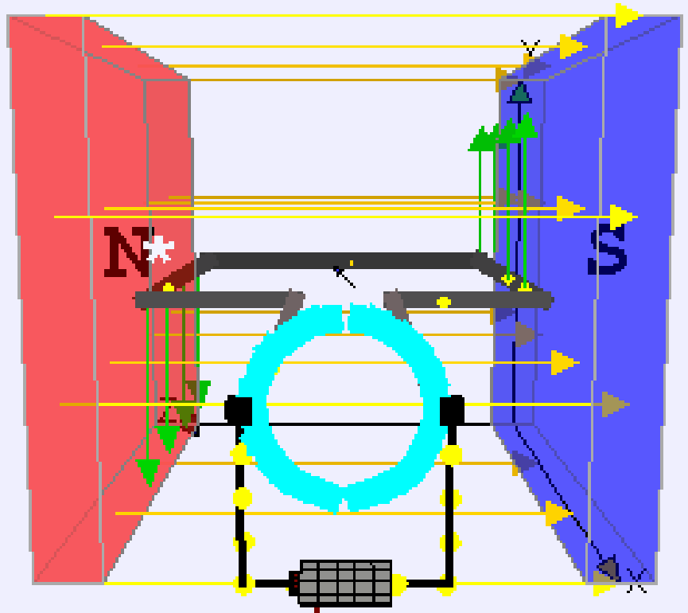

# Generador de corriente alterna y espira rotante

Unidad Temática VII — Electromagnetismo

## Rotating-Coil Generator



Rotate coil: “change $`\Phi_B`$, induce $`\mathcal E`$”

Si tenemos N espiras de área A rotando con velocidad angular ω constante en un
campo B, el flujo magnético será



```math
\theta=\omega t\quad(M.C.U)
```

```math
\phi_B=\vec B\cdot\vec A=BA\cos(\theta)=BA\cos(\omega t)
```

```math
\varepsilon=-N\frac{d\phi_B}{dt}=NBA\omega\sin(\omega t)
```

```math
\varepsilon_{max}=NBA\omega\Rightarrow\varepsilon=\varepsilon_{max}\sin(\omega t)
```

Fem alterna

Ejemplo: Produccion de energía eléctrica en una central hidroeléctrica

## Generador de corriente alterna



```math
\varepsilon(t)=\varepsilon_{max}\sin(\omega t)
```

(a): Esquema de un generador de ca. Se induce una fem en la espira rotante. El
circuito se cierra a través de un circuito externo (lámpara). (b): Gráfica la
fem en función del tiempo.

El generador es un dispositivo que convierte la energía mecánica del rotor
externo en energía eléctrica




```math
\varepsilon(t)=\varepsilon_{max}\sin(\omega t)
```

Que pasaría si saco la lámpara y pongo una batería en su lugar



## Procedencia y observaciones de transcripción

- Original:
  `2019/2do Parcial/2019 UT VII - Fenómenos de Inducción Electromagnética.pdf`,
  páginas 20–25 de 67. Fecha impresa: 14/05/2019.
- SHA-256: `cbefa338a0f56f56079880a84f05a963257a6473febd8da50f944a67f2210a8f`.
- Herramientas: PyMuPDF4LLM, Poppler y recortes PyMuPDF; páginas, fórmulas y
  figuras del tramo cotejadas visualmente. No se añaden respuestas a preguntas
  vacías.
- Se transcriben los símbolos de las láminas inglesas y se conservan las
  imágenes estáticas del PDF. El esquema repetido de páginas 22 y 24 se conserva
  con su ecuación. La pregunta sobre la batería no tiene respuesta escrita.
