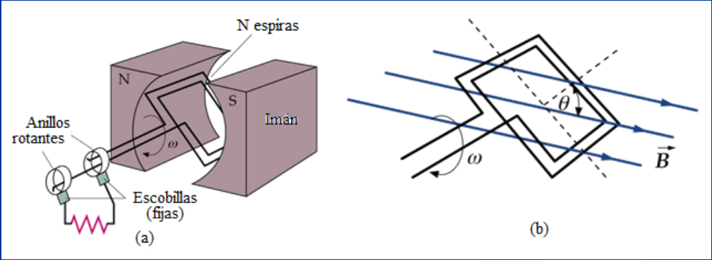
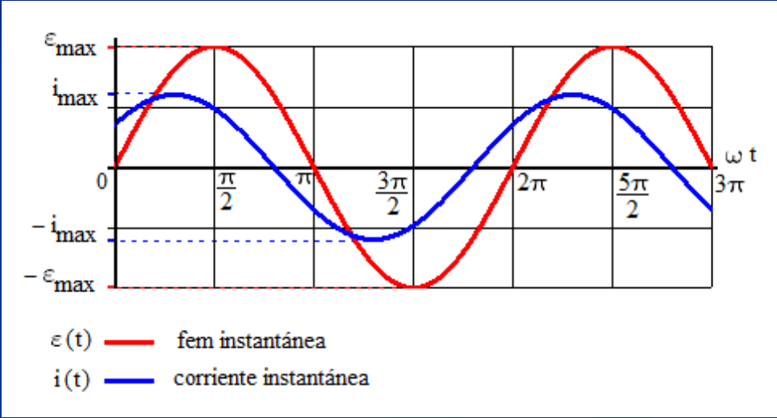

# Generador, fem y corriente alterna

Unidad Temática IX — Corriente Alterna

## Ejemplo de corriente alterna

El Generador de Corriente Alterna más sencillo es una espira que gira con
velocidad angular constante en un campo magnético uniforme



La fem y la corriente del circuito vienen dadas por las expresiones generales:

Fem alterna → Corriente alterna

```math
\varepsilon(t)=\varepsilon_{max}\sin(\omega t)\Rightarrow i(t)=i_{max}\sin(\omega t+\varphi)
```

Donde para la corriente:

- $`i(t)`$: intensidad instantánea de corriente
- $`i_{max}`$: valor máximo de la corriente
- $`\omega`$: pulsación o frecuencia angular
- $`\omega t+\varphi`$: ángulo de fase de la intensidad de corriente
- $`\varphi`$: fase inicial (diferencia de fase con la fem)

## Representación gráfica de la fem y la corriente instantáneas en función del tiempo



## Procedencia y observaciones de transcripción

- Original: `2019/3er Parcial/2017 UT IX Corriente Alterna.pdf`, páginas 5–7 de
  34\. Fecha impresa: 13/06/2018; el archivo se llama 2017 y está archivado en
  2019\.
- SHA-256: `9e7ec2ad4e867b5dc688982d6b052f2b16e926ee1adcfc55f7007697c05cf263`.
- Herramientas: preflight PyMuPDF4LLM, Poppler y recortes PyMuPDF. Páginas,
  expresiones y figuras del tramo cotejadas visualmente.
- Se conserva la notación del original sin añadir desarrollos ni soluciones.
