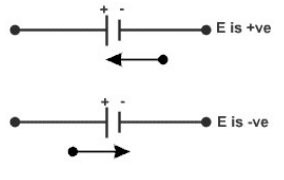
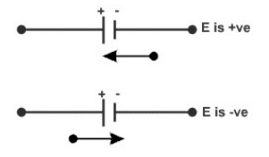
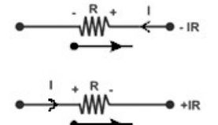
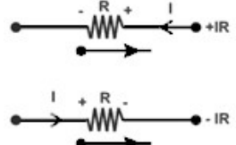

# Hoja de Fórmulas2019 — página1

> Fuente: `2019/Hoja de Fórmulas 2019.pdf`, página1de2. SHA-256:
> `08334993bbf390cc9959ca35446c5c1de7274de09029385c6801a5188d306499`. Extracción
> Poppler ycotejo visual de ambas páginas; fórmulas reparadas según el original.
> La grilla conserva el orden izquierda/centro/derecha, celdas yfilas vacías. La
> fila de encabezado vacío es solo un requisito de la representación Markdown.

FISICA II – IEM – IQ – ISI (esta hoja debe ser devuelta junto con el examen)

<!-- markdownlint-disable MD060 -->

|  |  |  |
| -- | -- | -- |
| $`\displaystyle \lvert\vec F\rvert=\frac1{4\pi\varepsilon_0}\cdot\frac{q_1q_2}{r_{12}^2}`$ $`\displaystyle \varepsilon_0=8.85\times10^{-12}\frac{C^2}{N\cdot m^2}`$ | $`\displaystyle F_x=\frac{q_0}{4\pi\varepsilon_0}\cdot\sum_{i=1}^{N}\frac{q_i(x_0-x_i)}{[(x_0-x_i)^2+(y_0-y_i)^2+(z_0-z_i)^2]^{3/2}}`$ | $`\displaystyle \vec E=\frac{\vec F}{q}`$ |
| $`\displaystyle \lvert\vec E_Q\rvert=\frac1{4\pi\varepsilon_0}\cdot\frac Q{r^2}`$ | $`\displaystyle E_{Qx}=\frac1{4\pi\varepsilon_0}\cdot\sum_{i=1}^{N}\frac{Q_i(x-x_i)}{[(x-x_i)^2+(y-y_i)^2+(z-z_i)^2]^{3/2}}`$ | $`\displaystyle \lvert\vec E_\sigma\rvert=\frac{\sigma}{2\varepsilon_0}`$ |
| $`\displaystyle \lvert\vec E_\lambda\rvert=\frac1{2\pi\varepsilon_0}\cdot\frac{\lambda}{r}`$ | $`\displaystyle E_{\lambda x}=\frac1{2\pi\varepsilon_0}\cdot\frac{\lambda(x-x_\lambda)}{[(x-x_\lambda)^2+(y-y_\lambda)^2+(z-z_\lambda)^2]}`$ | $`\displaystyle \mathop{∯}\nolimits\vec E\cdot d\vec s=\frac Q{\varepsilon_0}`$ |
| $`\displaystyle \mathop{∯}\nolimits\vec E\cdot d\vec s=\frac{\iiint\rho\cdot dV}{\varepsilon_0}`$ | $`\displaystyle \Delta V_{AB}=-\int_A^B\vec E\cdot d\vec l`$ | $`\displaystyle V_Q=\frac Q{4\pi\varepsilon_0r}`$ |
| $`\displaystyle \Delta V_{\sigma AB}=\frac{\sigma}{2\varepsilon_0}(x_A-x_B)`$ | $`\displaystyle \Delta V_{AB}=\frac{\lambda}{2\pi\varepsilon_0}\cdot\ln\frac{r_A}{r_B}`$ $`\displaystyle r_A\ge r_B`$ | $`\displaystyle C=\frac Q{\Delta V}`$ |
| $`\displaystyle C=\frac{\varepsilon_0A}{d}`$ | $`\displaystyle C_P=C_1+C_2;\qquad C_S^{-1}=C_1^{-1}+C_2^{-1}`$ | $`\displaystyle U=\frac12CV^2`$ |
| $`\displaystyle \varepsilon=\varepsilon_0\varepsilon_r`$ | $`\displaystyle \chi_e=\varepsilon_r-1;\quad\vec P=\varepsilon_0\chi_e\vec E;\quad\vec D=\varepsilon_0\vec E+\vec P`$ | $`\displaystyle \vec D=\varepsilon\vec E`$ |
| $`\displaystyle \mathop{∯}\nolimits\vec D\cdot d\vec s=Q`$ $`\displaystyle \mathop{∯}\nolimits\vec P\cdot d\vec s=-Q_P`$ | $`\displaystyle R=\rho\frac LS;\quad\vec E=\rho\vec J;\quad P=i^2R`$ $`\displaystyle I=\iint\vec J\cdot d\vec s`$ | $`\displaystyle I=NqvA`$ |
| $`\displaystyle N=\frac{\delta}{P_{\mathrm{molecular}}}\cdot N_{\mathrm{Avogadro}}`$ | $`\displaystyle R_S=R_1+R_2;\qquad R_P^{-1}=R_1^{-1}+R_2^{-1}`$ | $`\displaystyle V=IR`$ |
| $`\displaystyle \sum i_s=\sum i_e`$ $`\displaystyle \sum iR=\sum E`$  | 1) Poner la calculadora en modoSD. 2) Pulsar la tecla0 y después la teclaM+ hasta llegar al n°80. 3) (aparece DATA FULL). 4) Presionar AC (tecla roja) 5) Pulsar el2, dar arriba y poner13hasta que no quepan más 6) Dar=dos veces y pulsar0 y luego1 7) Presionar MODE hasta que aparezca EQN MAT VCT. Seleccionar EQN e ingresar coeficientes. | $`\displaystyle \sum i_s-\sum i_e=0`$ $`\displaystyle \sum iR+\sum E=0`$  |
|  |  |  |
|  |  |  |
| $`\displaystyle V_{\mathrm{esfera}}=\frac43\pi r^3`$ | $`\displaystyle S_{\mathrm{esfera}}=4\pi r^2`$ $`\displaystyle S_{\mathrm{cilindro}}=2\pi r^2+2\pi rL`$ | $`\displaystyle V_{\mathrm{cilindro}}=\pi r^2L`$ |
|  |  |  |
|  |  |  |
|  |  |  |

<!-- markdownlint-enable MD060 -->

## Observaciones de transcripción

Se conservan las16filas de la grilla, incluidas cuatro filas totalmente vacías,
ylas instrucciones de la calculadora como texto documental, sin ejecutarlas. Se
mantienen los dos planteos de signos deKirchhoff ylos diagramas originales. El
denominador deEλx conserva la potencia impresa, sin reemplazarla por una fórmula
externa.
