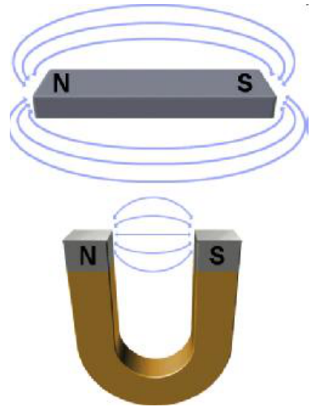
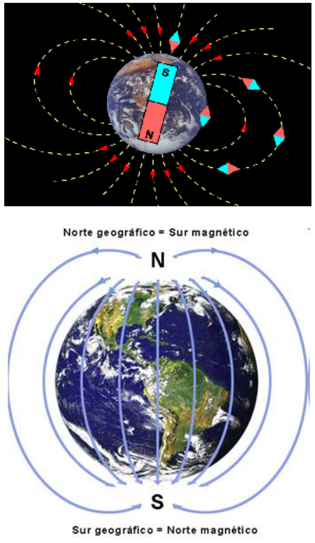
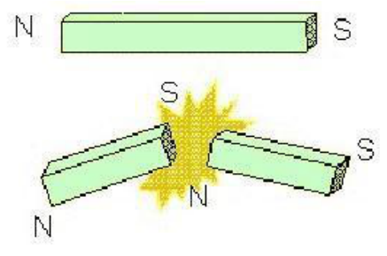

# Imanes y características de las fuerzas magnéticas

Unidad Temática V — Fuerzas Magnéticas sobre cargas y elementos de corriente

## Imanes y Magnetismo



- Los imanes poseen dos zonas extremas o polos en donde la acción magnética es
  más intensa. Los polos magnéticos de un imán no son equivalentes.
- Enfrentando dos imanes idénticos se observen atracciones o repulsiones mutuas
  según se aproxime el primero al segundo por uno o por otro polo.



- Para distinguir los dos polos de un imán recto se los denomina polo norte y
  polo sur. Esta referencia geográfica está relacionada con el hecho de que la
  Tierra se comporte como un gran imán. Las experiencias con brújulas indican
  que los polos del imán terrestre se encuentran próximos a los polos
  geográficos.
- Por tal motivo, el polo de la brújula que se orienta aproximadamente hacia el
  Norte geográfico se denomina polo Norte y el opuesto constituye el polo Sur.
  Tal distinción entre polos magnéticos se puede extender a cualquier tipo de
  imanes.



Otra particularidad del campo magnético es que los polos magnéticos no pueden
ser separados. No es posible “aislar” un polo magnético. Por la misma razón, no
existe un análogo magnético de la carga eléctrica. Si se intenta dividir un imán
a la mitad para separar los polos, invariablemente aparecerán los dos polos (más
o menos concentrados) en ambos pedazos

## Algunas características de las fuerzas magnéticas

- Un imán sólo ejerce fuerzas magnéticas sobre cierto tipo de materiales, en
  particular sobre el hierro.
- Las fuerzas magnéticas son fuerzas de acción a distancia.
- La intensidad de la fuerza magnética de interacción entre imanes disminuye con
  el cuadrado de la distancia que los separa.

```math
Fm\propto\frac1{r^2}
```

## Procedencia y observaciones de transcripción

- Original:
  `2019/2do Parcial/2019 UT V - Fuerzas Magnéticas sobre cargas y elementos de corriente.pdf`.
- SHA-256: `383fdb6f46e1627fbe65cf259b89a480bd4b4cc61821cbfc466fa3e4a63ceb29`.
  2019 es el nombre del archivo; no consta fecha impresa en estas páginas.
- Herramientas: PyMuPDF4LLM, Poppler y recortes PyMuPDF; páginas de este tramo
  cotejadas visualmente. No se modifica el contenido de las afirmaciones
  originales.
- Páginas 5–8 de 42; tres figuras y una expresión. Se conserva «se observen» y
  la afirmación sobre la dependencia con el cuadrado de la distancia.
