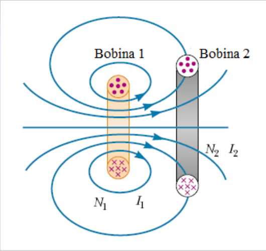

# Inducción mutua entre bobinas: versión Electromagnetismo

Unidad Temática VII — Electromagnetismo

## Inducción Mutua

En las experiencias de Faraday con dos bobinas arrolladas una sobre la otra y
aisladas eléctricamente, cuando variaba la intensidad de corriente que circulaba
por una de ellas, se generaba una corriente inducida en la otra. Esto es, en
esencia, el fenómeno de la inducción mutua. La variación de la intensidad de
corriente en una bobina da lugar a un campo magnético variable. Este campo
magnético origina un flujo magnético también variable que atraviesa la otra
bobina e induce en ella, de acuerdo con la ley de Faraday-Henry, una fuerza
electromotriz. Cualquiera de las bobinas del par puede ser el elemento inductor
y cualquiera el elemento inducido, de ahí el calificativo de mutua que recibe
este fenómeno de inducción.



Φ₂₁ Flujo en la bobina 2 debido a la corriente I1 en la bobina 1

Para una bobina de N espiras es

```math
L=\frac{N\Phi}I
```

Definimos la Inductancia mutua M₂₁ de la bobina 2 con respecto a la bobina 1
como:

```math
M_{21}=\frac{N_2\Phi_{21}}{I_1}\Rightarrow\Phi_{21}=\frac{M_{21}I_1}{N_2}
```

Si I1 es variable genera en 2 una fem

```math
\varepsilon_2=-N_2\frac{d\Phi_{21}}{dt}=-N_2\frac{M_{21}}{N_2}\frac{dI_1}{dt}
```

```math
\varepsilon_2=-M_{21}\frac{dI_1}{dt}
```

Similarmente si I2 es variable genera en 1 una fem

```math
\varepsilon_1=-M_{12}\frac{dI_2}{dt}
```

En la Inductancia mutua la fem inducida en una bobina es siempre proporcional a
la velocidad de cambio de la corriente de la otra bobina

Se demuestra que

```math
M_{12}=M_{21}=M
```

por tanto:

```math
\varepsilon_2=-M\frac{dI_1}{dt}\quad\text{y}\quad\varepsilon_1=-M\frac{dI_2}{dt}
```

La unidad de inductancia mutua es el Henry

## Procedencia y observaciones de transcripción

- Original: `2019/2do Parcial/2019 UT VII Electromagnetismo.pdf`, páginas 50–52
  de 62. No consta fecha impresa; 2019 es del nombre del archivo.
- SHA-256: `eff3447774cadfcb2726a6caabbe8e257782276fce3e67dda465673d5ef67a6a`.
- Herramientas: PyMuPDF4LLM, Poppler y recortes PyMuPDF; páginas, expresiones y
  figuras del tramo cotejadas visualmente.
- Esta versión no incluye la aplicación del cepillo de la otra fuente; no se
  agrega.
