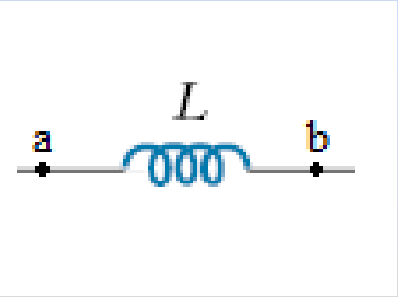
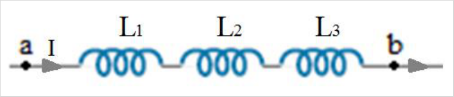
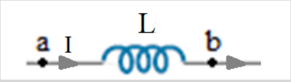
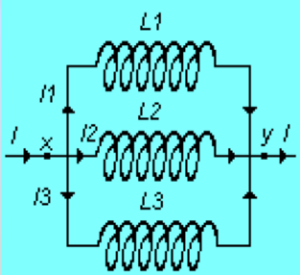
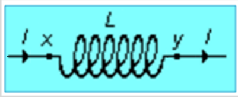

# Autoinducciones en serie y paralelo: versión Electromagnetismo

Unidad Temática VII — Electromagnetismo

## Autoinducciones en serie



Diferencia de potencial entre los extremos de una bobina

```math
\Delta V=V_a-V_b=L\frac{dI}{dt}
```





```math
\begin{cases}I=I_1=I_2=I_3\\V=V_1+V_2+V_3\end{cases}
```

```math
\begin{cases}\displaystyle V_1=L_1\frac{dI}{dt}\\\displaystyle V_2=L_2\frac{dI}{dt}\\\displaystyle V_3=L_3\frac{dI}{dt}\\\displaystyle V=L\frac{dI}{dt}\end{cases}\Rightarrow\begin{cases}\displaystyle L\frac{dI}{dt}=L_1\frac{dI}{dt}+L_2\frac{dI}{dt}+L_3\frac{dI}{dt}\\L=L_1+L_2+L_3\end{cases}
```

N autoinducciones en serie

```math
L=\sum_{i=1}^N L_i
```

## Autoinducciones en paralelo





```math
\begin{cases}\displaystyle V_1=L_1\frac{dI_1}{dt}=V\\\displaystyle V_2=L_2\frac{dI_2}{dt}=V\\\displaystyle V_3=L_3\frac{dI_3}{dt}=V\\\displaystyle V=L\frac{dI}{dt}\end{cases}
```

```math
\Rightarrow\begin{cases}I=I_1+I_2+I_3\\\displaystyle\frac{dI}{dt}=\frac{dI_1}{dt}+\frac{dI_2}{dt}+\frac{dI_3}{dt}\\\displaystyle\frac VL=\frac V{L_1}+\frac V{L_2}+\frac V{L_3}\\\displaystyle\frac1L=\frac1{L_1}+\frac1{L_2}+\frac1{L_3}\end{cases}
```

N autoinducciones en paralelo

```math
\frac1L=\sum_{i=1}^N\frac1{L_i}
```

## Procedencia y observaciones de transcripción

- Original: `2019/2do Parcial/2019 UT VII Electromagnetismo.pdf`, páginas 41–43
  de 62. No consta fecha impresa; 2019 es del nombre del archivo.
- SHA-256: `eff3447774cadfcb2726a6caabbe8e257782276fce3e67dda465673d5ef67a6a`.
- Herramientas: PyMuPDF4LLM, Poppler y recortes PyMuPDF; páginas, expresiones y
  figuras del tramo cotejadas visualmente.
- El equivalente en serie tiene bornes a y b; el del paralelo, x y. Se conservan
  ambos diagramas.
