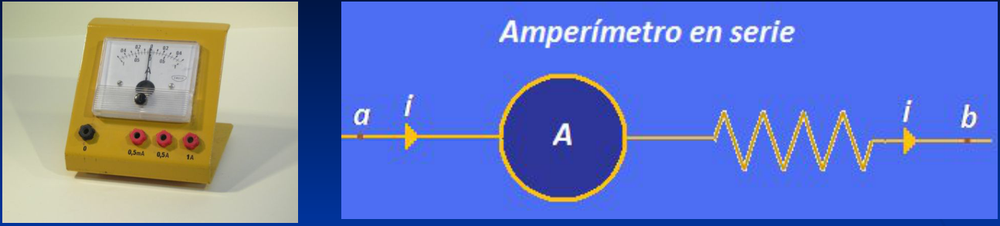
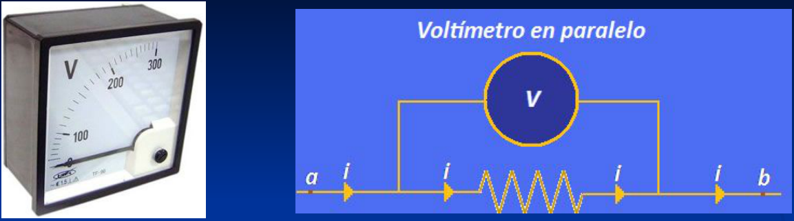
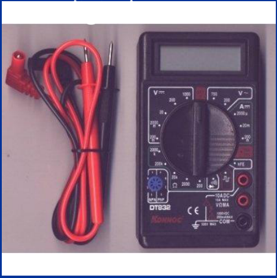
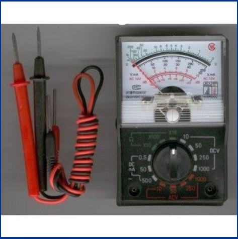
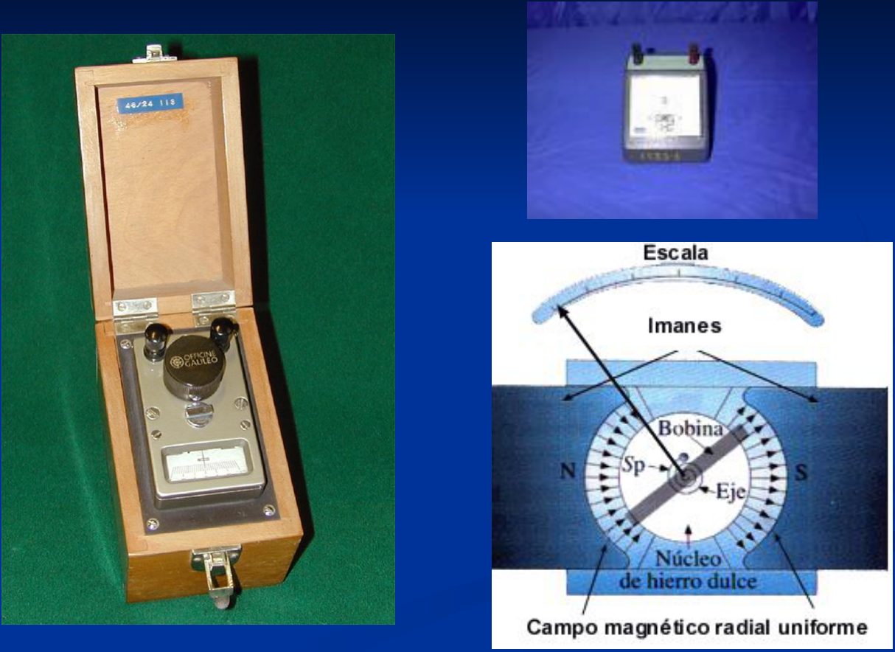
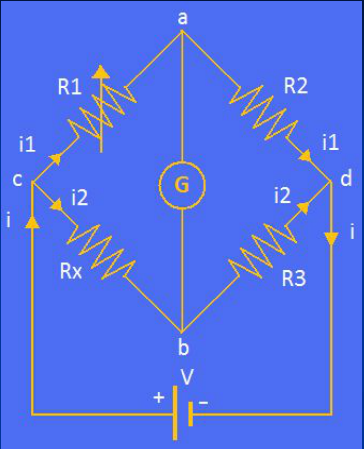

# Amperímetro



- El amperímetro mide la corriente que circula por su interior.
- Debe conectarse en serie.
- Tiene una cierta resistencia interna. Para no afectar el funcionamiento del
  circuito, debe ser lo mas pequeña posible

## Voltímetro



- El voltímetro mide la diferencia de potencial que se aplica entre sus
  extremos.
- Debe conectarse en paralelo.
- Posee una resistencia interna, que debe ser lo mas elevada posible, para que
  por la rama “externa” al circuito que lo contiene se derive el mínimo posible
  de corriente eléctrica.

Voltímetro y amperímetro se incluyen en un único dispositivo denominado Tester o
Multímetro. Están diseñados de manera que su introducción en el circuito no
afecte en forma apreciable su funcionamiento. Un voltímetro ideal tendría
resistencia infinita y un amperímetro ideal resistencia nula.

Tester digital



Tester analógico



## Galvanómetro



Rótulos del esquema: Escala; Imanes; Bobina; N; Sp; Eje; S; Núcleo de hierro
dulce; Campo magnético radial uniforme.

## Puente de Wheatstone



Rx: resistencia desconocida

R1: resistencia variable

R2 y R3: resistencias conocidas con precisión

Se varía R1 hasta que G indica corriente nula. En esa condición

```math
V_a=V_b\Rightarrow\begin{cases}V_c-V_a=V_c-V_b\\V_a-V_d=V_b-V_d\end{cases}
```

```math
\Rightarrow\begin{cases}i_1R_1=i_2R_x\\i_1R_2=i_2R_3\end{cases}\Rightarrow R_x=\frac{R_1}{R_2}R_3
```

## Procedencia y observaciones de transcripción

- Original: `2019/1er Parcial/2017 UT IV - Electrocinética.ppt.pdf`, páginas 30,
  31, 32, 33, 34 de 55.
- SHA-256: `5593bcdeb59339b25f4dfee074beac1812300dcec491fb423777a4e776ba1399`.
- El nombre del archivo indica 2017; se conserva bajo 2019 por su ubicación
  canónica. No consta autor en estas páginas.
- Herramientas: PyMuPDF4LLM, PyMuPDF y Poppler; cotejo visual de texto,
  fórmulas, tablas y diagramas. Figuras originales conservadas por recorte y
  render.
- La página 33 contiene fotografías y un esquema del galvanómetro, sin párrafo
  explicativo adicional. Se conservan ambas fotografías y todos los rótulos del
  esquema. Las palabras digital y analógico de la página 32 quedan parcialmente
  tapadas por las fotografías; se recuperan desde la capa textual.
