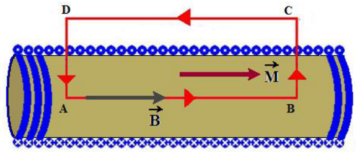

# Intensidad magnética H, permeabilidad y susceptibilidad

Unidad Temática VIII — Magnetismo en Medios materiales

## El vector H

Analizaremos el caso de un solenoide de longitud L, n espiras por unidad de
longitud, lleno de material con momento magnético M por unidad de volumen y por
el que circula una corriente i.

Para ello definiremos una nueva magnitud vectorial denominada intensidad
magnética H, que simplificará el análisis.

## Relación entre B, H y M



```math
\oint\vec B\cdot\overrightarrow{dl}=\oint(\vec B_0+\vec B_m)\cdot\overrightarrow{dl}=\oint(\vec B_0+\mu_0\vec M)\cdot\overrightarrow{dl}
```

```math
\oint\vec B_0\cdot\overrightarrow{dl}=\oint(\vec B-\mu_0\vec M)\cdot\overrightarrow{dl}
```

Teniendo en cuenta

```math
\oint\vec B_0\cdot\overrightarrow{dl}=\mu_0I
```

Ley de Ampere

I = n i (B-A) es la corriente libre neta que atraviesa el área limitada por
ABCD, y B₀ el campo magnético externo.

```math
\oint\left(\frac{\vec B}{\mu_0}-\vec M\right)\cdot\overrightarrow{dl}=I
```

La circulación de la magnituud vectorial entre parentesis es igual a la
corriente libre neta.

definimos

```math
\vec H=\frac{\vec B}{\mu_0}-\vec M
```

Intensidad magnética

```math
\oint\vec H\cdot\overrightarrow{dl}=I
```

La circulación de la intensidad magnética H es igual a la corriente debida a las
cargas libres que atraviesan el área definida por el camino de integración.

[H]=[Corriente]/[Long]=Ampere/metro — Unidad en el S.I.

```math
\vec B=\mu_0(\vec H+\vec M)
```

```math
\mu=\frac BH=\frac{\mu_0(H+M)}H=\mu_0\left(1+\frac MH\right)
```

```math
\mu_r=\frac\mu{\mu_0}=\left(1+\frac MH\right)
```

Permeabilidad magnética relativa

```math
\chi_m=\frac MH
```

Susceptibilidad magnética

Susceptibilidad: Indica el grado de sensibilidad a la magnetización de un
material influenciado por un campo magnético.

```math
\vec M=\chi_m\vec H
```

En materiales isotrópicos (sus propiedades mecánicas y térmicas son las mismas
en todas las direcciones) H y M tienen la misma dirección, y la susceptibilidad
magnética es un escalar.

En materiales no isotrópicos (cristales) H y M en general no tienen la misma
dirección, y la susceptibilidad magnética es un tensor

```math
\vec B=\mu_0(\vec H+\vec M)
```

Expresión general para la inducción magnética B

```math
\vec B=\mu\vec H
```

Expresión válida para medios isotrópicos y en algunos casos especiales de medios
no isotrópicos

## Propiedades generales de B y H

```math
\oint_{Sup}\vec B\cdot\overrightarrow{dS}=0
```

Se cumple aún en presencia de materia

```math
\oint\vec H\cdot\overrightarrow{dl}=I
```

La integral curvilínea de H sobre una trayectoria cerrada (circulación) es igual
a la intensidad de corriente neta que atraviesa el área limitada por la
trayectoria

La ecuación anterior puede rescribirse como:

```math
\oint\vec B\cdot\overrightarrow{dl}=\mu_0I_T
```

```math
I_T=I+I_m
```

donde I es la intensidad de corriente verdadera y Im la de magnetización

## Procedencia y observaciones de transcripción

- Original:
  `2019/2do Parcial/2019 UT VIII - Magnetismo en Medios materiales.pdf`, páginas
  7–11 de 21. No consta fecha impresa; 2019 es del nombre del archivo.
- SHA-256: `5d97f163bf24ba9b9d9317dbe7faec1a00e5fab87621e3849d37756083e8f919`.
- Herramientas: PyMuPDF4LLM, Poppler y recortes PyMuPDF; páginas, expresiones y
  figuras del tramo cotejadas visualmente.
- Se conserva «magnituud» y la integral cerrada simple de superficie rotulada
  Sup en página11. Las circulaciones se cotejaron visualmente porque Poppler
  pierde sus marcas de cierre.

## Versión impresa de seis diapositivas

El archivo `2019/2do Parcial/UT 8 6 pag.pdf` (SHA-256
`d2d2d0f25fb3fdf3e79399ff0127bd753745d6368a9511122ae7f7076e1f09b2`) reproduce
estas diapositivas en las páginas 2 de cuatro. Se cotejaron texto, expresiones y
figuras contra la versión individual; no contiene contenido adicional en este
tramo. La correspondencia por diapositiva está en
[el registro de imposiciones](../../../resources/common/imposiciones.json).
