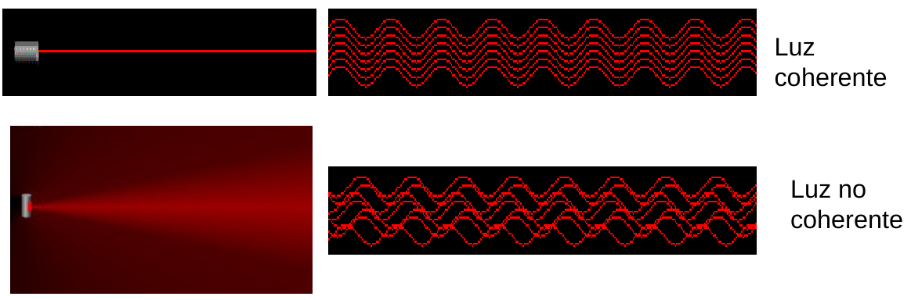
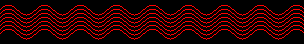
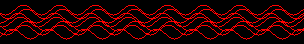

# Condiciones para percibir la interferencia. Coherencia

> Fuente: `2019/3er Parcial/UT XII - Interferencias.ppt`, diapositivas 6, 7.
> SHA-256: `1aedc0734c24e71c0cbae9ecc29b034fe9e22575940fc895559579ce1326b91e`.
> Original archivado bajo 2019; sin fecha de clase impresa. Copia normalizada
> con LibreOffice a PPTX/PDF, extracción MarkItDown y Poppler; texto, ecuaciones
> y figuras cotejados visualmente. Las animaciones incrustadas se conservan
> además de la vista estática cuando corresponde.

Cuando dos ondas luminosas interfieren, los campos electromagnéticos de cada una
de ellas se combinan. Siempre que dos o mas ondas llegan simultáneamente a un
punto del espacio se produce interferencia. ¿ Porque no lo observamos en el
salón de clases ?

- Las ondas deben mantener constante la diferencia de fase entre ellas. (Las
  fuentes deben ser coherentes)
- Deben tener la misma longitud de onda.

Una fuente monocromática es aquella que emite luz con una única frecuencia

```math
E=E_0\cos(kx-\omega t)\hat u
```

```math
\nu=\frac{c}{\lambda},\qquad k=\frac{2\pi}{\lambda}
```

Dos fuentes monocromáticas se dicen coherentes cuando emiten luz con la misma
frecuencia y longitud de onda. Deben tener una relación de fase definida y
constante.



Animaciones originales incrustadas:




