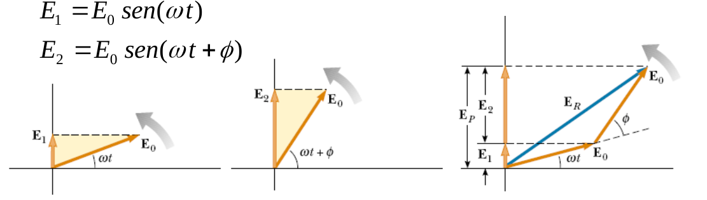
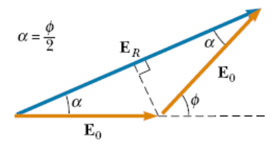
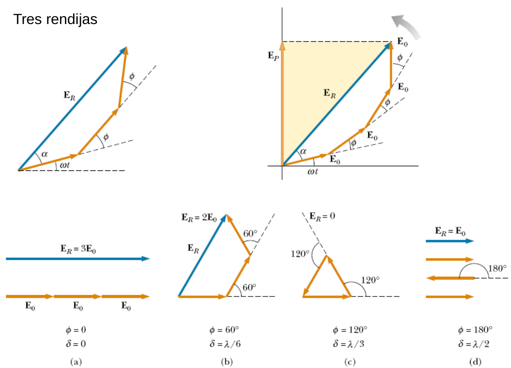
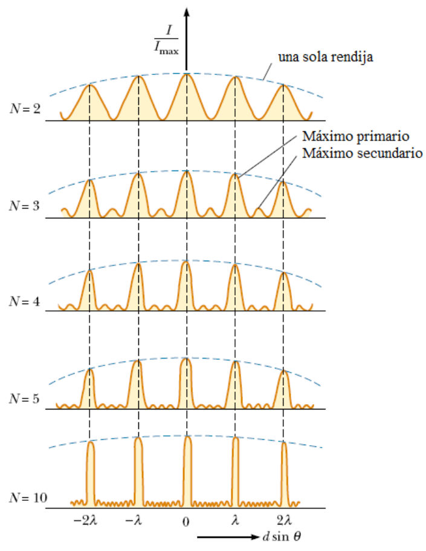

# Representación de ondas por fasores y tres rendijas

> Fuente: `2019/3er Parcial/UT XII - Interferencias.ppt`, diapositivas 25, 26,
> 27\. SHA-256:
> `1aedc0734c24e71c0cbae9ecc29b034fe9e22575940fc895559579ce1326b91e`. Original
> archivado bajo 2019; sin fecha de clase impresa. Copia normalizada con
> LibreOffice a PPTX/PDF, extracción MarkItDown y Poppler; texto, ecuaciones y
> figuras cotejados visualmente. Las animaciones incrustadas se conservan además
> de la vista estática cuando corresponde.

```math
E_1=E_0\mathop{\mathrm{sen}}\nolimits(\omega t),\qquad E_2=E_0\mathop{\mathrm{sen}}\nolimits(\omega t+\phi)
```




```math
E_R/2=E_0\cos(\alpha),\qquad \alpha+\alpha=\phi
```

```math
\alpha=\phi/2,\qquad E_R=2E_0\cos(\phi/2)
```

La proyección del fasor $`E_R`$ sobre el eje vertical en un instante t
arbitrario es:

```math
E_P=E_R\sin\left(\omega t+\frac{\phi}{2}\right)=2E_0\cos\left(\frac{\phi}{2}\right)\sin\left(\omega t+\frac{\phi}{2}\right)
```

## Tres rendijas



a) $`\Phi=0,\pm2\pi,\pm4\pi,\ldots`$; c) $`\Phi=\pm2\pi/3,\pm4\pi/3,\ldots`$ d)
$`\Phi=\pm\pi,\pm3\pi,\ldots`$



Patrones de interferencia para ranuras múltiples. Cuando N aumenta los máximos
primarios se angostan, pero conservan su posición. Aumenta el número de máximos
secundarios. La disminución de la intensidad de los máximos principales a
derecha e izquierda del orden cero se debe al fenómeno de difracción, que
analizaremos luego.
