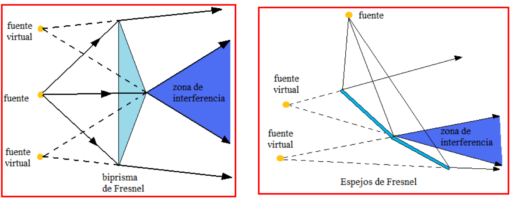

# Producción de haces coherentes por división del frente de ondas

> Fuente: `2019/3er Parcial/UT XII - Interferencias.ppt`, diapositivas 40.
> SHA-256: `1aedc0734c24e71c0cbae9ecc29b034fe9e22575940fc895559579ce1326b91e`.
> Original archivado bajo 2019; sin fecha de clase impresa. Copia normalizada
> con LibreOffice a PPTX/PDF, extracción MarkItDown y Poppler; texto, ecuaciones
> y figuras cotejados visualmente. Las animaciones incrustadas se conservan
> además de la vista estática cuando corresponde.

Producción de haces de luz coherentes por división del frente de ondas. La
fuente debe ser pequeña (fuente extensa colimada)

