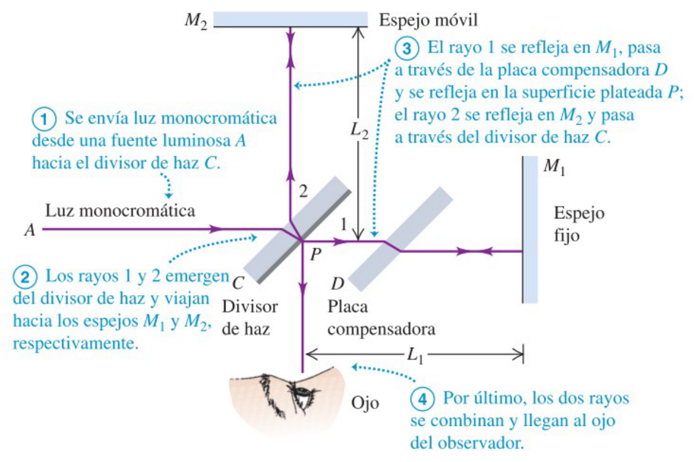
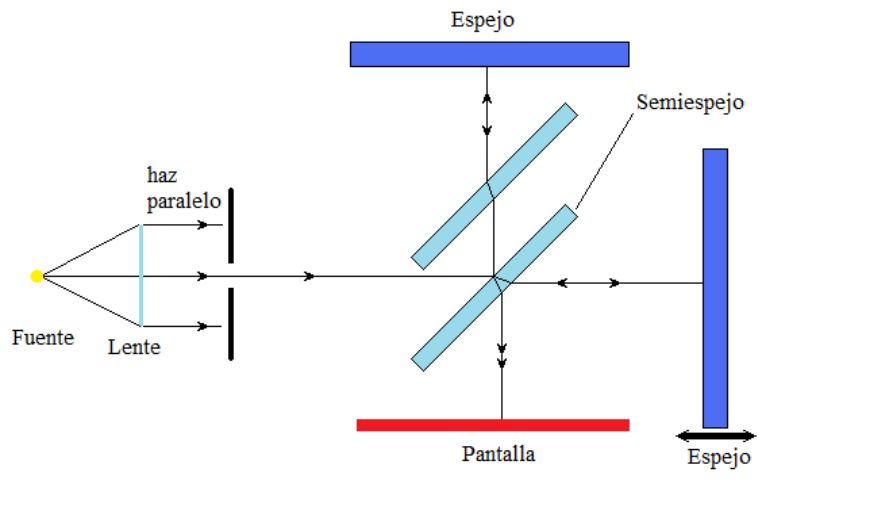

# Interferómetro de Michelson

> Fuente: `2019/3er Parcial/UT XII - Interferencias.ppt`, diapositivas 36, 42.
> SHA-256: `1aedc0734c24e71c0cbae9ecc29b034fe9e22575940fc895559579ce1326b91e`.
> Original archivado bajo 2019; sin fecha de clase impresa. Copia normalizada
> con LibreOffice a PPTX/PDF, extracción MarkItDown y Poppler; texto, ecuaciones
> y figuras cotejados visualmente. Las animaciones incrustadas se conservan
> además de la vista estática cuando corresponde.

1. Se envía luz monocromática desde una fuente luminosa A hacia el divisor de
   haz C.
1. Los rayos 1 y 2 emergen del divisor de haz y viajan hacia los espejos $`M_1`$
   y $`M_2`$, respectivamente.
1. El rayo 1 se refleja en $`M_1`$, pasa a través de la placa compensadora D y
   se refleja en la superficie plateada P; el rayo 2 se refleja en $`M_2`$ y
   pasa a través del divisor de haz C.
1. Por último, los dos rayos se combinan y llegan al ojo del observador.

## Haces coherentes por división de amplitud

Los espejos son perpendiculares. Semi espejos paralelos de igual espesor. Pasa
el 50% y refleja el resto.
