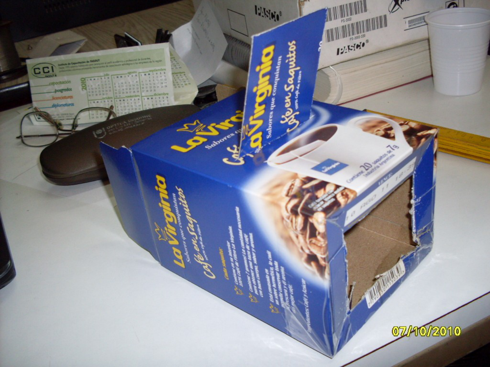
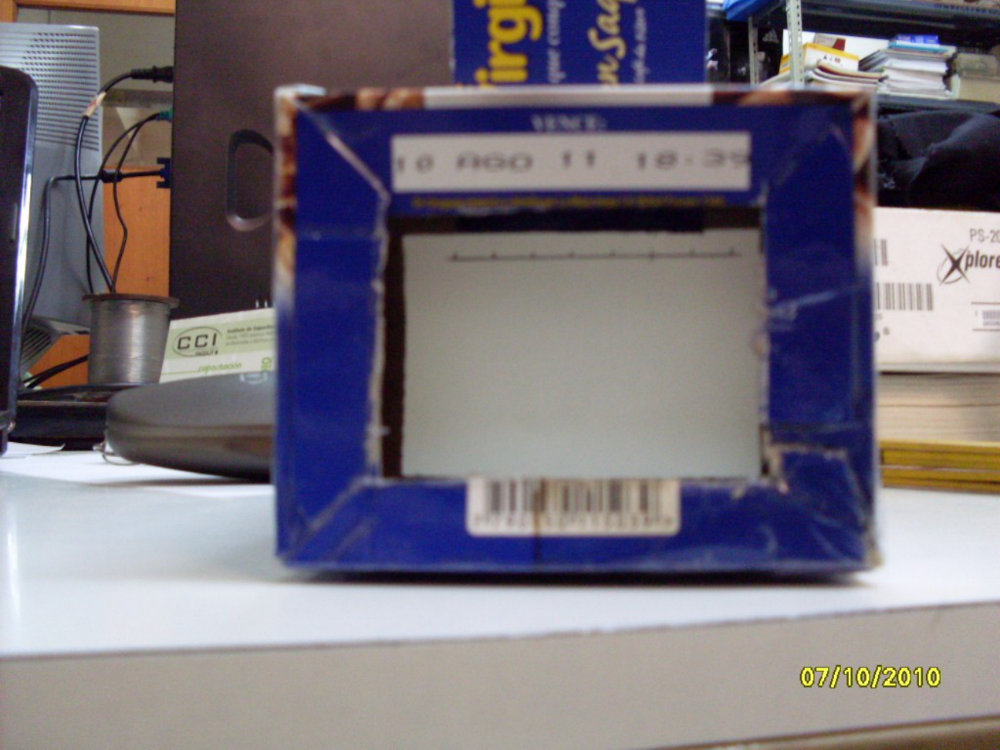
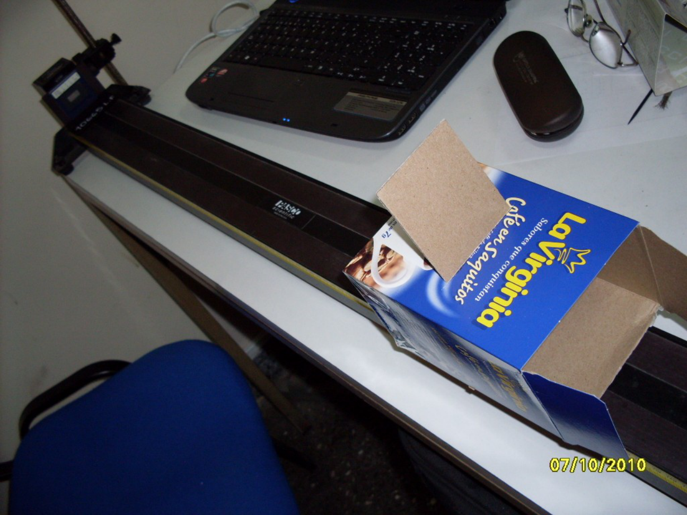
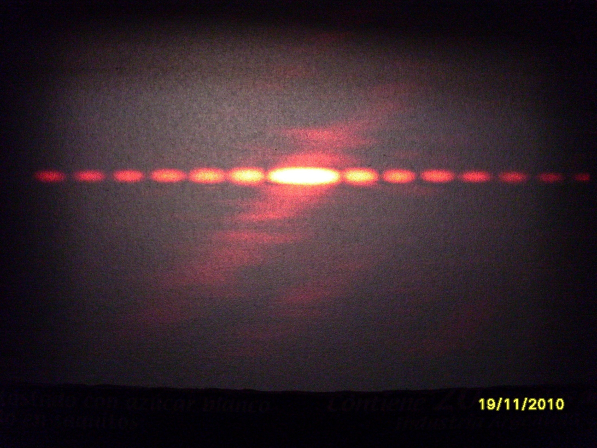
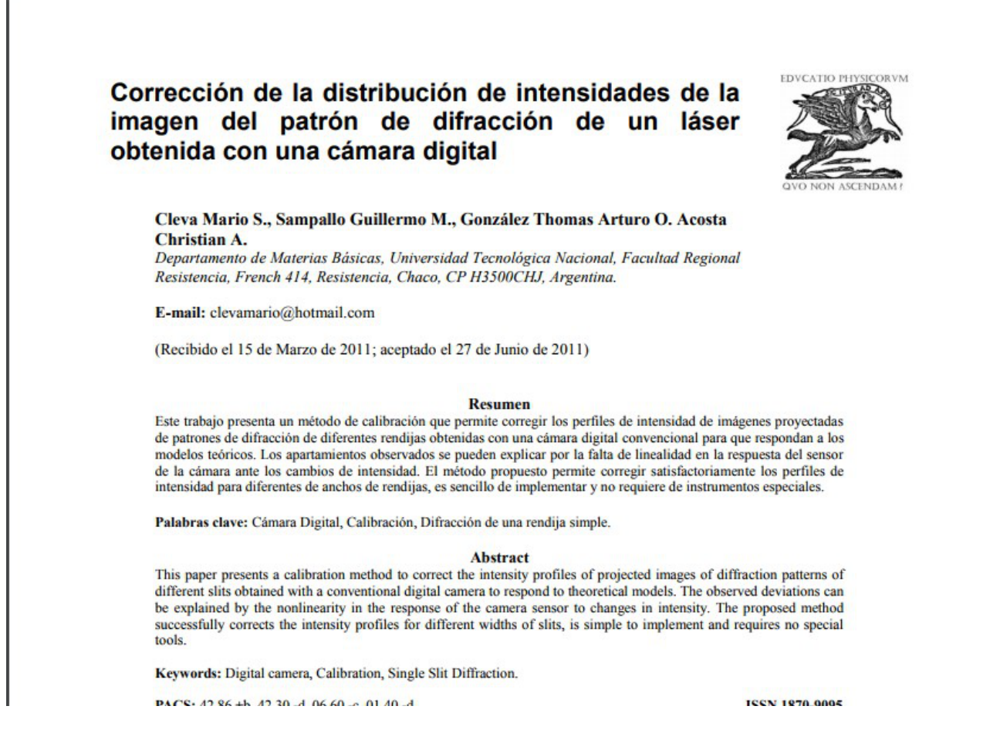

# Montaje y calibración de imágenes de difracción

> Fuente: `2019/3er Parcial/UT XII - Interferencias.ppt`, diapositivas 8, 9, 10,
> 11, 12. SHA-256:
> `1aedc0734c24e71c0cbae9ecc29b034fe9e22575940fc895559579ce1326b91e`. Original
> archivado bajo 2019; sin fecha de clase impresa. Copia normalizada con
> LibreOffice a PPTX/PDF, extracción MarkItDown y Poppler; texto, ecuaciones y
> figuras cotejados visualmente. Las animaciones incrustadas se conservan además
> de la vista estática cuando corresponde.

## Texto legible del recorte

**Corrección de la distribución de intensidades de la imagen del patrón de
difracción de un láser obtenida con una cámara digital**

Cleva Mario S., Sampallo Guillermo M., González Thomas Arturo O. Acosta
Christian A.

Departamento de Materias Básicas, Universidad Tecnológica Nacional, Facultad
Regional Resistencia, French 414, Resistencia, Chaco, CP H3500 CHJ, Argentina.

E-mail: <clevamario@hotmail.com>

(Recibido el 15 de Marzo de 2011; aceptado el 27 de Junio de 2011)

### Resumen

Este trabajo presenta un método de calibración que permite corregir los perfiles
de intensidad de imágenes proyectadas de patrones de difracción de diferentes
rendijas obtenidas con una cámara digital convencional para que respondan a los
modelos teóricos. Los apartamientos observados se pueden explicar por la falta
de linealidad en la respuesta del sensor de la cámara ante los cambios de
intensidad. El método propuesto permite corregir satisfactoriamente los perfiles
de intensidad para diferentes de anchos de rendijas, es sencillo de implementar
y no requiere de instrumentos especiales.

**Palabras clave:** Cámara Digital, Calibración, Difracción de una rendija
simple.

### Abstract

This paper presents a calibration method to correct the intensity profiles of
projected images of diffraction patterns of different slits obtained with a
conventional digital camera to respond to theoretical models. The observed
deviations can be explained by the nonlinearity in the response of the camera
sensor to changes in intensity. The proposed method successfully corrects the
intensity profiles for different widths of slits, is simple to implement and
requires no special tools.

**Keywords:** Digital camera, Calibration, Single Slit Diffraction.

## Observaciones de transcripción

Las fechas de las fotografías y del artículo no se toman como fecha de clase. El
recorte original corta las líneas inferiores de PACS/ISSN y conserva un emblema;
no se reconstruye la parte truncada. La presentación no incorpora el resto del
artículo. Se conserva «diferentes de anchos» del texto visible.
