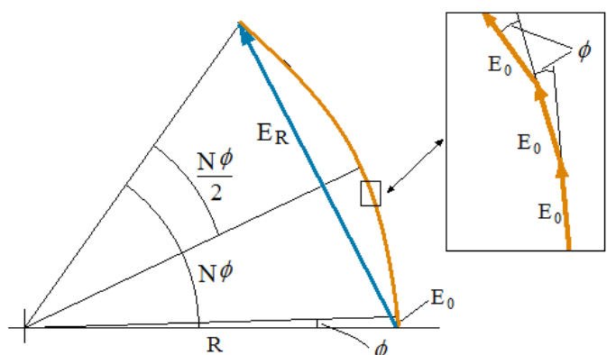

# Para N rendijas con separación d

> Fuente: `2019/3er Parcial/UT XII - Interferencias.ppt`, diapositivas 37, 38,
> 39\. SHA-256:
> `1aedc0734c24e71c0cbae9ecc29b034fe9e22575940fc895559579ce1326b91e`. Original
> archivado bajo 2019; sin fecha de clase impresa. Copia normalizada con
> LibreOffice a PPTX/PDF, extracción MarkItDown y Poppler; texto, ecuaciones y
> figuras cotejados visualmente. Las animaciones incrustadas se conservan además
> de la vista estática cuando corresponde.



```math
E_R=2R\mathop{\mathrm{sen}}\nolimits(N\phi/2),\qquad E_0=2R\mathop{\mathrm{sen}}\nolimits(\phi/2)
```

```math
R=\frac{E_0}{2R\mathop{\mathrm{sen}}\nolimits(\phi/2)}\quad\Rightarrow\quad E_R=E_0\frac{\mathop{\mathrm{sen}}\nolimits(N\phi/2)}{\mathop{\mathrm{sen}}\nolimits(\phi/2)}
```

Amplitud en P

```math
\phi=\frac{2\pi}{\lambda}d\mathop{\mathrm{sen}}\nolimits(\theta)\quad\Rightarrow\quad E_R=E_0\frac{\mathop{\mathrm{sen}}\nolimits\left(\frac{N\pi}{\lambda}d\mathop{\mathrm{sen}}\nolimits(\theta)\right)}{\mathop{\mathrm{sen}}\nolimits\left(\frac{\pi}{\lambda}d\mathop{\mathrm{sen}}\nolimits(\theta)\right)}
```

Intensidad para N rendijas

```math
I_P=I_0\frac{\mathop{\mathrm{sen}}\nolimits^2(N\phi/2)}{\mathop{\mathrm{sen}}\nolimits^2(\phi/2)}=I_0\frac{\mathop{\mathrm{sen}}\nolimits^2\left(\frac{N\pi}{\lambda}d\mathop{\mathrm{sen}}\nolimits(\theta)\right)}{\mathop{\mathrm{sen}}\nolimits\left(\frac{\pi}{\lambda}d\mathop{\mathrm{sen}}\nolimits(\theta)\right)}
```

I será máxima si todos los fasores tienen en P la misma dirección y sentido. En
ese caso

```math
E_R=NE_0\quad\Rightarrow\quad I_{P\max}=N^2I_0
```

$`I_{\max}`$ => $`\Phi=2n\pi`$

```math
2n\pi=\frac{2\pi}{\lambda}d\mathop{\mathrm{sen}}\nolimits(\theta)\quad\Rightarrow\quad\mathop{\mathrm{sen}}\nolimits(\theta)=\frac{n\lambda}{d},\qquad n=1,2,\ldots
```

La intensidad se anula para:

```math
N\phi/2=n_1\cancel{\pi}=N\frac{\cancel{2}\cancel{\pi}}{\cancel{2}\lambda}d\mathop{\mathrm{sen}}\nolimits(\theta)\quad\Rightarrow\quad\mathop{\mathrm{sen}}\nolimits(\theta)=\frac{n_1\lambda}{Nd}
```

$`n_1`$ no puede tomar los valores 0,N,2 N,3 N,..., pues los valores de
$`\theta`$ corresponden a máximos

## Observaciones de transcripción

Se conservan dos erratas visibles: en 37 el despeje deR incluye otroR en el
denominador; en 38 el último denominador de la intensidad muestra «sen» sin
cuadrado. La diapositiva 39 contiene cancelaciones manuscritas/tipográficas de 2
yπ, representadas con cancel. No se corrigen silenciosamente ni se agregan
soluciones.
