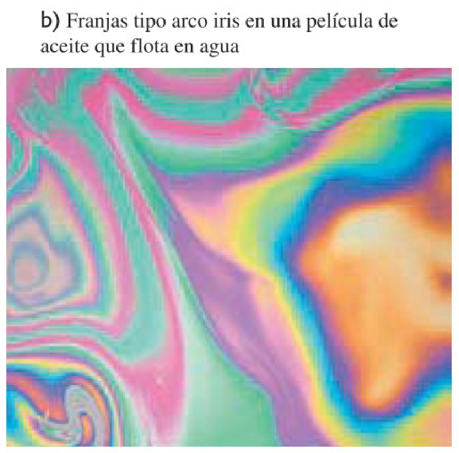
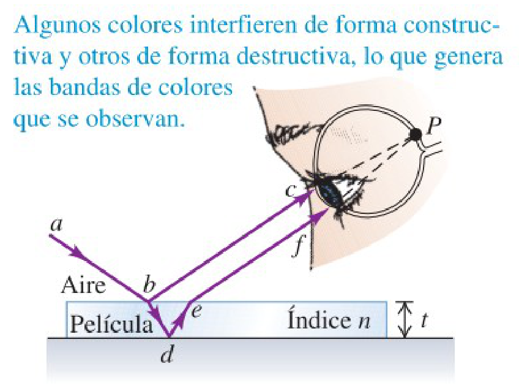
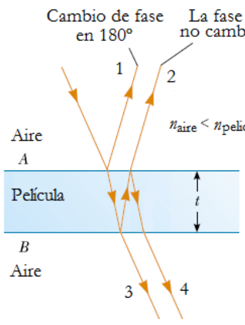

# Interferencia en películas delgadas

> Fuente: `2019/3er Parcial/UT XII - Interferencias.ppt`, diapositivas 32, 33,
> 34, 35, 41. SHA-256:
> `1aedc0734c24e71c0cbae9ecc29b034fe9e22575940fc895559579ce1326b91e`. Original
> archivado bajo 2019; sin fecha de clase impresa. Copia normalizada con
> LibreOffice a PPTX/PDF, extracción MarkItDown y Poppler; texto, ecuaciones y
> figuras cotejados visualmente. Las animaciones incrustadas se conservan además
> de la vista estática cuando corresponde.



b) Franjas tipo arco iris en una película de aceite que flota en agua



Algunos colores interfieren de forma constructiva y otros de forma destructiva,
lo que genera las bandas de colores que se observan.



Incidencia casi normal

Rayo 1 180º => $`\lambda_n/2`$

Rayo 2 0º pero diferencia de camino igual a $`2t`$. Si $`2t=\lambda_n/2`$ =>
interferencia constructiva. En general:

```math
2t=\left(m+\frac12\right)\lambda_n\qquad(m=0,1,2,\ldots)
```

Interferencia constructiva

```math
2t=m\lambda_n\qquad(m=0,1,2,\ldots)
```

Interferencia destructiva

## Fin tema 12

## Ampliación posterior al cierre — diapositiva 41

Incidencia casi normal

Rayo 1 180º => $`\lambda_n/2`$

Rayo 2 0º pero diferencia de camino igual a $`2t`$. Si $`2t=\lambda_n/2`$ =>
interferencia constructiva. En general:

```math
2t=\left(m+\frac12\right)\lambda_n\qquad(m=0,1,2,\ldots)
```

```math
2nt=\left(m+\frac12\right)\lambda\qquad(m=0,1,2,\ldots)
```

Interferencia constructiva

Si $`2t`$ es igual a número entero de $`\lambda_n`$ tenemos interferencia
destructiva. En general:

```math
2t=m\lambda_n\qquad(m=0,1,2,\ldots)
```

```math
2nt=m\lambda
```

Interferencia destructiva

## Observaciones de transcripción

La diapositiva 35 dice «Fin tema 12»; existen siete diapositivas posteriores que
también se transcriben. La 41 repite el diagrama de 34 y agrega las formas con 2
nt; se conservan ambas exposiciones.
