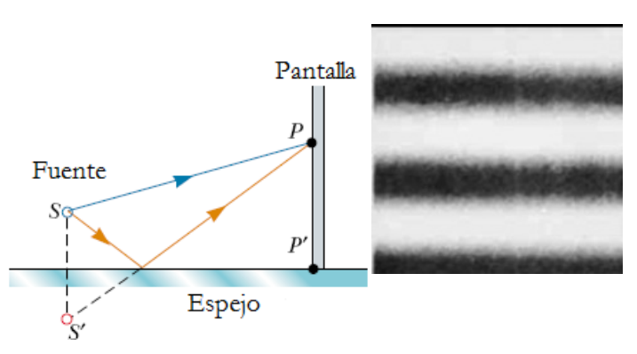
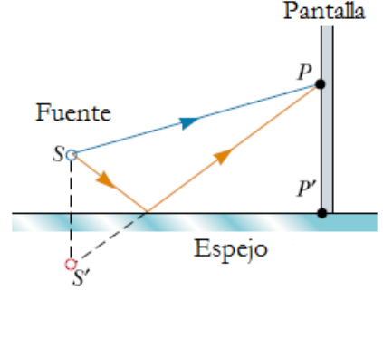
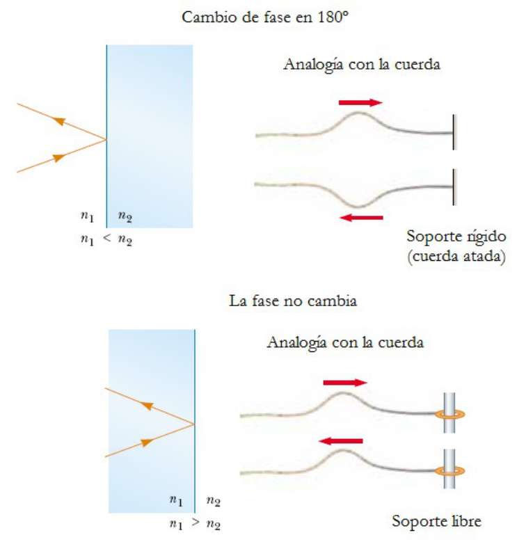

# Cambio de fase debido a la reflexión. Espejo de Lloyd

> Fuente: `2019/3er Parcial/UT XII - Interferencias.ppt`, diapositivas 29, 30,
> 31\. SHA-256:
> `1aedc0734c24e71c0cbae9ecc29b034fe9e22575940fc895559579ce1326b91e`. Original
> archivado bajo 2019; sin fecha de clase impresa. Copia normalizada con
> LibreOffice a PPTX/PDF, extracción MarkItDown y Poppler; texto, ecuaciones y
> figuras cotejados visualmente. Las animaciones incrustadas se conservan además
> de la vista estática cuando corresponde.




Obtenemos un patrón de interferencia invertido respecto del de dos fuentes
puntuales????. Hay una diferencia adicional de $`\pi`$ en la fase.

Una onda electromagnética experimenta un cambio de fase de 180º al reflejarse
desde un medio que tiene índice de refracción mayor que el del medio donde se
desplaza.

Índice de refracción

```math
n=\frac{\text{velocidad de la luz en el vacio}}{\text{velocidad de la luz en el medio}}=\frac{c}{v}=\frac{\lambda}{\lambda_n}
```



$`n_1\lt n_2`$ => el rayo al reflejarse en el medio 2, invierte su fase. En la
cuerda un pulso viajero al reflejarse en un extremo fijo se invierte.

$`n_1\gt n_2`$ => el rayo al reflejarse en el medio 2 no experimenta cambio de
fase. En la cuerda un pulso viajero al reflejarse no se invierte.

## Observaciones de transcripción

Se conservan los cuatro signos de interrogación tras «puntuales» y «vacio» de la
ecuación original.
