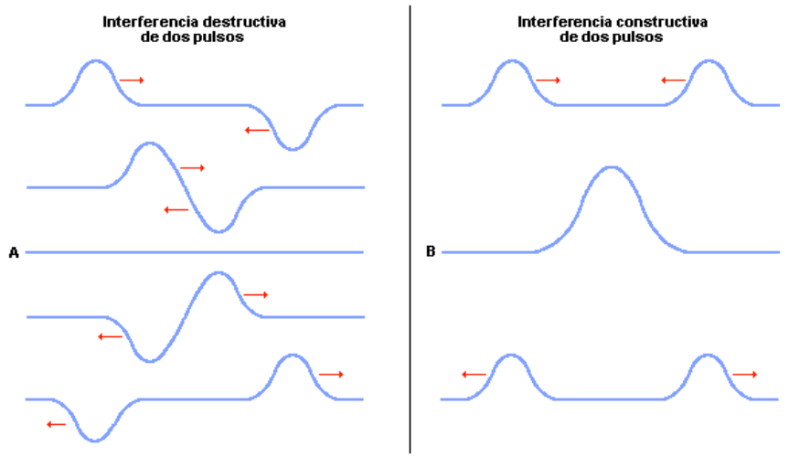
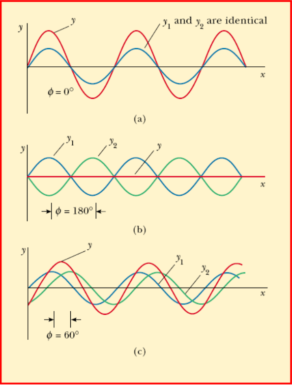

# Interferencia y principio de superposición

> Fuente: `2019/3er Parcial/UT XII - Interferencias.ppt`, diapositivas 2, 3, 4,
> 5\. SHA-256:
> `1aedc0734c24e71c0cbae9ecc29b034fe9e22575940fc895559579ce1326b91e`. Original
> archivado bajo 2019; sin fecha de clase impresa. Copia normalizada con
> LibreOffice a PPTX/PDF, extracción MarkItDown y Poppler; texto, ecuaciones y
> figuras cotejados visualmente. Las animaciones incrustadas se conservan además
> de la vista estática cuando corresponde.

El término *interferencia* se utiliza para designar el fenómeno que tiene lugar
cuando dos o más trenes de ondas se superponen en una misma región del espacio.



Si la amplitud de los pulsos es exactamente la misma, la elongación puede llegar
a anularse totalmente en la región de interferencia, como ocurre en el caso (A).
Se encuentra en la práctica que, si la amplitud de la onda no es muy grande,
durante la interferencia se cumple el principio de superposición.

El principio de superposición establece que la amplitud resultante en cada punto
de la región que interfiere cumple la relación

```math
y=y_1+y_2
```

donde $`y_1`$, $`y_2`$ representan las amplitudes de las ondas correspondientes.

Además, a los efectos de la propagación, cada onda se comporta como si la otra
no estuviera presente. Significa que, a pesar de la interferencia, en lo que se
refiere a la propagación del movimiento, cada onda no perturba el movimiento
posterior de la otra.

Con el fin de ejemplificar lo anterior, consideremos dos ondas sinusoidales que
se propagan a lo largo de una dirección dada:



Si $`\phi=0`$:

```math
y_1(x,t)+y_2(x,t)=2y_m\sin(kx-\omega t)
```

Amplitud doble y misma frecuencia y longitud de onda. Se suman constructivamente
=> **interferencia constructiva**.

Si $`\phi=\pi`$:

```math
y_1(x,t)+y_2(x,t)=0
```

Amplitud nula. Se cancelan mutuamente => **interferencia destructiva**.

En general si $`\cos(\phi/2)=\pm1`$ => interferencia constructiva. Esto se
cumple si $`\phi=0,2\pi,4\pi,6\pi,\ldots`$. Es decir si $`\phi`$ es múltiplo par
de $`\pi`$.

Si $`\cos(\phi/2)=0`$ => interferencia destructiva. Esto se cumple si
$`\phi=\pi,3\pi,5\pi,\ldots`$. Es decir si $`\phi`$ es múltiplo impar de
$`\pi`$.

```math
y_1(x,t)=y_m\mathop{\mathrm{sen}}\nolimits(kx-\omega t)
```

```math
y_2(x,t)=y_m\mathop{\mathrm{sen}}\nolimits(kx-\omega t+\phi)
```

```math
k=2\pi/\lambda,\qquad \omega=2\pi f
```

Aplicando:

```math
\mathop{\mathrm{sen}}\nolimits(A)+\mathop{\mathrm{sen}}\nolimits(B)=2\cos\left(\frac{A-B}{2}\right)\sin\left(\frac{A+B}{2}\right)
```

```math
\begin{aligned}
y_1(x,t)+y_2(x,t)&=y_m[\mathop{\mathrm{sen}}\nolimits(kx-\omega t)+\mathop{\mathrm{sen}}\nolimits(kx-\omega t+\phi)]\\
&=2y_m\cos\left(\frac{\phi}{2}\right)\sin\left(kx-\omega t+\frac{\phi}{2}\right)
\end{aligned}
```

Amplitud:

```math
2y_m\cos\left(\frac{\phi}{2}\right)
```

Con la misma frecuencia ($`\omega`$) y longitud de onda ($`k`$).

## Observaciones de transcripción

Se conserva el orden de las diapositivas: los casos particulares anteceden a la
deducción general. Se conservan las variantes «sen»/«sin» y la identificación
original «longitud de onda (k)».
