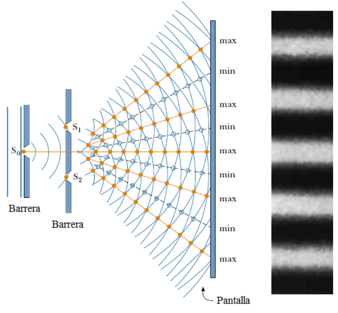
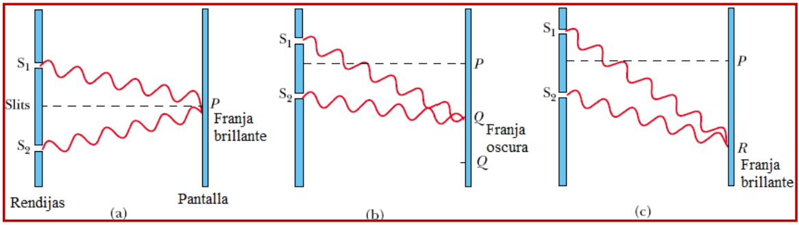
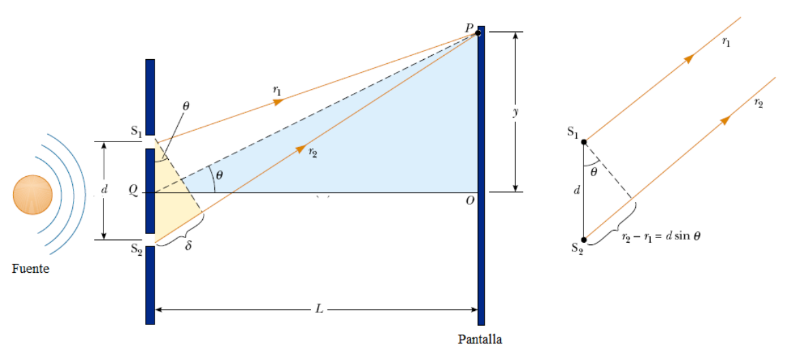
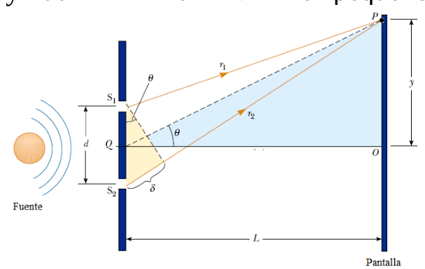
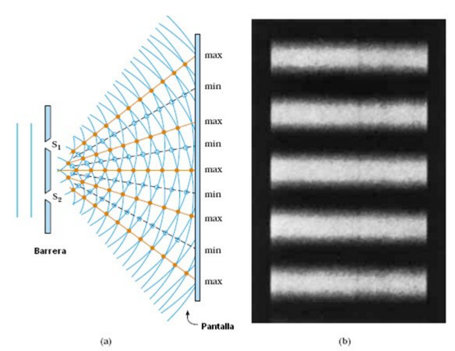

# Experiencia de Young. Geometría y franjas

> Fuente: `2019/3er Parcial/UT XII - Interferencias.ppt`, diapositivas 13, 14,
> 15, 16, 28. SHA-256:
> `1aedc0734c24e71c0cbae9ecc29b034fe9e22575940fc895559579ce1326b91e`. Original
> archivado bajo 2019; sin fecha de clase impresa. Copia normalizada con
> LibreOffice a PPTX/PDF, extracción MarkItDown y Poppler; texto, ecuaciones y
> figuras cotejados visualmente. Las animaciones incrustadas se conservan además
> de la vista estática cuando corresponde.

## Interferómetros de división de frente de onda. Experiencia de Young

A partir de una fuente de luz monocromática se puede emplear una barrera que
contenga dos pequeñas aberturas (rendijas u orificios) para obtener dos fuentes
de luz coherentes.



Se observa una sucesión de franjas brillantes y oscuras, que corresponden a
zonas de interferencia constructiva y destructiva respectivamente



a) Interferencia constructiva en P; b) Interferencia destructiva en Q; c)
Interferencia constructiva en R.



$`L\gg d`$ => $`r_1`$ puede ser considerado paralelo a $`r_2`$. $`\delta`$ es la
diferencia de camino.

```math
\delta=r_2-r_1=d\mathop{\mathrm{sen}}\nolimits(\theta)
```

Si:

```math
\delta=d\mathop{\mathrm{sen}}\nolimits(\theta)=m\lambda,\qquad m=0,\pm1,\pm2,\ldots
```

Interferencia constructiva.

Si:

```math
\delta=d\mathop{\mathrm{sen}}\nolimits(\theta)=(m+1/2)\lambda,\qquad m=0,\pm1,\pm2,\ldots
```

Interferencia destructiva.

$`d\sim1\mathrm{mm}`$, $`\lambda`$ entre 400 y 700 nm => $`d\gg\lambda`$ =>
$`\theta`$ pequeño



```math
\mathop{\mathrm{tg}}\nolimits(\theta)=\frac{y}{L}\cong\mathop{\mathrm{sen}}\nolimits(\theta)
```

Posiciones de las franjas brillantes y oscuras en la pantalla:

Franjas brillantes =>

```math
y_{\mathrm{brillante}}=L\mathop{\mathrm{sen}}\nolimits(\theta)_{\mathrm{brillante}}=\frac{\lambda L}{d}m
```

Franjas oscuras =>

```math
y_{\mathrm{oscura}}=L\mathop{\mathrm{sen}}\nolimits(\theta)_{\mathrm{oscura}}=\frac{\lambda L}{d}(m+1/2)
```

```math
m=0,\pm1,\pm2,\ldots
```

## Repetición gráfica de la diapositiva 28


