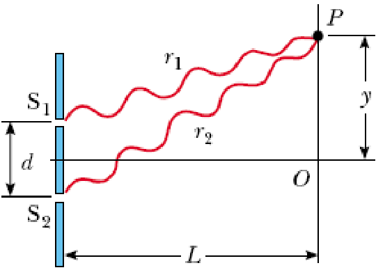
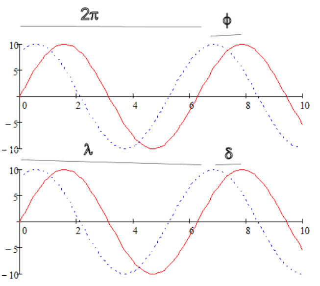
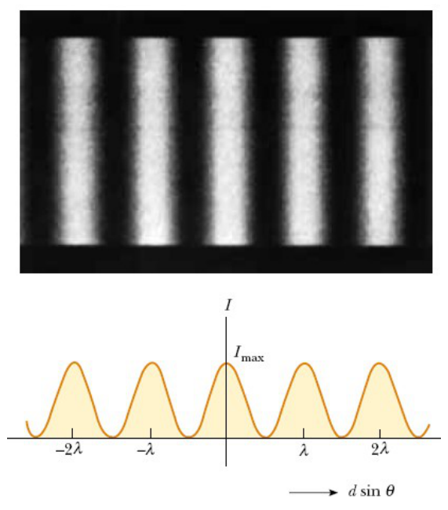

# Distribución de intensidad en la experiencia de Young

> Fuente: `2019/3er Parcial/UT XII - Interferencias.ppt`, diapositivas 17, 18,
> 19, 20, 21. SHA-256:
> `1aedc0734c24e71c0cbae9ecc29b034fe9e22575940fc895559579ce1326b91e`. Original
> archivado bajo 2019; sin fecha de clase impresa. Copia normalizada con
> LibreOffice a PPTX/PDF, extracción MarkItDown y Poppler; texto, ecuaciones y
> figuras cotejados visualmente. Las animaciones incrustadas se conservan además
> de la vista estática cuando corresponde.



- Primero trabajaremos en el cálculo de la amplitud Ep si E y $`\varphi`$ son
  conocidos.
- Después encontraremos la intensidad I de la onda resultante, que es
  proporcional a Ep²
- Por último, relacionaremos la diferencia de fase $`\varphi`$ con la diferencia
  de trayectorias, que está determinada por la geometría de la situación.

S1 y S2 fuentes coherentes de igual amplitud, $`\lambda`$ y $`\omega`$. Los
campos eléctricos en P son:

```math
E_1=E_0\mathop{\mathrm{sen}}\nolimits(\omega t),\qquad E_2=E_0\mathop{\mathrm{sen}}\nolimits(\omega t+\phi)
```

```math
\sin(A)+\sin(B)=2\sin\left(\frac{A+B}{2}\right)\cos\left(\frac{A-B}{2}\right)
```

Amplitud del campo eléctrico resultante en P

```math
E_P=E_1+E_2=2E_0\cos\left(\frac{\phi}{2}\right)\sin\left(\omega t+\frac{\phi}{2}\right)
```

$`\phi=0,2\pi,4\pi,\ldots`$ => interferencia constructiva.

$`\phi=\pi,3\pi,5\pi,\ldots`$ => interferencia destructiva.

**La intensidad luminosa en un punto es proporcional al cuadrado de la magnitud
del campo eléctrico resultante en ese punto**

```math
I\propto E_P^2=(E_1+E_2)^2=4E_0^2\cos^2\left(\frac{\phi}{2}\right)\sin^2\left(\omega t+\frac{\phi}{2}\right)
```

Los instrumentos (y el ojo) en general detectan la intensidad promediada en el
tiempo, por lo que el seno se promedia a½, quedando:

```math
I=I_{\max}\cos^2\left(\frac{\phi}{2}\right)
```

```math
\frac{\delta}{\lambda}=\frac{\phi}{2\pi}
```

```math
\Rightarrow\quad\phi=\frac{2\pi}{\lambda}\delta=\frac{2\pi}{\lambda}d\mathop{\mathrm{sen}}\nolimits(\theta)
```

Dependencia de la diferencia de fase con el ángulo $`\theta`$



```math
I=I_{\max}\cos^2\left(\frac{\pi}{\lambda}d\mathop{\mathrm{sen}}\nolimits(\theta)\right)
```

Para $`\theta`$ pequeño $`\mathop{\mathrm{sen}}\nolimits(\theta)\approx y/L`$

```math
I\approx I_{\max}\cos^2\left(\frac{\pi d}{\lambda L}y\right)
```



PANTALLA: se observan una serie de franjas brillantes y oscuras alternadas que
corresponden a zonas de interferencia constructiva y destructiva. El máximo
central corresponde al orden cero.

Diagrama de la intensidad en función de la diferencia de camino
$`d\mathop{\mathrm{sen}}\nolimits(\theta)`$.

## Observaciones de transcripción

Se conserva la frase original «el seno se promedia a½», así como las variantes
de fase φ/ϕ y la denominación «amplitud» aplicada a la expresión temporal.
