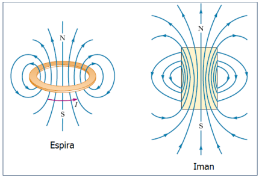
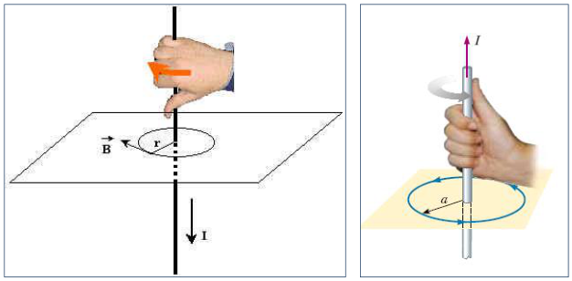
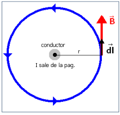
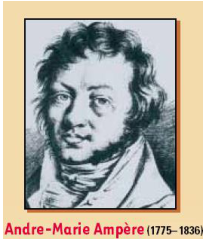
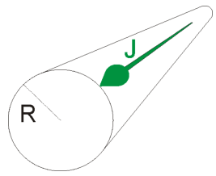
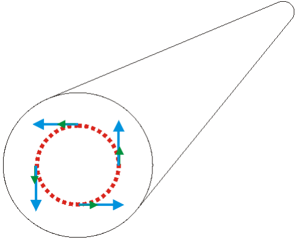
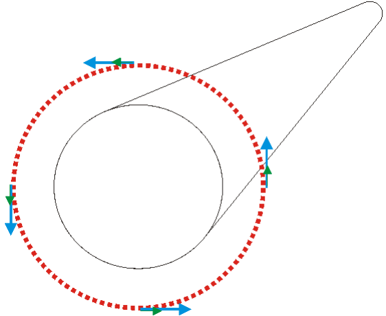
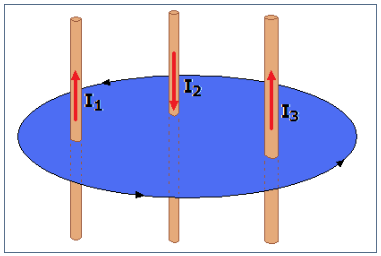

# Ley de Ampere y corrientes distribuidas

Unidad temática VI — Campo de Inducción Magnética. Propiedades.

Fecha impresa: 08/05/2019.



En el dibujo se representa el campo magnético de una espira por la que circula
una corriente I, y el campo de un imán. Desde el punto de vista del campo, la
espira se comporta como un imán cuyo polo N es la cara por donde sale el campo y
el polo S la cara por donde entra.

## Regla de la Mano Derecha

El sentido del campo que genera una corriente se obtiene aplicando la regla de
la mano derecha (Video)



## Ley de Ampere

Las líneas de campo de un alambre largo y recto por el que circula corriente son
circunferencias que enlazan o enhebran el alambre conductor. La relación entre
el campo magnético que rodea al conductor y la corriente enlazada se expresa
mediante la ley de Ampere



```math
\oint\vec B\cdot\overrightarrow{dl}=\oint B\,dl=B\oint dl=B(2\pi R)
```

Obtuvimos antes que

```math
B=\frac{\mu_0I}{2\pi R}
```

Podemos escribir

```math
\oint\vec B\cdot\overrightarrow{dl}=\mu_0I
```



La circulación del vector B a lo largo de cualquier curva cerrada es igual a la
intensidad que atraviesa una superficie limitada por dicha curva por la
permeabilidad

Este resultado que obtuvimos para un caso particular, tiene validez general,
incluso para trayectorias no circulares, de forma arbitraria. I es la corriente
neta enlazada.

```math
\oint\vec B\cdot\overrightarrow{dl}=\mu_0\sum I_{enlazadas}
```

## Corrientes distribuidas

Si las corrientes no están confinadas a un hilo, sino que están distribuidas

```math
\oint\vec B\cdot\overrightarrow{dl}=\mu_0.\int\vec J.\overrightarrow{dS}
```

Por un conductor cilíndrico macizo, de radio R = 1 mm, circula una densidad de
corriente J = C.r (A/m²) con $`0\lt r\lt R`$. Determinar a) el valor y las
unidades de la constante C si la corriente total que transporta el conductor es
0,3 A. b) el campo de inducción magnética en el interior y el exterior del
conductor







## Signo de las corrientes enlazadas

El signo de las corrientes enlazadas esta dado por la regla del tirabuzón.
Positivas las que circulan en el sentido de desplazamiento del tirabuzón y
negativas para el sentido contrario, girando en el sentido en que se recorre el
camino de integración.



Un camino cerrado es el borde de un infinito número de superficies. La ley de
Ampere tal cual la formulamos es válida cualquiera sea la superficie que
consideremos, a condición de que las corrientes enlazadas sean estacionarias

```math
\oint\vec B\cdot\overrightarrow{dl}=\mu_0(I_1-I_2+I_3)
```

## Procedencia y observaciones de transcripción

- Original:
  `2019/2do Parcial/2019 UT VI - Campo de Inducción Magnética. Propiedades.pdf`,
  páginas PDF 5–8 de 16, diapositivas 9–16 de 31.
- SHA-256: `b9bb8ec5e8acfa36814e15207ee532a00e566ff5ea72bd139eff27ae0b2d634f`.
- Herramientas: PyMuPDF4LLM, Poppler y recortes PyMuPDF; cotejo visual de todas
  las páginas y expresiones de este tramo. Se conservan figuras, etiquetas y
  erratas del original.
- Las diapositivas 14 y 15 contienen sólo diagramas: se conservan sin añadir una
  solución. El vídeo de la mano derecha apunta a
  `../Videos Eperiencias Labs/Campos Magneticos de Corrientes/La regla de la Mano Derecha.RM`,
  archivo local no incluido.
