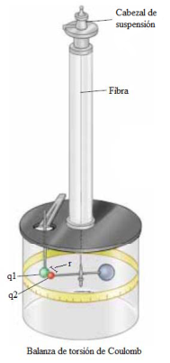
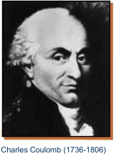
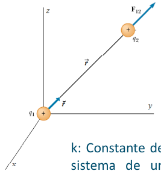
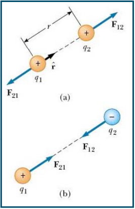

# Qué vimos hasta acá?

## LEY DE COULOMB

Estudiaremos procesos en los que la carga **no varía con el tiempo**. En estas
condiciones se dice que el sistema está en **Equilibrio Electrostático**.



**Balanza de torsión de Coulomb.** Coulomb empleó una balanza de torsión para
estudiar las fuerzas electrostáticas. Para ello cargó una esfera fija con una
carga q₁ y otra esfera, situada en el extremo de una varilla colgada, con una
carga q₂. La fuerza ejercida por q₁ sobre q₂ gira la varilla y torsiona la fibra
de la que cuelga. Girando el cabezal de suspensión en sentido contrario se
mantienen las esferas a la distancia original. La fuerza se mide por el ángulo
que hay que girar el cabezal.



Coulomb halló que:

- La fuerza ejercida por una carga sobre otra es directamente proporcional al
  producto de ambas cargas q₁q₂.
- La fuerza es inversamente proporcional al cuadrado de la distancia r entre las
  esferas cargadas.

### Enunciado de la Ley de Coulomb

La fuerza de interacción entre dos cargas eléctricas es directamente
proporcional al producto de las mismas, e inversamente proporcional al cuadrado
de la distancia que las separa. Su recta de acción es la de la recta que une las
cargas, y su sentido depende de los signos de las cargas. Cargas de igual signo
se repelen y de signo contrario se atraen.

### Expresión matemática de la Ley de Coulomb



```math
\vec F=k\frac{q_1q_2}{r^2}\breve r
```

k: Constante de Coulomb, cuyo valor depende del sistema de unidades y del medio
en el que trabajemos.

En el vacío S.I. ⇒

```math
k=8{,}9875\cdot10^9\,N\,m^2/C^2\cong9\cdot10^9\,N\,m^2/C^2
```

El hecho de que las cargas aparezcan con su signo propio en la ecuación anterior
da lugar a la existencia de dos posibles signos para la fuerza, lo cual puede
ser interpretado como la existencia de dos dos tipos de fuerzas: atractivas y
repulsivas, características de la interacción electrostática.

- Cargas con signos iguales darán lugar a **fuerzas repulsivas de signo
  positivo**
- Cargas con signos diferentes experimentarán **fuerzas atractivas de signo
  negativo**.

La interacción eléctrica obedece a la tercera ley de Newton (Acción y Reacción

```math
\vec F_{21}=-\vec F_{12}
```



(a): cargas de igual signo (+ y +), (- y -) ⇒ Repulsión

(b): cargas de distinto signo (+ y -) ⇒ Atracción

### Constantes auxiliares

Permitividad del Vacío (εₒ): Se define de forma que

```math
k=\frac1{4\pi\varepsilon_o}
```

```math
\varepsilon_o=8.8542\cdot10^{-12}\,C^2/N\,m^2
```

### Características de las fuerzas de Coulomb

```math
\vec F=k\frac{q_1q_2}{r^2}\breve r
```

- Proporcional al producto de las cargas
- Inversamente proporcional al cuadrado de la distancia
- Tiene la dirección de la recta de acción que unen las cargas
- Pueden ser atractivas o repulsivas
- La fuerza entre dos cargas cualesquiera es independiente de la presencia de
  otras cargas.

## Procedencia y observaciones de transcripción

- Original:
  `2019/1er Parcial/2018 UT I - Fuerza Eléctrica y Campo Elécrtico.pdf`, páginas
  11, 12, 13, 14 de 42.
- SHA-256: `326bb078ddbf25b43f166e198c175106027b686dde0d0ea9688c025795f46ca7`.
- El nombre del archivo indica 2018; ubicación canónica 2019. No consta autor ni
  fecha completa en estas páginas.
- Herramientas: PyMuPDF4LLM y Poppler para extracción; texto, todas las
  expresiones y figuras cotejados visualmente. Medios conservados por
  recorte/render PyMuPDF.
- Se conservan «dos dos tipos», el paréntesis abierto de Acción y Reacción, los
  valores de constantes y el subíndice o de permitividad. La unidad de
  permitividad mantiene la escritura C²/N m², sin añadir paréntesis. El versor r
  se representa con la marca curva breve que utiliza la fuente.
