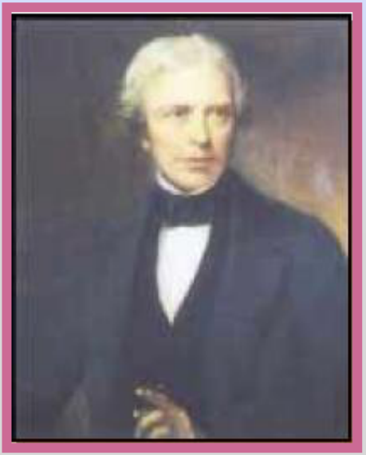

# Ley de Faraday y Michael Faraday: versión Electromagnetismo

Unidad Temática VII — Electromagnetismo

## Ley de Faraday

La fuerza electromotriz inducida en un circuito es proporcional a la rapidez con
la que varía el flujo magnético que lo atraviesa, y directamente proporcional al
número de espiras del inducido.

Matemáticamente se expresa como:

```math
\varepsilon=-N\frac{d\varphi}{dt}
```

Fem instantánea

## Michael Faraday (1791-1867



Físico y Químico inglés, considerado el mas grande científico experimental de su
época. Algunas de sus contribuciones al estudio de la electricidad son: la
invención del motor eléctrico, generador eléctrico y el transformador,
descubrimiento de la inducción electromagnética y formulación de las leyes de la
electrólisis.

## Procedencia y observaciones de transcripción

- Original: `2019/2do Parcial/2019 UT VII Electromagnetismo.pdf`, páginas 13–14
  de 62. No consta fecha impresa; 2019 es del nombre del archivo.
- SHA-256: `eff3447774cadfcb2726a6caabbe8e257782276fce3e67dda465673d5ef67a6a`.
- Herramientas: PyMuPDF4LLM, Poppler y recortes PyMuPDF; páginas, expresiones y
  figuras del tramo cotejadas visualmente. Se conserva esta versión por sus
  diferencias documentales.
- La ley se presenta sólo como fem instantánea; no se añade la forma de
  diferencias finitas de la otra versión. El encabezado biográfico tiene el
  paréntesis final ausente en el original.
