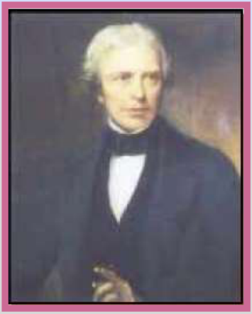

# Ley de Faraday y ley de Lenz

Unidad Temática VII — Electromagnetismo

## Ley de Faraday

La fuerza electromotriz inducida en un circuito es proporcional a la rapidez con
la que varía el flujo magnético que lo atraviesa, y directamente proporcional al
número de espiras del inducido.

Matemáticamente se expresa como:

```math
\varepsilon=-N\frac{\Delta\varphi}{\Delta t}\qquad\text{o}\qquad\varepsilon=-N\frac{d\varphi}{dt}
```

Fem instantánea

## Faraday’s Law

```math
\mathcal E=-N\frac{\Delta\Phi_B}{\Delta t}
```

## Michael Faraday (1791-1867)



Físico y Químico inglés, considerado el mas grande científico experimental de su
época. Algunas de sus contribuciones al estudio de la electricidad son: la
invención del motor eléctrico, generador eléctrico y el transformador,
descubrimiento de la inducción electromagnética y formulación de las leyes de la
electrólisis.

## Ley de Lenz: El sentido de las corrientes inducidas

Aunque la ley de Faraday-Henry, a través de su signo negativo, establece una
diferencia entre las corrientes inducidas por un aumento del flujo magnético y
las que resultan de una disminución de dicha magnitud, no explica este fenómeno.
La justificación física se basa en el principio de conservación de la energía y
la enunció Lenz (1804-1869).

Ley de Lenz: Las corrientes que se inducen en un circuito se producen en un
sentido tal que con sus efectos magnéticos tienden a oponerse a la causa que las
originó.

## Procedencia y observaciones de transcripción

- Original:
  `2019/2do Parcial/2019 UT VII - Fenómenos de Inducción Electromagnética.pdf`,
  páginas 13–16 de 67. Fecha impresa: 14/05/2019.
- SHA-256: `cbefa338a0f56f56079880a84f05a963257a6473febd8da50f944a67f2210a8f`.
- Herramientas: PyMuPDF4LLM, Poppler y recortes PyMuPDF; cotejo visual de todas
  las páginas, expresiones y figuras del tramo. Se preservan el idioma de las
  láminas y las afirmaciones del original.
