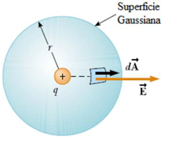
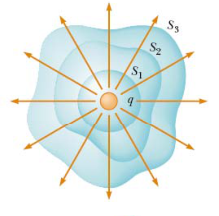
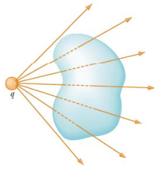
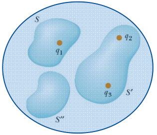
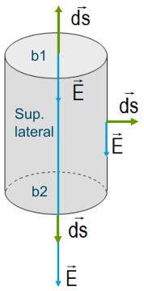

# Flujo y ley de Gauss



```math
E=\frac1{4\pi\varepsilon_0}\frac q{r^2}
```

Constante sobre la superficie esférica de radio r

```math
\Phi_E=\oint\vec E\cdot\overrightarrow{dA}=\oint E\,dA=E\oint dA
```

```math
\Phi_E=E\cdot4\pi r^2
```

```math
\Phi_E=\frac1{4\pi\varepsilon_0}\frac q{r^2}\cdot4\pi r^2=\frac q{\varepsilon_0}
```

Qué ocurre si aumento el tamaño de la superficie? Qué magnitudes cambian y cómo
afecta al resultado?

```math
\Phi_E=\oint\vec E\cdot\overrightarrow{dA}=\frac q{\varepsilon_0}
```



El número total de líneas de campo que atraviesan las superficies es el mismo.
El flujo neto es independiente de la forma de la superficie gaussiana que se
considere.



Si no hay carga en el interior, el número de líneas que entran es igual al de
las que salen y por tanto el flujo neto es cero. No hay carga encerrada.

## Ley de gauss



```math
\Phi_E=\oint\vec E\cdot\overrightarrow{dA}=\frac{q_{\text{neta encerrada}}}{\varepsilon_0}
```

Enunciado de la Ley de Gauss

**El flujo eléctrico neto a través de cualquier superficie gaussiana cerrada es
igual a la carga neta que se encuentre dentro de ella, dividida por la
permitividad del vacío.**

## Ejemplo 2

Supongamos un cilindro de radio R colocado en el seno de un campo eléctrico
uniforme con su eje paralelo al campo. Calcular el flujo de campo eléctrico a
través de la superficie cerrada.



El flujo total es la suma de tres términos, las dos bases (b1 y b2) mas el que
corresponde a la superficie lateral cilíndrica. En ésta última el flujo es cero
ya que los vectores superficie y campo son perpendiculares. Así

```math
\Phi=\int_{b1}\vec E\cdot\overrightarrow{ds}+\int_{b2}\vec E\cdot\overrightarrow{ds}
```

```math
\Phi=\int_{b1}E\cos(\pi)\,ds+\int_{b2}E\cos(0)\,ds
```

```math
\Phi=0
```

El flujo sólo es proporcional a la carga que encierra una superficie, no a la
forma de dicha superficie.

## Procedimiento para aplicar el teorema de Gauss

La ley de Gauss nos da un procedimiento alternativo a la ley de Coulomb para el
calculo del campo eléctrico. Pero solo puede aplicarse a problemas con “gran
simetría”.

Dada una distribución de carga, buscar una superficie gaussiana que cumpla estas
condiciones:

```math
\left.\begin{aligned}&\bullet\ \vec E\perp\ \mathrm o\ \parallel\ \mathrm a\ \overrightarrow{dS}\\&\bullet\ \vec E\quad\text{constante}\end{aligned}\right\}\quad\text{en todos los puntos de la sup.}
```

El flujo eléctrico a través de una superficie cerrada viene dado por

```math
\Phi=\oint\vec E\cdot\overrightarrow{ds}=\frac{q_{int}}{\varepsilon_o}
```

Si la superficie cerrada gaussiana cumple las dos condiciones anteriores

```math
\oint\vec E\cdot\overrightarrow{dS}=\oint E\,dS=E\oint dS=ES
```

Por lo tanto

```math
ES=\frac{q_{int}}{\varepsilon_o}
```

S es el área de la superficie gaussiana

qᵢₙₜ es la carga encerrada en dicha superficie

## Procedencia y observaciones de transcripción

- Original:
  `2019/1er Parcial/2018 UT I - Fuerza Eléctrica y Campo Elécrtico.pdf`, páginas
  36, 37, 38 de 42.
- SHA-256: `326bb078ddbf25b43f166e198c175106027b686dde0d0ea9688c025795f46ca7`.
- El nombre del archivo indica 2018; ubicación canónica 2019. No consta autor ni
  fecha completa en estas páginas.
- Herramientas: PyMuPDF4LLM y Poppler para extracción; todas las expresiones y
  figuras cotejadas visualmente. Medios por recorte/render PyMuPDF; la captura
  de fórmulas y la figura oculta de líneas se recuperan desde sus franjas raster
  originales.
- Se conserva la numeración Ejemplo 2, las preguntas sin resolver y la condición
  de E constante en todos los puntos tal como la formula la fuente. Se respetan
  los cambios A/S y 0/o en los subíndices de permitividad.
