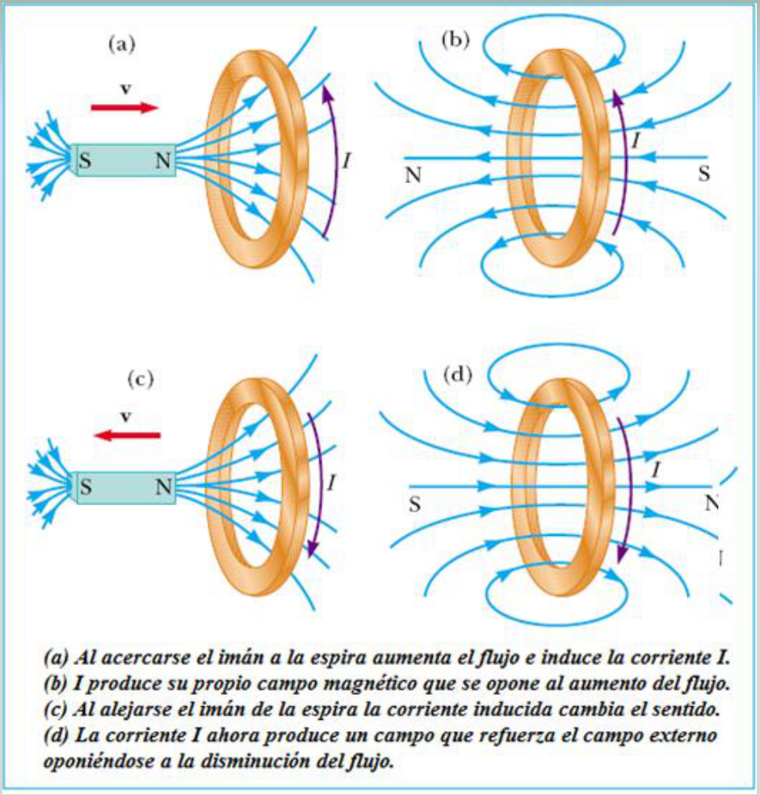

# Ley de Lenz: versión Electromagnetismo

Unidad Temática VII — Electromagnetismo

## El sentido de las corrientes inducidas

Aunque la ley de Faraday-Henry, a través de su signo negativo, establece una
diferencia entre las corrientes inducidas por un aumento del flujo magnético y
las que resultan de una disminución de dicha magnitud, no explica este fenómeno.
La justificación física se basa en el principio de conservación de la energía y
la enunció Lenz (1804-1869).

Ley de Lenz: Las corrientes que se inducen en un circuito se producen en un
sentido tal que con sus efectos magnéticos tienden a oponerse a la causa que las
originó.

## Dos campos magnéticos distintos

Tenemos que tener presente que ahora se estudian dos campos magnéticos
distintos:

1. El campo magnético variable o flujo que induce la corriente.
1. El campo magnético producido por la corriente inducida (todas las corrientes
   producen un campo magnético)

El segundo campo se opone al cambio en el primero.

La ley de Lenz se enuncia de otra forma, valida incluso si no puede fluir
corriente (como cuando un circuito esta incompleto)

Una fem inducida siempre esta en una dirección que se opone al cambio original
en el flujo que la produjo.

## Ley de Lenz: casos ilustrados

a) Al acercarse el imán a la espira aumenta el flujo e induce la corriente I.

b) I produce su propio campo magnético que se opone al aumento del flujo.

c) Al alejarse el imán de la espira la corriente inducida cambia el sentido.

d) La corriente I ahora produce un campo que refuerza el campo externo
oponiéndose a la disminución del flujo.

Otro modo de verlo: Cuando el polo norte de un imán se aproxima a una espira, la
corriente inducida circulará en un sentido tal que la cara enfrentada al polo
norte del imán sea también Norte, ejerciendo una acción magnética repulsiva
sobre el imán. Inversamente, si el polo norte del imán se aleja de la espira, la
corriente inducida ha de ser tal que genere un polo Sur que se oponga a la
separación de ambos.

Podemos decir que el fenómeno de inducción electromagnética se rige por dos
leyes:

1. La ley de Lenz: cualitativa, que nos da el sentido de la corriente inducida
1. La ley de Faraday-Henry: cuantitativa, que nos da el valor de la fem
   inducida.

## Procedencia y observaciones de transcripción

- Original: `2019/2do Parcial/2019 UT VII Electromagnetismo.pdf`, páginas 15–18
  de 62. No consta fecha impresa; 2019 es del nombre del archivo.
- SHA-256: `eff3447774cadfcb2726a6caabbe8e257782276fce3e67dda465673d5ef67a6a`.
- Herramientas: PyMuPDF4LLM, Poppler y recortes PyMuPDF; páginas, expresiones y
  figuras del tramo cotejadas visualmente. Se conserva esta versión por sus
  diferencias documentales.
- Se conservan las cuatro figuras y pies de página 17, frente al único caso
  visible de la otra versión. La página 18 dice «corriente (fem) inducida»; no
  se sustituye por una formulación nueva.
